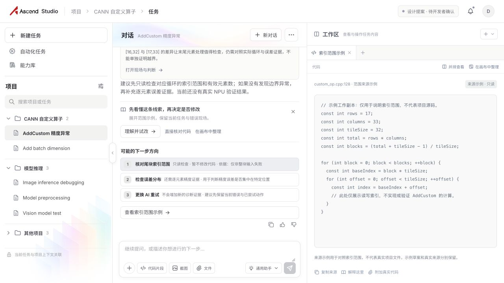
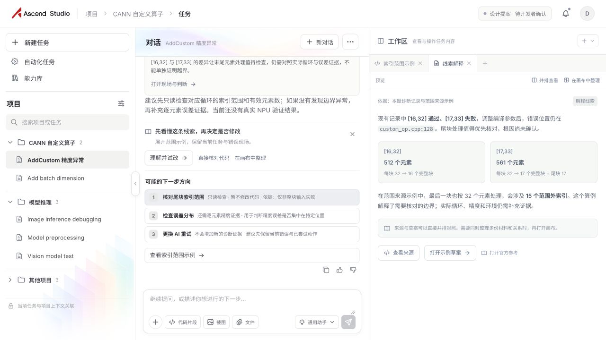
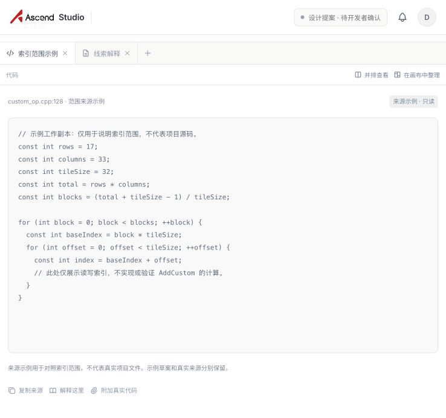
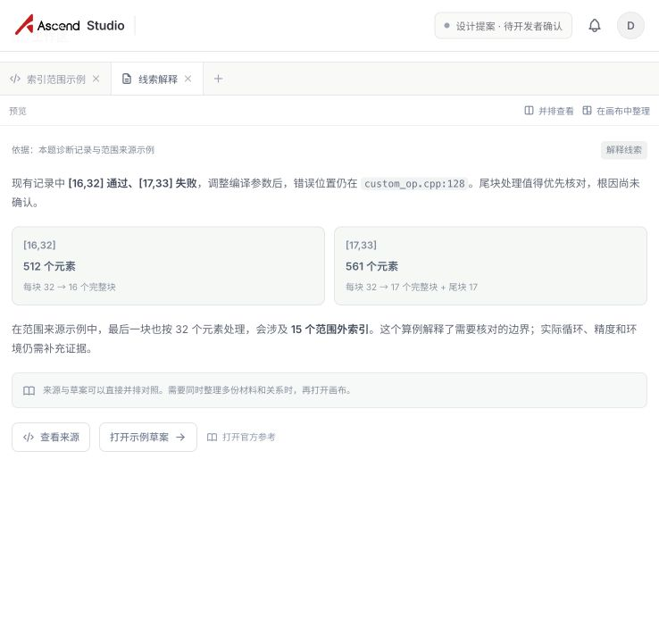

# 问题02「判断与纠错」原型视觉 QA

## 对照材料

- Source visual truth: `/Users/hsin/.codex/generated_images/01a0f0fa-7e78-7c81-a14c-994e31ca9b7b/exec-762b9846-774f-4eb4-a3ab-84ecbdd968c9.png`
- Source dimensions: 1584 × 993 px.
- Implementation: Codex In-app Browser, `http://127.0.0.1:5173/`.
- Implementation capture: Codex In-app Browser capture shown during this review; 1584 × 994 px screenshot at a 1584 × 994 CSS viewport. The current CUA browser API does not expose a persistent screenshot file path.
- Density normalization: screenshot dimensions match the CSS viewport 1:1; no resampling. Source is one pixel shorter in height, so that edge difference was excluded.
- State: default AddCustom 精度异常 task; rationale expanded; first next-step route selected; no extra chat messages.
- Additional viewport check: 1280 × 720. The message and diagnostic regions scroll independently while the composer remains visible.

## Full-view comparison

The three-column structure matches the selected mock: compact grouped project tasks on the left, the task conversation in the middle, and evidence, uncertainty, and action suggestions on the right. The conversation remains visible and contains a detailed explanation plus selectable next steps. The right panel preserves the unconfirmed status of the tail-block clue. The automation and capability-library shortcuts remain in the sidebar.

## Focused-region comparison

- Left navigation and task groups: shortcut order, project grouping, compact row spacing, and neutral selected state reviewed.
- Conversation: message indentation, readable response width, attempt context, rationale expansion, and next-step selection reviewed.
- Judgment panel: evidence rows, pale yellow uncertainty card, no text outline or glow, and synchronized action state reviewed.
- Decorative image: restrained pastel accent remains confined to the top of the right panel.

## Fidelity surfaces

- Typography: compact UI sizes follow the user's request to reduce overall type size. Key labels remain readable at the 1584 × 994 view; secondary metadata uses smaller type. The body response uses slightly more line spacing and denser evidence copy than the first implementation.
- Spacing and layout: left navigation uses 22vw at the desktop comparison width; conversation and operation regions stay close to the agreed 55:45 ratio. Message inset and card widths were adjusted to match the mock's alignment. At 1280 × 720, long content scrolls within its panel instead of hiding the composer.
- Colors and tokens: warm white and light gray dominate; cool blue-violet is used sparingly. Selected task/action states are neutral gray without a saturated outline or left stripe. The uncertainty card uses a pale yellow surface; its heading has no stroke or shadow.
- Images and assets: Ascend logo and the supplied generated glass accent are image assets; no decorative art is drawn with CSS.
- Copy and content: `[16,32]` passes, `[17,33]` fails, and `precision mismatch` at `custom_op.cpp:128` are presented as the known evidence. Tail-block handling is a lead to investigate, not a confirmed cause. The UI does not claim real NPU validation.

## Comparison history

1. Initial browser render was blank because `IconLock` was used without being imported. Added the missing import; the page then rendered and the production build passed.
2. First visual pass had a sparse, left-shifted conversation and short right-side cards. Added the diagnostic explanation and next-step rows to the conversation, aligned the message inset to the mock, and increased evidence/action row height while keeping compact typography.
3. Rechecked the 1584 × 994 main view and 1280 × 720 desktop view. No remaining P0/P1/P2 visual or functional mismatch was found.

## Interaction and build checks

- Project search filters grouped tasks and supports project-name matches.
- Rationale expands and collapses.
- Selecting an action in either the conversation or right panel updates the selected route and primary action label.
- Sending a chat message appends the user message and assistant response; the original review state was restored afterward.
- `npm run build` passed and produced the Vite client and Sites build artifacts.

## Findings

- No actionable P0/P1/P2 findings remain.

## Follow-up polish

- The generated mock uses slightly larger body text in places. The implementation keeps the requested smaller, denser type scale; adjust after the user's review if they want more visual weight.

## 2026-09-30 · 对话消息样式澄清

- 用户澄清：AI 回复应直接铺在对话区背景上，不放在气泡里；仅用户消息使用靠右气泡。
- 移除 AI 回复的底色、边界、阴影与气泡尾，恢复纯背景文本；用户气泡保持右对齐。三栏结构与文案不变。
- 在 1280 × 720 预览中确认 AI 回答直接显示在白色对话背景上，用户消息仍是靠右浅灰气泡；三栏结构保持完整。长回答继续在对话区滚动，输入区固定。
- `npm run build` 通过。此题仍处于单题评审阶段，用户确认后再开始下一题。

## 2026-10-03 · 移除对话头像

- 用户提出对话区不要头像；已移除用户与 Ascend Studio 的头像，保留各自的文字标识。
- AI 回复继续直接显示在背景上，用户气泡靠右；调整消息容器列数后复核三栏结构没有变化。
- `npm run build` 通过。窄视口预览确认双方头像已移除、AI 文本无气泡底、用户气泡靠右；该视口按既有响应式规则纵向堆叠三栏，未在本轮重新做桌面尺寸截图。

final result: passed

### 2026-10-26 · 抖音四页预览放大

- **问题：** 用户反馈四张抖音知识图文仍缩成一排小块。原有固定比例生效，但预览容器没有撑满渠道卡片。
- **调整：** `.channel-preview-tiktok` 与 `.channel-preview-tiktok-panels` 明确占满可用宽度；四页各自保持 `69:100` 比例，网格靠上对齐，按卡片宽度均分。
- **本地复核：** 381px 窄视口 CUA 显示四张图横向铺满抖音卡片，不再挤在左侧；竖版比例仍一致。桌面视口尚未截图核验。
- **验证：** `npm run build:pages`、构建 JS `node --check`、`git diff --check` 通过；未运行自动化测试。源码与静态产物已随提交 `cb6070b4` 推送至 `origin/main`；Pages workflow `40316645739` 成功，公开 HTML / CSS HTTP 200，CSS 已核对包含撑满宽度规则。桌面截图尚未核验。

## 2026-10-24 · 探索终点提示去重与发送入口收敛

- **Target:** Ascend Studio 新建任务首页的「探索」方案，用户附图中的训练效率叶子节点。
- **Finding:** 叶子状态同时显示“这个方向已经具体到可开始 / 编辑需求”与画布底部的节点状态说明，两者被绝对定位到同一区域，文字相互覆盖；表单上下各有一个提交按钮。
- **Fix:** `completeLeaf` 为真时不渲染 `.explore-field__note`，只保留叶子提示和编辑操作；移除底部“发送并开始”按钮及桌面 / 窄屏专属样式，保留输入区右侧图标按钮作为唯一表单提交入口。
- **Evidence:** 用户截图为直接反馈（H）；本地 In-App Browser `http://127.0.0.1:5201/?home=explore` 在 1280×720 复现“每步耗时波动”终点，目视确认文字不再重叠且仅显示图标发送；A11y 树仅出现一个“发送并开始”按钮（M）。本轮未将浏览器截图另存为文件。
- **Validation:** `npm run build`、`npm run test:sites`（4/4）、`npm run build:pages` 与 `git diff --check` 通过；构建有既有 JS chunk >500 kB 提示。未改变任务 Prompt / 发送处理、首页模式切换、页面序列 / hash 或 API / Host / Application 边界。
- **Release:** 源码提交 `5872e106` 与 Pages 产物 / QA 记录提交 `f4b0abfc` 已推送 `origin/main`；Pages workflow `39992045663` 的 build 与 deploy 均成功。`ascstudio/index.html` 指向 `index-CDzESHM6.js` / `index-D0rtDyQ8.css`；本环境对线上页面的 HTTPS 回读握手失败 / 超时，因此未确认资源级 HTTP 状态。

final result: passed

## 2026-10-24 · 发布渠道详情返回入口

- **Intent:** 用户指出从任一渠道卡片打开详情后，缺少明确的返回位置。
- **Implementation:** 把详情顶栏原先的轻量「查看全部发布渠道」文字链接改为左箭头按钮「返回渠道总览」，点击回到四渠道卡片视图。
- **Interaction check:** 本地 `http://127.0.0.1:5203/` 使用图像推理调试的已完成示例进入社区草稿。选中 GitCode 并打开详情，顶栏返回按钮可见；点击后回到四卡总览，已选社区与 GitCode 保持不变。随后核对抖音详情页，返回按钮同样可见。截图曾在 CUA 预览中检查，本轮未另存入仓库。
- **Validation:** `npm run build:pages`、`git diff --check` 通过；未运行测试套件。构建保留既有 Vite 大 chunk 提示。
- **Scope:** 只调整发布渠道详情导航；不改变奖励文案、发布状态、页面序列 / hash 或 API / Host / Application 边界。
- **Release:** 功能提交 `184d2527` 与远端最新主线合并后，`3603cdc5` 已推送到 `origin/main`。Pages workflow `39990403368` 成功；线上 HTML、`index-CSGahLNK.js` 与 `index-CiM5ep6g.css` 返回 HTTP 200，JS / CSS 已核对含返回文案及按钮样式。

## 2026-10-23 · 图像推理画布聚焦与完整阅读试点（设计规则）

- 目的：作为 AddCustom 节点聚焦 / 长内容完整阅读规则的第二个试点，确认共同入口可复用，同时不抹平不同任务自己的工作区结构。
- 共通规则：卡片右上角提供“聚焦”和“完整阅读”。聚焦仍留在画布内，并自动适配所选卡片；完整阅读将同一内容打开到任务内容区，长正文仅在任务内容区滚动。画布卡片只承担静态预览，不出现内部滚动或重复正文。
- 图像推理特例：保留图像推理自身的自由画布与任务内容标签；不将整个任务改成 AddCustom 专属聚焦视图，也不隐去其图像、张量、源码、尝试和结果的既有关联。完成阅读后应能返回原画布上下文。
- 影响范围：仅记录图像推理这一试点，不代表其他任务已经采用该模式；后续按任务逐个评审。未改变其他任务、页面序列 / hash 或 API / Host / Application 边界。
- 评审检查项：①在图像推理画布中分别对图像 / 张量解释、源码、尝试节点触发聚焦，确认始终留在自由画布且所选卡片得到适配；②触发完整阅读，确认正文在任务内容区呈现、长内容仅在那里滚动；③返回后检查原画布视口、节点关系与任务内容标签仍保留；④检查卡片无内部滚动条、底部提示条或重复完整内容；⑤切换其他任务，确认其行为未被本试点意外改变。
- 状态：设计材料与 Demo 实现已完成；本地 CUA 回放通过聚焦、完整阅读和返回画布流程。仍需由用户评审共通入口是否适合迁移到下一种任务。

## 2026-10-09 · 交互补齐

- 将仅弹出提示的入口改为实际表单、菜单和操作区，覆盖项目任务切换与创建、能力选择、代码附件、发送、AI配置、对话历史、自动化状态与演示运行、证据详情和复核记录。保留既有三栏结构及对话视觉规范。
- 在 In-app Browser 的 1584 × 994 桌面视口查看初始界面与操作状态。实际走过代码范围计算 → 误差示例 → 复核生成 → 返回诊断；记录出现在当前任务的对话与右侧列表。范围算例为 561 / 32；示例 CSV 为 8 个元素、3 个超差，界面保留演示标识。
- 查看任务切换、新建任务、能力加入、代码片段关联、发送、新对话与历史恢复、自动化开关与演示运行，以及更换诊断助手并保留现有证据的状态。新对话会取消尚未完成的旧演示答复；任务间上下文分开保留。
- 更新后浏览器没有捕获到 console error。`npm run build` 通过，生成既有 Vite/Sites 构建产物；未新增或运行自动化测试。
- 演示回复、自动化状态不连接真实 AI、调度器或硬件；用户 CSV 的误差计算在浏览器内执行，不代表完整算子精度验证。附件与任务状态保存在本次页面会话中，刷新恢复默认状态。
- 本轮未应用尚未选定的 ImageGen 装饰方案。交付前刷新原型，恢复默认 AddCustom 任务，供用户评审。

## 2026-10-09 · 来源方案交互迁移

### 范围与来源

- 更新目标：当前问题02，保留Ascend Studio三栏壳。交互取自 `/Users/hsin/Documents/Coding/AscendCANN/cann-dashboard/ploy-interaction-lab/learning-canvas-story/index.html#19`、`story-data.mjs`及`build.mjs`中的B1–B6与共用机制。来源画布的整体布局与图像预处理技术结论不作为本原型的视觉或技术事实。
- 本轮视觉基准：`evidence/20261009-before-flow.jpg`，即实施前现有原型（继承无头像、AI文本铺背景、用户气泡靠右及中性选中等已确认修改）。1584×994像素与CSS视口，dpr=1。
- 默认状态更新图：`evidence/20261009-default-final.jpg`；解释状态最终图：`evidence/20261009-understand-final.jpg`；两者同为1584×994，密度1:1，不重采样。基准与默认态合并于 `evidence/20261009-shell-comparison.jpg`（3168×1024，顶部30px为比较标签）。
- 同状态字号迭代：`evidence/20261009-understand.jpg` 对照最终解释图，合并全图 `evidence/20261009-typography-comparison.jpg`；右侧1028–1584的局部1:1比较为 `evidence/20261009-operation-typography-focus.jpg`。本轮实际打开合并比较和局部比较后形成结论。
- 其他状态：`evidence/20261009-diff.jpg`、`20261009-validation.jpg`、`20261009-contents-final.jpg`。

### 五项视觉检查

- 字体：沿用系统中文字体与原有层级；操作区正文12px、代码/Diff11px，元信息至少10px，避免初版8–9px文本过小。新标题16px，与既有右栏一致。
- 布局：默认态比较确认左侧项目分组、快捷入口及三栏边界未变，中央/右侧约55:45。新增就地入口使下方内容继续在原面板滚动；输入框保持可见。只在右侧展开材料，没有添加学习中心或新页面。
- 色彩：暖白、浅灰、中性选中保持；冷蓝紫用于克制的提示和操作，Diff行采用浅淡增删底色。正文对比度加深，没有彩色左条、文字描边或新高饱和选中态。
- 图片：Ascend标识与现有玻璃装饰资产保持；本轮未使用尚未选定的新ImageGen装饰图。操作界面由可编辑组件组成。
- 内容：已知现场及根因未知表述保留；所有演算明确是示例，应用只在浏览器副本中发生；范围通过不代表精度、项目修复或NPU通过。旧尝试保存快照与来源，手改代码不冒充执行。

### 修正与再次观察

1. 初版操作区8–9px与过浅文字，属于P2。提高正文/代码/元信息字号并加深文字；最终同状态全图和局部比较显示正文层级清晰，颜色与原壳一致。内容索引同样提高字号，重新捕获最终图。
2. 无变化提案原可点击应用，属于P2状态问题。增加无改动说明与应用禁用、数据层拒绝无改动应用；浏览器看到默认整块策略的“没有新增改动”与禁用按钮。有效元素策略出现真实增删行。
3. 内容索引打开Diff时先生成对应尝试提案，避免空Diff；恢复本题同时重置局部缩放/排列。旧尝试标明模式、形状、策略及代码快照，眼前参数变化时提示尚未产生新结果。
4. 加入自定义Hook引用期间Vite热更新产生一次旧Hook顺序错误；完整刷新后页面正常，后续流程未捕获新增console error。历史日志保留该条，未将其描述成全程零错误。

### 实际浏览状态与边界

- 实际操作：错误现场→解释→整块范围算例→无改动Diff→取消→隔离副本有效元素策略→范围通过→Diff确认→分层范围复核→撤销应用→索引收纳/恢复；两种模式切回各自草案，任务切换后记录仍属于AddCustom。
- 另查看固定、对照、退出对照入口、折叠/展开、阅读缩放及键盘材料换位；拖动处理已实现，但本轮未用鼠标实际拖动，不声称已覆盖该手势。真实复制沿用浏览器剪贴板调用，本轮未再次核验系统剪贴板。
- `npm run build`通过；没有新增或运行自动化测试。当前QA针对1584×994桌面，移动端及其他尺寸未重新查看。
- 无剩余可见P0/P1/P2问题。刷新恢复初始会话；未接AI、真实文件写入、任务持久化、NPU。

final result: passed

## 2026-10-09 · 用户纠正后实现真正自由画布

### 更正与范围

- 上一轮 `passed` 只针对固定面板版的可见样式与流程，不能证明完成自由画布。用户指出差异后已选择“自由画布”，本轮替换右侧容器；保留当前三栏壳，不复制来源方案的完整平台框架。
- 来源仍为 Learning Canvas Story 的B1–B6及共用机制：对象局部展开、临时对照退出恢复、固定、摘要折叠、收纳恢复。交付范围为问题02，其他题目待本题评审。

### 观察与修正

- 1280×720默认桌面视口，未设置新的尺寸覆盖。实际拖动来源标题后世界坐标由(28,28)变为(56,53)；角落拖动使尺寸从428×350变为404×330，空白拖动使视口变为(-50,28)。这些操作分别作用于对象或视口。
- 固定来源后移动/调整尺寸禁用；临时对照保持固定来源坐标，退出恢复来源、草案可见性及视口。折叠保留摘要，收纳/恢复仍保留坐标和尺寸；内部内容索引无全屏遮罩。
- 试改打开独立草案与参数。有效元素策略的[17,33]/32尝试为561元素、18块、尾块17、最大索引560、范围外0；取消保留草案/尝试，索引可重新生成Diff。确认后展开复核块；原Diff仍保留1条删除与2条新增，按钮显示已应用。范围复核中[16,32]与[17,33]均范围内，真实项目仍待验证。
- 误差示例8个元素、3个超差，复核卡共享范围和误差依据；保存的动态记录包含561/32、8/3、atol0.00001、rtol0.001与来源。恢复初始状态后CSV与结果清空；任务切换回本题保留画布视口和对象状态。
- 修正3处状态问题：应用后Diff基准改用生成时快照；复核记录保存计算依据；误差计算期间禁用输入，防止旧结果覆盖新输入。重置通过resetVersion重新挂载卡内状态，取消旧计时器。
- 修正浏览器定位卡内按钮导致父画布原生滚动、浮动工具遮住按钮的问题：画布使用overflow:clip，卡体独立滚动。再次观察父画布scrollTop为0，应用按钮可完成操作。
- 低比例适应全部用于对象概览，阅读时定位对象；首次打开和恢复只移动新对象或视口，不重排已有对象。暖白浅灰、克制冷蓝紫、中性选中，无头像/文字描边；本轮未应用待选装饰候选。

### 结果与证据

- `npm run build`通过；最终刷新后日志未捕获console error。未新增或运行自动化测试；Ctrl/Command滚轮缩放、移动端、系统剪贴板本轮未单独覆盖。
- 当前截图：`evidence/20261009-free-canvas-default.jpg`（手动适应初始对象76%）、`20261009-free-canvas-explanation.jpg`（解释定位100%）、`20261009-free-canvas-overview.jpg`（11对象概览16%）。这些都是默认1280×720视口，未拉大截图尺寸。
- 当前状态：主要画布操作和本题连续流程已手动观察，等待用户评审。刷新恢复初始会话；AI、真实项目、持久化、NPU未连接，不能把范围算例通过当作精度或修复结论。

## 2026-10-09 · GitHub Pages发布适配

- 将同一原型源码与既有证据纳入根仓，UI和交互设计不变。品牌资源改为BASE_URL解析，Pages构建使用相对base，避免仓库子路径404。
- 本轮不新增或运行测试套件；沿用上轮本地画布操作的观察，发布后的可访问性另由HTTP和部署回执确认。

## 2026-10-09 · 根仓平级目录与发布回执

- 完整源码和静态产物提交 `64e934ad` 已推送origin/main，GitHub Pages构建状态built，无构建错误。
- 用户纠正源码不应归在CANN Dashboard下，现迁到根仓 `ascend-studio/`，与 `cann-dashboard/` 平级；Pages静态入口仍为根仓 `ascstudio/`。输出路径同步为 `../ascstudio`，仅调整组织位置，不改UI或交互。
- 新路径下 `npm run build:pages` 通过；线上入口、JS、CSS、Logo与装饰图均可访问，响应内容与本地产物一致；本地预览已改从根仓权威源码启动，HTTP 200。未新增或运行测试套件。
- 平级迁移提交 `1a42a00a` 已推送origin/main；GitHub Pages入口现可供问题02评审。

## 2026-10-09 · 两处装饰底图落地

### 范围与视觉依据

- 用户授权把当前装饰应用到HTML，明确右侧无装饰，并更正“装饰地图”为“装饰底图”。本轮只处理问题02的背景图片，不重新实现整张生成图的排版或文字。
- 视觉参考：design-explorations/canvas-bottom-pattern-20261009/refined.png（1672×941），仅取左侧重复档案薄片及中间冷暖交汇材质；右侧纹理按最新用户指令省去。当前HTML的布局与内容基准为evidence/20261009-ambient-before.jpg。
- 最终实现：evidence/20261009-ambient-final.jpg。In-app Browser，CSS视口1672×941，DPR 1，截图1672×941；参考与实现均未拉伸或密度缩放。使用桌面视口以对照三栏，完成后调用viewport.reset()。
- 状态：AddCustom任务、两个项目展开、判断依据展开、解释建议关闭、右侧初始两个对象100%。旧参考图的76%及生成文字差异属于既有HTML与生成图的差异，不作为本次装饰改动目标；前后HTML截图保持相同交互状态。
- 全图比较：参考图、当前实现与改动前HTML同一输入共同检视；最终参考与实现再次共同检视。局部证据：evidence/20261009-ambient-project-detail.jpg及20261009-ambient-dialog-detail-final.jpg。原始生成素材亦检视，透明通道与形状正确。

### 必须核对的五项表面

- 字体与文字：沿用原字体、字号、行高与深灰文字；任务标题、AI铺底正文、用户右侧气泡与代码断行相对于HTML基准不变。没有生成文字作为界面内容、没有头像或文字描边。
- 间距与布局：两张图片absolute，不进入flex内容流；左栏项目紧凑分组、页脚、对话标题、输入框、三栏边界与画布对象位置保持。内容层使用flex item z-index，不统一设置relative，从而保留既有移动端composer sticky规则。
- 色彩：主体暖白浅灰与中性选中保留。图片以左侧16%、对话18%透明度和渐消遮罩叠加，浅蓝青/紫粉/杏黄/薄荷保留通透色彩；不出现填色背景块、明显投影或高饱和选中。
- 图片质量：独立ImageGen PNG有真实alpha，不拼接整页截图、不用CSS造型替代图片。归档素材1086×1448、对话素材2172×724；边缘的亮线被透明度与遮罩弱化，无白色矩形底或明显截断。侧栏图随宽度保持比例，对话图object-fit:cover，图层不接收点击、不原生拖动、从可访问性树隐藏。
- 内容与功能范围：已有现场与根因未知口径不变。右侧装饰元素为0；保留功能性点阵、小地图和画布交互。只改App的两个图片元素及背景样式，不修改任务、对话或画布业务状态。

### 发现、修正与再次比较

- 初版对话图top:36px、190px高、14%透明度，交汇点位于用户气泡下方，互动曲面不易辨认，属于P2图片位置问题。证据：20261009-ambient-implemented.jpg与20261009-ambient-dialog-detail.jpg。
- 改为top:0、170px高、18%透明度，并扩大中央遮罩保留范围。最终20261009-ambient-final.jpg及dialog-detail-final局部可见交汇曲面在气泡上方，四周渐消，文字与气泡位置保持。再次对照参考和HTML基准，没有剩余本次范围内可见P0/P1/P2问题。

### 构建与未覆盖范围

- npm run build:pages通过；git diff检查通过。未新增或运行测试，不声称本轮覆盖全部自由画布操作、输入、剪贴板或移动端交互。装饰absolute、pointer-events:none与aria-hidden的浏览器DOM读值已查看，两图已加载；右侧装饰计数为0。
- 原预览进程停止期间留有一条Vite WebSocket连接失败日志；已从仓内权威目录重启预览并刷新后完成图片观察，不将历史日志描述为全程零错误。
- 当前仍是浏览器演示，AI、真实项目写入、持久化和NPU未连接。装饰不产生新功能、研究证据或技术根因结论。

final result: passed

## 2026-10-09 · 收起胶囊、标题底图与三栏宽度

- 本轮目标来自用户明确指令：左侧可收起，在右缘中点有小胶囊；底图更清楚；对话底图必须在header.panel-header.conversation-header；三栏宽度可拖拽。
- 图片、字体、正文和任务数据保持原实现。左侧PNG透明度25%、对话32%；对话图实际父节点为conversation-header，高度与标题容器一致61px，absolute且不接收点击。右侧无装饰。
- 展开/收起截图：evidence/20261009-sidebar-expanded.jpg、sidebar-collapsed.jpg。胶囊18×52px，中性灰白，位于工作区垂直中点；收起后入口仍可见，项目内容从可访问性树隐藏，展开恢复。
- 三栏截图：evidence/20261009-three-column-resized.jpg。同一1672×941视口实际拖动左边界后，三栏宽度由367.84/717.28/586.87变为306.84/778.28/586.87；再拖动右边界后为306.84/693.28/671.87。左/右操作仅影响相邻栏，文字正常换行，输入框及画布工具仍在各自栏内。
- 分隔线覆盖既有边界，不占位；Pointer Capture确保拖动持续，结束清除is-resizing；role=separator与aria数值提供键盘/可访问性入口。默认窄屏规则仍为纵向结构；手动宽度只存在当前页面。
- npm run build:pages通过。未新增或运行测试套件；键盘、doubleclick、窄屏和调宽后的完整画布流程本轮未单独操作，不声称已覆盖这些行为。没有新增研究、根因或NPU结论。
- 当前展示未见本次范围内阻碍布局或阅读的问题，等待用户评审。

final result: passed

## 2026-10-09 · C方案：左上角柔光

- 依据：用户在当前HTML截图讨论后明确选C，并说明形状不重要。本次限定为conversation-header装饰层调整，沿用已有ImageGen透明PNG，不重新生成或改变页面结构。
- 同一1672×941桌面页面前后截图为evidence/20261009-header-glow-before.jpg及header-glow-final.jpg；已打开两张图共同比较。项目宽度、对话宽度、画布宽度与会话内容一致。
- 字体/文字：原标题、次要任务名、按钮、AI平铺正文与右侧用户气泡保持。对话标题左侧可见浅蓝紫和淡粉柔光，文字无模糊或描边。
- 图片/颜色：760px固定宽度并保持原比例，top:-110px/left:-170px、blur22px、24%透明度；渐消中心使可见重心靠左上，右侧按钮区保持干净。之前完整居中波带已弱化为局部柔光，没有新图片占位或高对比轮廓。
- 间距/布局：仅装饰CSS变化，原header高度与内容位置保持。左侧25%档案底图、右侧无装饰、自由画布内容与工具沿用；不改变业务状态或技术结论。
- npm run build:pages通过，产物同步ascstudio。未新增或运行测试，未重新操作分栏拖动、键盘、窄屏或画布全流程。当前截图未见本次范围内可见P0/P1/P2问题；柔光强度仍供用户评审。

final result: passed

## 2026-10-10 · 轻微曲面与浅彩露出

- 用户目标：保留对话标题左上角位置，仍需一点形状；颜色应丰富可见，不能像一块局部灰暗。用现有透明PNG调整裁切、模糊、彩度和渐消，不新增图片或页面元素。
- 本轮前后截图为evidence/20261010-header-shape-before.jpg、header-shape-final.jpg，局部为header-shape-detail.jpg。已打开前后图共同检视：1672×941、默认367.84/716.28/587.88附近三栏宽度，当前会话内容及画布位置一致。
- 第一轮8px模糊/27%透明度仍露色不足；逐步调整裁切与渐消后，最终760px固定宽度、left:-170px/top:-80px、blur1.5px/saturate1.2、opacity50%。渐消椭圆扩大至400×155px，核心增加，让蓝紫、粉杏与曲面局部能辨认，右侧工具区域回到浅白。
- 字体/布局：标题、上下文、按钮、栏边界、正文与画布没有移动或重排。正文无模糊、描边或装饰覆盖；装饰仍在header内、不占位、不接收点击。素材尺度不依赖栏宽，左档案/右画布规则沿用。
- 构建通过；未新增或运行测试，未复做拖拽、移动端或完整画布交互。本次范围内未见可见P0/P1/P2问题；颜色和形状强度继续交用户评审，不声称全面交互或可访问性核验。

final result: passed

## 2026-10-10 · 按需画布与普通查看器

目标：实施已确认的“需要时再打开画布”，不改三栏壳、主体视觉、装饰底图和其他问题。

本地展示：In-app Browser，默认1280×720。

- 默认右侧是索引范围示例代码视图，只有该材料标签；画布首次从工具菜单打开为空。
- 来源与草案直接并排；两份材料加入画布后，关闭画布恢复同一并排现场。
- 画布卡片可展开完整内容，“返回画布”恢复现场。源卡片方向键移动12px后关闭/重开，位置和world transform相同（49%缩放现场）。切换到Add batch dimension只显示其简报；返回问题02保留原画布。
- 仅有效元素策略运行[17,33]/32后，参数视图保持选中，“新结果1”及尝试标签未读出现。主动打开结果→Diff→应用到浏览器示例副本→复核，保存[16,32]与[17,33]的范围算例结果；这些不代表真实算子/NPU通过。
- 官方参考查看器呈现真实URL与外开入口。本轮未确认跨域内嵌正文成功，不将网页外壳或加载事件作为资料读取证据。
- 修复卡片操作按钮首次点击因卡片排序而丢失；普通活跃标签自动进入横向标签栏视野。

证据：evidence/20261010-content-workspace-{default,split,canvas-restored,diff,browser}.png。前一轮源视觉为evidence/20261010-header-shape-final.jpg；本轮只改变右侧组织/导航，继续复用其三栏与视觉。

构建：npm run build:pages；JS语法与git diff检查。未新增或运行测试套件，未全面重复自由画布手势、复制、前进/后退或窄屏行为。截图是M级当前页面展示，不是生产服务或硬件验证。

## 2026-10-10 · 装饰底图淡度一致

对话从50%不透明度降至25%，两处底图共享.ambient-art的opacity .25。In-app Browser 1280×720读值均0.25；before/final截图位于evidence/20261010-ambient-opacity-{before,final}.png。保留现有曲面、颜色、渐消与布局；没有重做交互或窄屏检查。Pages构建及diff检查通过，无测试套件。

## 2026-10-10 · 拖动栏宽时对话自适应

用户确认正文常规铺满、特别宽时整体居中；授权实施前一轮的按栏宽重排方案。改变对话内容布局，保留三栏拖动机制、任务和当前会话。

- App加入统一conversation-flow，所有消息、尝试记录、AI正文共享宽度。常规宽度铺满，760px上限后整个内容流居中；输入框同步上限与居中。正文两侧采用12–24px对称边距，移除原左侧62px留白和AI段落500/560px上限。
- 使用具名conversation容器查询；460px以下下一步标题与说明上下排，440px以下输入工具与模型/发送分两排；360px以下进一步收紧内边距。工具保持完整、字号稳定，建议按钮允许换行；任务名省略而标题及操作保留，初始长文本/代码路径允许断行。
- 默认1280×720，对话494px，正文453.6px、两侧约19.7px。实际右边界拖到360/300px后，下一步说明与输入区分行；300px下正文/按钮等本轮选取元素未超出对话栏，scrollWidth未超过clientWidth。右侧拖动不改变项目宽度。
- 在左栏边界避开中部收起胶囊实际拖动，项目从286到440px，对话494到340px，右侧仍500px；对话按自身宽度同步重排。随后恢复默认286/494/500，任务、依据展开状态及右侧代码材料保持，没有刷新。
- 为展示超宽规则临时使用1720×960视口，对话981.6px，正文和输入框均760px，左右间距均110.3px；已恢复默认1280×720及三栏宽度。两处装饰仍为25%，右侧无装饰；用户气泡在内容流内靠右、AI直接铺背景。

截图：evidence/20261010-conversation-resize-{before,default,360,300,wide,left-divider,final}.png。M级本地页面展示及DOM尺寸；没有新增或运行测试套件，没有全面复做附件、超长输入、移动端、任务切换或自由画布流程。未产生AI/NPU或根因验证。

构建：npm run build:pages通过，产物同步根仓ascstudio；构建后JS语法与git diff检查随提交执行。

## 2026-10-10 · 可视化设计点迁移缺口审阅

范围：用户反馈当前问题02难以体现源方案的可视化设计点。本轮使用Product Design audit，限于当前代码入口和解释页；没有修改原型或发布新功能。

### 当前页面两步观察（1280×720）

1. **当前代码入口：操作可用，关系呈现缺失。** AI提供建议，右侧显示完整来源代码与“解释这里”；没有代码行选中与错误现场/图形区域联动。用户仍需在文字中自行建立对应。

2. **点击“解释这里”：能打开说明，图解不足。** 右侧保留来源标签并打开线索解释，任务及对话保持；仅两张512/561数字卡、段落和跳转按钮，没有整块/尾块/范围外索引的可操作图形，也没有对应代码行。

本轮两张截图均来自当前页面、保存后实际打开检查；没有刷新、改变栏宽或运行尝试。截图为M级本地观察。小字号、低对比次要文字可能影响阅读，未进行对比度测量或完整键盘/辅助技术审阅；不能据此宣称可访问性通过。

### 源方案及源码对照

- learning-canvas-story/index.html:477–488与images/B1.png、B2.png：选中代码行关联错误日志、实际/预期形状；原文件→概念图解，局部理解/试改/验证路径。源图是界面提案，配色、头像、学习中心/学习组不属于要恢复的当前UI规则。
- 源文件:495–517与images/B6-task-try.png：图解与隔离副本临时对照、尝试结果对应Diff、应用和分层验证；参数控件紧贴代码行，代码→形状对照→张量图同步。当前本题应迁移联动关系，用索引/分块图表达本题内容；原张量示例不是AddCustom根因证据。
- 当前CanvasMaterials的解释是数字与文字；参数为表单，尝试结果为指标；ActionWorkspace误差计算是表格，缺少分布图。旧TaskPracticeFlow的阶段路径不再挂载。尝试快照、Diff、应用/撤销、并排、画布移动/固定/收纳仍有，但可视组织被材料标签拆散。
- TaskCanvas有connections绘制组件，App未传入连接数据，运行默认为空；这项关系可视化未接上，不能称为用户入口隐藏导致。原代码行与图形联动尚未实现。

### 建议，尚未确认或实施

| 方向 | 补回什么 | 优先级 |
| --- | --- | --- |
| A · 代码与图解联动 | 普通解释页显示整块/尾块/有效区间；点击图形定位代码，修改输入或tile后图形同步变化 | 建议先做 |
| B · 尝试前后对照 | 同一参数比较整块访问/仅有效元素，尝试关联Diff和结果；误差图标出容差与异常点并定位数据行 | 接续A |
| C · 证据关系 | 按需画布接真实来源/解释/尝试/Diff/结果关系；普通查看器保留关联来源入口 | 后续完善 |

优先让问题02的“理解线索→试算→核对变化”呈现完整可视化体验，普通内容页承载图形和联动；画布仍按用户需要打开。未要求恢复固定步骤或自动切换，不开始下一题。当前方案仅为讨论，未构建或运行测试，不产生AI/NPU或根因结论。

## 2026-10-10 · 图解、视频片段与尝试的接入讨论

用户要求继续梳理原方案的图示，特别播放视频时关联图解，并说明怎样补进当前问题02。本轮仅对照、提出接入方案；未改原型源码或Pages。继续使用Product Design audit，以原方案明确指定的图/文字及当前页面为依据；两个代理只读审阅源A1–A5和原型接入点。

### 来源补全

- learning-canvas-story/index.html#12及images/A3.png：视频《图像为什么有三个通道》示意停在02:14/06:30，当前字幕解释RGB；用户对话追问通道顺序。视频→通道顺序关系标签→RGB张量图（HWC224,224,3到CHW3,224,224），图解可固定/对照/收纳，下方保留说明与代码，继续跟练紧邻内容。主会话实际查看A3、A4，源审阅代理实际查看A1–A5。
- #14及images/A4.png：同一图解进入练习临时并排；本次形状检查附在代码下，上次失败可折叠回看。A1/#8另有目标/路径图形预览，A2/#10有受影响节点的变更预览，A5/#16有与证据对应的完成状态及恢复。
- A3原图未清楚画出字幕选中高亮；source/image-prompts.json有字幕→张量关联意图。原图播放时间不是播放进度自动更新图解的实证；自动跟随、字幕选句工具和双向代码定位均属于待补交互设计。
- cann-app.js:4900及4936已有章节选择→替换当前讲解/概念/代码/练习的组织规则，可复用产品逻辑；它是另一条学习Demo，没有接入当前Ascend Studio，且没有真实播放时间监听。当前ascend-studio/src没有视频/字幕/时间锚点机制，源码与原图目录内也未发现mp4/webm/vtt/srt片源，不能把原图播放器当成已有媒体。

### 当前页面两步观察

采用当前已有In-app Browser标签，保留任务/栏宽/输入/对话。浏览器适配中的旧标签无法读取，改用同一浏览器已列出的原型标签3成功读取；未另开页面或刷新。实际视口截图约738×692，页面在窄容器内纵向排列，未临时放大视口；本轮证据仅用于材料页内容，不能据此评价桌面三栏比例。

1. 来源代码页：只有整段只读代码和“解释这里”等入口；没有逐行选择、图形区域或代码概念锚点。

2. 点击“解释这里”：来源标签保留，打开“线索解释”，只有512/561的数字卡、文字与跳转按钮。没有图解、视频或片段关联。查看来源后再次回解释，最终保留解释现场。

两张截图均实际保存并打开检查；首张初次截图未包含来源代码，已用完整可见来源材料截图替换。当前观察属M级本地页面证据，不是桌面全面审阅。小字号/浅色元信息的可读性需要在最终图解版再核验；没有测量对比度或进行完整辅助技术验证。

### 推荐承接机制，尚未确认或实施

| 设计点 | 当前问题02的接入方式 |
| --- | --- |
| 图解解释对象 | 对话概念/代码位置打开同一解释材料；顶部显示正在解释的代码与依据，主体展示总元素→整块→尾块→有效/范围外位置，代码行与图形互相定位 |
| 视频关联图解 | 同一解释内按需展开“观看讲解”；默认只看图解。当前片段、字幕、对应图形可见，窄工作区上下、宽工作区并排 |
| 从字幕提问 | 选句提供解释/查看图解入口，中间提问附视频标题、时间、选句；回答/图解来源可跳回片段 |
| 跟随与固定 | 播放进入章节时只替换当前未固定图解；固定参考保持。可主动切回“跟随讲解”，阅读时不自动移动材料 |
| 从讲解试改 | “暂停并试一下”沿用图解和示例参数，暂停视频，参数改变时图形更新；返回讲解恢复时间与章节，讲解演示参数和用户试改参数分别保留，避免覆盖 |
| 尝试与结果可追溯 | 图形快照随attempt.snapshot保存，历史参数不被当前输入覆盖；图解/代码/本次结果临时对照，Diff可定位对应区域；误差图关联数据行与阈值 |
| 按需画布 | 用户需要多材料整理才进入，连接具体来源片段→图解→尝试→Diff/结果；普通查看也有来源入口。画布视频只保留一个播放实例，隐藏/关闭时暂停 |

本题图解为范围示例内容，原RGB图不直接搬到AddCustom；非整块失败仍只是待核查线索。图解不把上传代码自动当成已解析/执行，示例试算与真实项目/NPU证据分开。视频仍需本题对应的真实素材及时间标注；可先用标明“讲解交互示例”的片段演示联动，不能冒充官方课程或真实播放录像。

呈现方案供选择：A（推荐）图解为主，同一解释页按需展开视频，当前字幕/图解/参数接续；B视频与图解作为独立材料，用户临时并排并固定参考，适合宽工作区但操作和占宽更多。两种都沿用任务/对话/普通查看/按需画布框架，不恢复学习中心或学习组。尚未选型，不实施。

接入可复用CanvasMaterials解释材料、useTaskFlow参数/attempt.snapshot、TaskWorkspace保留实例、useContentWorkspace的splitWith/endSplit。新增解释会话状态（图解阅读/视频讲解/参数探索、片段/字幕/来源锚点）；不将此状态混入任务phase。App须提供实际connections后画布才有语义关系。

本轮未构建、未新增或运行测试，未改其他题目、报告序列、研究事实或API/Host/Application边界；仅提交审阅记录/截图/根与原型交接并立即push。

## 2026-10-10 · 重定迁移策略的只读审阅

用户要求先重新讨论两份材料的设计点迁移及视觉品质；停止实现，保留未提交工作。此节是策略依据，不是构建完成/验收报告。

- 源：精简报告正式问题02（#15/16）、问题04（#19–22）；Learning Canvas Story A3/#12、A4/#14、B1/#19、B2/#21、B6/#29及共用机制/#31。已实际打开问题02原图、A3和B6。旧官网知识适用性id02未在正式六题序列。
- 当前观察：In-app Browser 1280×720，默认只读来源→点击“解释这里”。分别保存并实际打开evidence/20261010-strategy-01-current-source.png、02-current-diagram.png。前序新增逐行来源、compact尾块图已显示；未观看讲解、试改或误差图，不声称完整交互检查。
- 可见层次问题：对话四段说明与依据反复表达不确定性，优先动作低于首屏；来源及工具元信息整体很浅；解释页“尾块有效元素”在面板/图解重复；多数相似描边容器叠加。蓝紫图解已经有轻区分，后续需以对象关联和主要动作加强重点，不增加每卡独立颜色。
- 建议：中间用简短结论＋依据入口；右侧按需显示路线比较、对应代码/图解/讲解、参数试改和结果，记录来源及返回点；保留导航灰白选中，主操作蓝紫渐变，状态绿/琥珀/红用小标签和图标，未运行灰色。文字对比和内容间距先于色彩强度；不恢复头像、AI气泡、学习中心或画布常驻。
- 边界：当前图解是索引范围示例，尾块仍是待核查线索；真实媒体、代码/NPU执行未验证。前序待整合代码未完成，停止构建/提交它们。此轮仅讨论，后续选定关键状态后继续整合。

## 2026-10-10 · 两案例可视化整合与主代理验收

### 迁移对应

| 来源设计点 | 当前入口 | 响应与返回 |
| --- | --- | --- |
| 简版正式02/#15–16 判断下一步 | AddCustom 对话、判断依据及方向比较 | 事实/缺项/线索区分；按需打开范围图或误差核对 |
| 简版正式04/#19–22 理解与迁移 | AddCustom 代码行 → 关联图解 | 整体分块/尾块/访问边界聚焦、参数试算、结果带回任务 |
| 学习方案A3/#12–13 讲解与图解 | 两案例“观看讲解” | 60秒动态讲解示例，章节/字幕/图解对应；字幕提问携时间来源，返回片段；未接真实视频 |
| 学习方案B2/#21–22 输入到张量 | 图像与张量图解 | 实际生成输入照片、逐像素RGB通道、原概念配图与维度说明 |
| 学习方案B6/#29–30 参数与形状 | 预处理练习副本 | 调轴/增batch，代码和输出维度同步；无效重复轴阻止生成修改提案 |
| 学习方案A4/#14–15 对照与尝试 | 尝试记录/形状检查与尝试 | 独立快照、前后图形/维度对照、选择记录、Diff、应用/撤销、返回核对 |

### 手动操作验收

- AddCustom：点矩阵(0,0)和第18块、尾块放大、访问过程滑块/单步、到offset31显示index575范围外；整块试算保存15个范围外位置；改validCount策略保存0并生成两次图形对照；应用Diff后复核[16,32]/[17,33]的示例范围。实际循环与精度根因未验证。
- 图像：RGB通道由照片生成；讲解播放/切段，固定CHW参考后切batch仍保留CHW；字幕提问保存00:40并可返回；进入练习参数实时变化；NHWC与NCHW分别保存，两次形状对照；取消提案保留尝试，重新生成/应用，返回复核，撤销后显示未应用；重复轴2,1,2禁用修改预览。
- 两任务往返：图像撤销后保留两次尝试；AddCustom范围通过记录没有进入图像对话；工作区标签、当前视图、滚动与参数分别保留。刷新后回初始AddCustom来源页，属于明确演示边界。
- 画布：通过材料工具栏进入，普通内容继续保留；移动/尺寸方向键微调，固定后移动禁用，收纳后恢复，关闭画布回普通内容。图像画布临时对照使用image-source/image-practice，避免引用AddCustom的source/draft。
- 宽度：1280×720默认；工作区拖至360px，im-material与ex-panel宽338且scrollWidth相等，范围结构宽318且scrollWidth318；两份图解在窄工作区上下并排。1600×900收起左栏，正文超过760px居中；工作区拖至约1049px，两份材料左右各约524px。390×844页面上下组织，body.scrollWidth390、工作区高度680，无全页横向溢出。已恢复默认视口。
- 浏览器error日志为空；npm run build:pages成功；四个JS hook的node --check通过；diff空白检查通过。没有新增/运行自动测试套件。
- 最后修正：主要按钮黑色；图解次级按钮灰白；误差图和表格数值层级加强；固定参考不覆盖练习；应用图像提案后清除旧提案；隐藏访问演示通过IntersectionObserver暂停；紧凑尾块显示偏移编号。

### 证据与边界

- evidence/20261010-two-cases-addcustom.jpg：普通内容中的输入/分块。
- evidence/20261010-two-cases-image.jpg：照片与实际RGB通道、概念分层图。
- evidence/20261010-two-cases-attempts.jpg：无效轴尝试与有效NCHW尝试。
- evidence/20261010-two-cases-narrow.jpg：360px工作区张量上下重排。
- 本地交互证据为M，不是NPU实证。生成照片与原方案概念配图分别标注；概念配图猫照片不同，不宣称当前照片的真实张量。片段是动态交互示例而非官方视频。数学/形状检查与真实项目/模型验证分别表达。
- Luna只修改两份图解CSS；主代理承担整合、修正与上述手动验收。仍待用户设计评审，不将“可操作”当成全部六题已完成。

## 2026-10-10 · 中间对话栏自适应修复验收

Luna负责代码修复，主代理负责复现与最终手动检查。本轮没有重新设计工作台，保留普通宽度铺满、极宽760px居中、AI铺背景与用户靠右规则。

| 场景 | 实际观察 |
| --- | --- |
| 1400×620 | 修复前frame640px、输入框底626px超出viewport；修复后frame620px |
| 1280×480，中栏300px | 正文/输入框宽275px，正文scrollWidth275；工具条换行，输入框底466px |
| 1280×360 | frame与全页420px，可滚动多出的60px；消息仍独立滚动。否定初版height:auto的930px内容展开 |
| 1600×900，收起左栏，中栏1222px | 正文/输入框760px、同轴居中；实际鼠标拖分隔线能改变宽度 |
| 390×844 | 页面scrollWidth390，正文约359px；维持窄屏上下组织 |
| 首条提问/演示答复 | 同任务追加后scrollTop380，scrollHeight873、clientHeight493，位于底部 |
| 两任务往返 | AddCustom scrollTop360 → 图像0 → AddCustom360 |
| 进入/关闭画布 | 两次均保持对话scrollTop360 |
| 新对话/恢复历史/重置 | 三次定位顶部scrollTop0，无互相覆盖 |

源码仅styles.css/useWorkbenchState.js；完整刷新后无新增error。编辑新增Hook期间存在HMR顺序报错，重新加载后无重现。npm run build:pages、node --check与diff空白检查通过；未新增/运行自动测试套件。

证据：evidence/20261010-chat-responsive-default.jpg（恢复默认1280×720）；evidence/20261010-chat-responsive-narrow.jpg（300px中栏、480px高）。附件顶部气泡裁切只能说明已有滚动状态；本轮确认并修复的是短视口裁切和任务切换滚动竞争。没有真实AI或NPU验收。

## 2026-10-10 · 学习画布负担与第一旅程讨论（未实施）

本轮仅审阅原方案与当前交互；不是新一轮代码验收。原材料A1/A2为设计提案，当前截图为M级界面观察，无用户实测。

1. 当前普通内容起步：左项目任务、中间预置精度错误对话，右来源代码。对话“查看图解并试改/直接核对代码/在画布中整理”、右材料/并排/画布入口同时存在。截图：evidence/20261010-canvas-flow-start.jpg。
2. 从对话进入画布：来源、现场与判断、线索解释同屏，当前1280×720右工作区约500px，自动适应全部缩至53%，文字与图解控件明显变小，需要再放大定位。截图：evidence/20261010-canvas-flow-materials.jpg。截图均保存后实际打开核对。

优点：材料关系与来源保留、普通内容及自由布局均可用。风险：用户需理解材料与模式；整体缩放影响阅读及点选；正常学习的下一步不清晰，画布导航成为额外工作。未做本轮键盘/屏幕阅读器或WCAG验证，不以截图声称无障碍合规。

第一旅程为learning-canvas-story A1–A5（#7–17）：表达目标/调整路径缺失；理解/练习局部已接图像调试；完成保存未串完整。下一步讨论三个组织方向：连续内容页、系统按活动排好内容（推荐）、AI管理自由画布。第一旅程应从目标或现成路径开始，保留任务内学习，不恢复学习中心/学习组。所有改造建议待用户选择；未修改源码/Pages，未构建/测试。

## 2026-10-11 · 任务中学习交互实施验收

Luna完成图解参数与意图分流子任务；主代理整合并在 In-app Browser 手动验收。范围为两个现有任务，未实现学习目标起步旅程，未新增/运行自动测试套件。

| 场景 | 实际结果 |
| --- | --- |
| AddCustom 初始“为什么” | 图解同步呈现，参数直接可调；不需进入画布 |
| 只报“检查失败了，帮我修复” | 保持索引代码视图；短依据＋“解释这条线索” |
| “请解释为什么检查失败” | 进入解释而非执行检查 |
| [17,33]/32、整块→有效元素 | 当前反馈15范围外→0；图解、代码即时更新 |
| 保存范围算例、随后列数34再审阅 | 保存现场不切页；Diff对应当前[17,34]、578元素、尾块2，非旧[17,33] |
| Diff取消/明确应用 | 取消返回原参数；应用后仍留审阅页，仅浏览器副本，无自动复核 |
| 图像2,0,1与batch | 当前 NCHW [1,3,224,224]；取消batch后 CHW [3,224,224]，直接审阅包含取消batch的当前快照 |
| 图像重复轴 | 就地显示无效并禁用审阅，未伪装成有效张量 |
| “请检查已应用的示例” | 直接进入已应用形状核对；单项符合与真实项目/推理未运行分层 |
| 字幕00:40追问、调参 | 回答携带原句/时间，关联访问图；列数34即算578/19/尾2，讲解位置仍40秒 |
| 回看旧消息时保存新结果 | 对话scrollTop前后均0，出现“有新回复”；右侧仍解释，结果材料只未读提示 |
| 等图像答复时切回AddCustom | 不被异步答复拉回图像；AddCustom列数34与材料恢复 |
| 1280×720，实际拖右栏360px | AddCustom图解336px/试改316px，图像参数338px；各自scrollWidth=clientWidth |
| 1280×480，实际拖中栏300px | 正文275px、输入273px，输入框底466px；正常控件未横向溢出 |
| 390×844，两案例 | 页面scrollWidth390；参数和反馈无横溢出 |
| 1600×900 | 图形、当前反馈、保存/审阅保持同内容；恢复默认比例 |

本轮是 M 级浏览器观察。动态片段为讲解交互示例；未执行项目代码、真实AI、模型或NPU。build:pages、静态语法和差异检查最终结果随交付补记。

证据：evidence/20261011-task-learning-addcustom.png；evidence/20261011-task-learning-image.png。窄栏本轮以实际拖动及 DOM 尺寸读数记录，未另存窄栏截图。完整刷新后的浏览器日志另核对，开发中热更新短暂文件替换或旧tab超时不能声称全程无错误。

最终检查：npm run build:pages 成功（JS index-Bf6JCisy.js / CSS index-iIwNpDNd.css）；七个相关 .js 的 node --check 与 git diff --check 通过。完整刷新后的两任务操作未出现新增浏览器 error。没有新增或运行自动测试。

## 2026-10-11 · B 就近行动提示验收

Product Design audit先捕获6处修改前状态；两位Luna分别实现提示基础组件/试改提示，另一位Luna维护原设计材料旁的体验复核文档。主代理修正状态身份、提示入视口时机、DOM唯一id、代码生成复用、关联对象动效、Diff展开、检查状态语义，并完成手动体验检查。范围为AddCustom，图像流程只观察不改。

| 实际手动场景 | 观察 |
| --- | --- |
| 初始明确为什么提问 | 同步图解；诊断B提示及关联对象一次淡强调 |
| 关闭诊断、切图像、返回 | 仍保留摘要，可重新展开 |
| 整块→仅有效元素 | 数学范围外15→0，结果旁直接审阅；保存为次级 |
| 保存成功与列数34 | 同参数显示已保存对应尝试；新参数显示未保存，审阅578元素/19块/尾2的当前快照 |
| 列数为空 | 无演算、保存禁用、无有效提示动作；历史仍在 |
| Diff取消、完整代码展开/收起 | 保留参数/历史；修改行±2上下文，原完整代码按需读；支持证据折叠 |
| 应用后 | 保持Diff，浏览器副本更新；不自动检查；提示明确下一步 |
| 点击检查提示 | 直接进入并执行两组浏览器范围检查；首次文案不叫重新；已有结果才重新 |
| 范围核对结果 | 通过仅指示例；真实项目/NPU待验证中性，结果旁给核对来源/误差动作 |
| 回看对话期间检查完成 | scrollTop前后0，scrollHeight592→724、clientHeight493，未自动滚底 |
| 1280×720右工作区360px | 参数316、试改提示290；clientWidth=scrollWidth，按钮264单列；应用后提示336且无横溢出 |
| 中栏300px、1280×480 | 对话299、提示273，输入框底y390，位于视口内；工具与提示换行 |
| 390×844 | body和Diff scrollWidth390；应用提示366且宽度一致 |
| 1600×900 | Diff及提示宽452，未横向溢出；结束恢复默认视口及比例 |

截图目录evidence/20261011-proactive-audit，01–06修改前、07–12修改后。12首次截图裁切提示，已替换为完整应用后提示并验看。提示动效220ms、关联对象700ms；单次入视口/关闭事件由代码控制；reduced-motion源码规则已核对，未实际切系统偏好或做屏幕阅读器全流程，不能声称无障碍合规。最后完整刷新并操作后error日志为空。

本轮不新增/运行自动测试。仅浏览器示例、副本、数学索引演算；无真实AI、项目写入、C++/模型/NPU执行；不证明精度或根因。用户评审待定，其他故事仍待后续逐题实现。最终Pages构建/静态检查回执随交付补记。

最终构建与静态检查：npm run build:pages成功，Pages资源index-CHCj9ZiA.js / index-BRAVOMQe.css；useTaskFlow.js、useProactiveCues.js的node --check通过，JSX由Vite构建解析。git diff --check通过。未新增或运行自动测试。

## 2026-10-12 · 内容管理检查

结果：本轮核心交互与自适应检查通过，待用户评审。依据为既有三栏界面、本轮UI操作及源码复核；未新增/运行自动测试，不宣称完整无障碍或生产环境验收。

详细规则/步骤/观察在[任务内容管理§9](../cann-dashboard/ploy-interaction-lab/learning-canvas-story/content-management-design.md)。关键证据：evidence/20261012-content-management/01-before.png、02-before-canvas.png、04-cancelled-diff-snapshot.png、05-grouped-overview.png、06-narrow-overview.png、07-image-snapshot-narrow.png、08-mobile-overview.png、09-low-height.png、10-history-choice.png、11-final-overview.png。

- 已修复：原空画布需再次人工挑材料；工具与历史混列；顶部标签积累；收起后找回入口隐藏；两任务的记录索引分离。总览/自由摆放/普通内容共用ID，生成快照嵌套，取消/重开不运行。
- 观察：误差计算两次保留两个容差条件，重开保持0.05及两历史；图像预处理提案历史可打开，两个任务各自计数；总览scroll331.5往返331.5，自由viewport往返保持。定位器原先滚动与内容高度变化造成的359→331.5另记，未据此声称所有内容改变都保持绝对offset。
- 自适应：1280×720实际拖右栏360px无横溢出；1280×480中栏299px、输入273px底y466；390×844页面/总览宽390。视口override与布局恢复。
- 最终全新加载打开总览error/warn为空，已操作标签error为空；一次CDP超时读取AX后恢复。保留本地有限意图/浏览器示例边界，无跨刷新恢复/真实AI/模型/NPU/项目写入。
- 源码复核：Luna指出图像snapshot白名单与记录归组问题，主代理修复后实际恢复图像快照；普通任务关闭不进入不存在的画布，未发现剩余P1/P2。减少动效样式已保留，未重新实测系统偏好/完整读屏流程。

Pages构建与静态检查回执随后补充。

最终构建回执：build:pages成功，JS index-D7375VcR.js、CSS index-BEGs8Lx0.css；useCanvasState.js、useContentWorkspace.js、task-content-catalog.js的node --check通过，JSX由Vite构建解析。存在503.10kB主JS的非阻塞chunk-size提示，未改变构建阈值或声称完成加载性能评估。普通收起与自由/总览概要同步在最终源码再次实际操作，error日志仍为空。

## 2026-10-12 · 默认聚焦与内容全貌修订

final result: passed（本次授权范围的主代理检查；用户评审待定）。

### 对照与范围

同1280×720，对照evidence/20261012-header-review/02-desktop-headers.png与evidence/20261012-focused-space/01-focused.png：用户批准取消62px对话标题和将右129px三排合成36px；实际旧header/tabs/toolbar节点0，右栏36px。三栏、项目列表/自动化/能力库、无头像对话、右对齐用户气泡、中性选择、黑主按钮保持。最终两主题六内容见13-final-overview.png，均经主代理查看。

### 实际操作

| 路径 | 结果 |
| --- | --- |
| 17×33/32切仅有效元素、保存、审阅 | 原图解联动；直接审阅当前参数，保存不切页 |
| 取消→看全部→历史提案 | 回原图解scroll454.5/参数保留，历史只读；取消不删记录，打开不重生成 |
| 刷新→恢复 | 尝试仍1次、取消提案仍1快照；后续应用/检查后刷新保对应参数/状态/历史 |
| 应用→明确检查 | 留Diff，不自动检查；点击后两组范围结果，真实工程/NPU待验证 |
| 整区收起→刷新→打开 | 对话494→994px，恢复同一历史对象及原阅读/布局 |
| 参考跨步骤 | 来源→Diff保图解参考；500px右栏参考为36px入口，可查看并返回；明确移除 |
| 任务往返 | 图像独立现场，返回AddCustom仍原内容/参数/参考 |
| 组名/用途纠正 | 修改刷新后保留；随后恢复原名称/用途，无强制归档步骤 |
| 查找 | 无匹配空态可清筛选，用途入口仅展开查找出现；DOM输入调用一次超时，freshAX输入后继续，无运行error |
| 误差现场 | 8行示例atol0.05/rtol0.001，1项超差；刷新保CSV/容差/结果/选中行，没有重新计算 |
| 真实拖宽 | 从中栏300实际拖到494；右360正常；键盘Home/End和双击恢复正常 |

### 自适应

1280×720，右360：工作区/toolbar/overview clientWidth=scrollWidth=360。1280×480，中300：正文275/输入273，各自无横溢，输入bottom466。390×844：页面、顶栏、总览clientWidth=scrollWidth=390；列改为纵向，允许页面滚动。临时尺寸和默认比例已恢复。截图01–13覆盖聚焦/Diff/概要/历史/收起/检查/窄栏/窄中栏/参考/窄屏/最终概要，保存并查看主要状态。

### 发现与修正

- 分隔条updateBoundary曾引用局部disabled：Luna只读发现，主代理修复，并实际鼠标/键盘验证。
- 提示收摘要后取消缺直接继续入口：补普通“审阅当前修改”，不要求先展开提示。
- 总览过高：压到短标题/一行摘要/元信息，默认两列、窄栏单列，长解释移详情；六项两主题在默认桌面全露出。
- 范围检查回执和详细快照在目录重复：优先详细快照，聊天回执仍保留；已应用状态明确。
- 隐藏任务总览滚动保存可能串owner：回调绑定所属任务，后台登记仍activate:false。

没有新增/运行自动测试；十份纯JS node --check、Vite JSX/CSS构建及git diff --check通过。主JS仍有>500kB体积提示，未做性能基准、完整屏幕阅读器、保存禁用/配额失败及多标签并发实操。保存失败显示实际未保存状态；二进制附件不持久化。当前是浏览器示例运算，无真实AI/工程写入/模型/NPU，不声称真实根因或精度通过。

## 2026-10-12 · 讲解播放器尾块章节错位修复

用户截图显示观看讲解时文字竖排、图形挤在左侧。主代理在实际页面复现：外层 `ex-lesson-scene ex-scene-tail` 与内部尾块图形共用 `.ex-scene-tail`，误命中32列网格，标题宽9.625px/高338px。外层动态类改为独立的 `ex-lesson-focus-*`，内部图形类保持原语义。Luna只读复核最终确认该类名冲突；其首轮把继承的overflow-wrap判断为根因不正确，已由DOM尺寸纠正。

| 检查条件 | 实际观察 |
| --- | --- |
| 1440×900正常栏宽，三个章节 | 场景display:block；场景clientWidth/scrollWidth均467；18个总元素块、32个尾块位置正常，字幕和对应示例代码随章节联动 |
| 右栏360px，三个章节 | 场景clientWidth/scrollWidth均336；标题高21px，尾块图宽306px；无竖排错位或播放器横向溢出 |
| 1600×900，右栏948px，三个章节 | 触发播放器/图解双列417.562/480.438px；场景clientWidth/scrollWidth均416；布局正常 |
| 播放→选中字幕 | 播放从20秒推进；选字幕前playing=true/time20.2，后playing=false/time20.2；显示解释这句/暂停并试一下 |
| 播放结束、关闭→重新打开 | 到60秒停播；重开保留进度、暂停状态及正常场景布局 |

7张截图保存于 `evidence/20261012-lesson-layout/`，主代理已实际查看。最后恢复默认栏宽及临时viewport；浏览器error日志为空。`npm run build:pages`成功，JSX由Vite解析，产物index-B9rM6D-K.js/index-BeCYEscw.css；原有主JS>500kB提示保持。本轮未新增或运行自动测试，未声称已覆盖所有移动端、a11y或多标签场景。只修显示布局；范围算例仍不能确认真实AddCustom根因、精度或NPU通过。

## 2026-10-12 · B 分类下拉完整链路

Luna处理CSS与只读风险复核，主代理实现JSX/状态回退并最终操作验收。当前标题四类下拉是主导航，小提示处理属基础规则。

| 操作 | 实际结果 |
| --- | --- |
| 讲解→代码→网页→Diff | 36px顶栏，代码14行示例正常，Diff保旧提案/应用状态 |
| 网页地址导航→收起重开 | 已知公开报告iframe实际显示；URL/返回记录保本会话，收起回相邻Diff |
| 固定网页参考→查看→收起 | 标参考/返回当前，关闭回原代码，无残留关系 |
| 7对象全部收起→找回 | 末项总览，7材料仍在，尝试1/Diff历史3/范围历史1保持；图解17/33/32和20秒暂停恢复 |
| 历史点击及刷新 | 12:08入口aria-controls与实际12:08快照ID一致，刷新保持；未生成新提案/检查 |
| 图像/普通任务往返 | 图像6材料/3组，未产出项标条件；普通只有简报；回AddCustom现场保留 |

发现旧历史按钮继承25px顶栏高度，长文字重叠造成误点；改自动高度后94/94/76px，确认正确快照。菜单用preventScroll聚焦、只滚内部列表；最终原生键盘End/上箭头后workspace-grid.scrollTop=0，Escape/Tab退出正常。locator按键自带祖先滚动、过早DOM读取/名称空格/工具脚本编码语法等取证错误未当成产品行为。

1440×900、右360；1280×480右360菜单344px无横溢，top99/bottom467、列表scrollTop170.5、外层0；390×844页面390/menu374无横溢，允许纵向滚动。默认栏宽与viewport已恢复，error日志为空；14张截图evidence/20261012-content-dropdown，主代理查看主要状态。

node --check、build:pages、diff检查通过，index-eMqom2g2.js/index-CfoSMdUk.css；JS522.76kB体积提示保持。未新增/运行自动测试，未完整a11y/多标签/所有移动键盘验收。原始官方页未确认显示，浏览器跨刷新回初始URL；分类是已知映射。代码/Diff仍本地示例，未接工程/AI/模型/NPU。

## 2026-10-16 · 跨场景共性交互完整链路

Luna分工概要卡、目录语义、规则初稿及只读检查，主代理整合共享入口/导航/对照/恢复并实际操作；没有新增或运行自动测试。业务规则集中在原内容管理方案第17节，源码和Pages一起交付。

- AddCustom既有7内容：历史3条展开/12:02快照对照/结束回原总览（scrollTop=0）；历史只读身份/收起后刷新恢复；原图解17/33/32/有效元素与20秒暂停保留。明确保存才从1次变2次；图解信息入口可直接回看两次同ID尝试。导航没有新增提案或检查。
- 图像：改轴2,0,1/batch=true即时输出[1,3,224,224]，明确保存、审阅、应用后不自动检查；打开核对也只导航。明确形状复核后记录；batch=false生成新提案，总览待应用，旧核对显示旧条件且不连到新提案。最终2次尝试/3条提案及应用历史/1条详细核对，图解入口共享这2次尝试；实际打开[3,224,224]只读历史且参数未变。
- 对照：宽948px两正文473/474且scrollWidth相等；窄505/360切换双方完整阅读。窄栏选12:01→看全部→回到刚才仍12:01；结束回进入前12:12。Luna发现的comparisonFocus返回缺失已修。发现旧CSS隐藏窄栏第二正文，补正确显示；去重复参考标题行，使并排顶端对齐。
- 360px图像卡clientWidth/scrollWidth均328；1280×480记录面板top100/bottom468，body306/scroll336内部滚动；390×844页宽/scrollWidth390，面板376无控件横溢。默认栏宽/临时viewport已恢复。
- 当前被收起对象的后台登记不重新打开，整区入口可见1项更新且唤醒保现场；activate:false/实际显示IDs与手工草稿保护经源码复核。未新接真实外部后台，未捕捉长任务结果晚于收起到达或做真实编辑并发；不把这些说成实测。任务往返分别保AddCustom历史与图像新提案。error日志为空。

取证evidence/20261016-shared-interactions，共12幅；04和11为最终总览，其他过程图细节见README。没有新用户研究、完整屏幕阅读器、多标签或跨设备验收；仅本地浏览器范围/形状示例，不证明真实根因、精度、模型或NPU结果。

最终3份纯JS node --check通过，JSX由Vite解析；npm run build:pages通过，产物index-Ca564Dek.js/index-sjsgx6p3.css。主JS546.41kB的非阻塞体积提示保持，没有修改阈值或声称性能验收。最终diff检查和提交回执记在AGENTS。

## 2026-10-19 · 内容关系地图与语义缩放

- 范围：按显式对象/历史ID派生关联，稳定网格自动排列；100详情/70摘要/40主题语义层，适应全部逐级精简，按任务保存层级与位置。主题仍是两个案例的预置适配，不是任意AI语义归组。主代理负责最终浏览器操作，Luna做纯派生模块/CSS/目录字段/文档及只读复核。
- AddCustom：原7项内容、2次尝试保留；来源入口打开尝试1（12:01）只读，回总览和整区收起唤醒保持现场。100%展开解释历史为整行，前两卡均168.99px高，历史在其后。360单列/810两列无横溢；适应全部在默认505px显示70%摘要，360px显示40%主题。
- 刷新修正：初次发现层级恢复而scrollTop153变0，因工作区高度测量时序；双rAF后重设已保存滚动位置，重测153→刷新→153。最终截图04覆盖修正后结果；不能把初次失败当通过。
- 图像：独立5174来源，用已有两条历史；采用不含batch的尝试2→打开核对仍待复核→明确复核保存→含batch保存尝试3→审阅但不应用。摘要显示提案来源3、已应用来源2、旧核对2；旧核对关系打开11:09精确只读Diff，input_data=transformed不含batch。新Diff快照保存attemptId/code；旧缺少精确归属时不猜。修复同参数多次尝试优先选中ID，再回退最近匹配，避免静默引用最早尝试。
- 更新定位：筛选只显示Diff，点击“1项更新”清除筛选，恢复5节点并一次强调attempts，保留当前工作区；未接真实异步后台，时序/编辑冲突仅源码复核。
- 1280×480：右447px，适应全部为主题，scrollHeight/clientHeight=315；工具栏无溢出。390×844：地图宽390/scrollWidth390，主题body573；摘要单列328px、标题12px，页面宽390。地图未做几何缩字。
- 临时视口结束恢复；用户5173参数与历史未重置，只操作查看/缩放/布局。执行示例流程用隔离5174。截图与DOM读数见 `evidence/20261019-content-map/`。
- 五份纯JS语法检查与Vite Pages构建通过，JSX由Vite解析；最终资源index-C3EIKjJE.js/index-D4F9-R1k.css，561.58kB体积提示为非阻塞。开发期间HMR修改Hook依赖长度产生过一条React开发告警；最终完整刷新从2026-10-19T03:25:34.112Z起观察无新增error/warn。没有新增或运行自动测试。未覆盖完整a11y、跨设备、多标签及真实AI/工程/模型/NPU。

## 2026-10-20 · 学习目标起步

主代理在独立5174实际核对A1–A5和新建学习目标双入口；详细流程、11幅实拍、宽窄DOM读数与边界见[evidence/20261020-learning-goal/README.md](evidence/20261020-learning-goal/README.md)。默认/重复轴失败、正确形状通过、旧条件标记、新尝试重核对、保存刷新恢复、任务隔离、来源交接与代码复制均有实际操作回执。宽824px并排、360px上下、390手机和1280×480短视口检查通过；最终完整刷新无新增error/warn。JS语法、Pages构建和diff检查通过；611.78kB主包提示保持，无新增自动测试。没有真实AI、Python、模型/NPU或学习效果验证。

## 2026-10-20 · 学习层级自由画布与左右/上下布局

### 对照与范围

选定参考：[v2-layout-review.png](design-references/learning-left-hierarchy-20261020/v2-layout-review.png)。主代理通过内置浏览器在同一学习任务状态下实看左右与上下布局；桌面参考视口为1672×940，另看1280×720与390×844。浏览器截图在本轮工具输出中内联查看，未保存独立 PNG；本条只报告已实际观察状态，不把图稿当实拍。

### 实际操作

| 路径 | 结果 |
| --- | --- |
| 默认左右布局 | 路径树保持在内容左侧；阶段及所有一级子节点同时可见。仅当前子步骤各连到图解、当前材料，未保留父阶段的重复连线 |
| 切换上下布局 | icon tab 仅图标，含 title/aria-label 与 pressed 状态；路径整体位于上方，图解/讲解或练习材料纵向排在下方。切换后当前节点、条件与历史保持 |
| 切回左右 / 刷新 | 两种布局分别恢复视角比例；2.1 当前选中状态在切换与刷新后保留 |
| 聚焦当前→退出 | 当前材料74%→110%→返回原74%平移/缩放状态 |
| 收起→恢复 | 两块材料同时收起，路径和选中子节点保留；点击恢复后图解、讲解及视角回到原位置 |
| 固定与键盘移动 | 固定按钮 pressed 状态正确；对象方向键移动10px，再反向移动回原位置 |
| 路径预览 | 对已跳过环境的路径开始调整，草案中恢复环境节点，再取消；原路径的跳过状态和学习记录保持 |
| 内容导航 | 下拉中的跟练定位到2.1“调整通道顺序”；输入检查定位到3.1“核对本次输入”，两者都回画布并显示对应材料 |
| 新建学习目标 | 打开任务起点后，学习目标表单显示目标、基础、每天时间和“创建学习任务”；未提交表单、未创建测试任务 |
| 窄视口 | 1280×720页面scrollWidth=clientWidth=1280；390×844为纵向三栏且scrollWidth=clientWidth=390。1280下“适应完整路径”缩放为左右60%、上下57%，全路径完整可见但文字较小，可用缩放/聚焦放大 |

### 视觉检查与修正

- 字体：画布节点与材料沿用12px级别，节点父子层级明确；宽屏74%/83%画布缩放下可读。1280全路径适配时字号缩小，作为窄桌面限制记录，工具栏缩放和聚焦可定位局部。
- 布局：修复上下布局中代码/讲解材料横向越出画布的问题；两材料改为沿当前路径下方排列，练习阶段将代码材料作为当前主内容。路径位置、工具栏和小地图均留在同一画布内。
- 连线：只保留当前子步骤到图解、当前材料两条明确路径；没有穿过节点文字的连线。
- 颜色与图片：保留浅点阵背景、低饱和节点与紫色当前关联；RGB三通道由同一张照片像素分色，张量层为概念示意，边界文字明确。
- 文案：明确标出“浏览器仅演算维度；未执行 Python 或模型/NPU”，看过、练习通过及检查回执分开呈现。

期间热更新曾短暂出现 `diagramWidth` 初始化顺序错误；已移动宽度声明并重新加载。当前页面完整刷新后可操作，刷新后DOM无空白画布，现有交互均已实点。`node --check` 对三个JS hook通过，Vite Pages构建成功，`git diff --check`通过；未新增或运行自动测试。生产构建JS为654.98kB，保留Vite >500kB提示，不代表性能已验证。路径是预置图像输入案例；无真实Python、模型、NPU、工程写入或学习效果验证。

## 2026-10-20 · 新建任务首页与学习/开发切换

以用户选择的首页截图为参照，将“新建任务”从旧多字段弹窗改为右侧首页；左侧项目/任务列表保留。单目标输入在学习/开发间切换，当前模式为黑底白字，提示和CTA随模式变化。学习任务进入模型推理项目，开发任务进入当前项目，名称由目标截取；创建成功后由现有状态逻辑切入任务，点选左侧已有任务会离开首页。初次访问仍保留原任务工作区，只有点击“新建任务”才切换。

本地浏览器 1280×720 实际检查：首次加载显示原工作区；点“新建任务”出现首页；学习与开发选中态切换、textarea提示、计数与CTA更新；收起/展开侧栏后版面保持完整；点选当前已有任务返回对话/工作区；再次打开新建页后清空预览输入并恢复学习默认模式。未提交表单，避免在浏览器持久状态中留下测试任务；任务创建路由及项目/kind参数经源码检查，未实际验证创建完成后的页面回跳。

`npm run build:pages`通过，JSX由Vite解析；主JS 658.05kB，保留既有 >500kB 提示。`git diff --check`及相关Hook `node --check`通过。没有新增或运行自动测试。没有真实AI、工程写入、Python、模型、NPU或学习效果验证；页面调整不影响正式材料页序/hash及 API / Host / Application 层边界。

GitHub Pages run `39411454562` 的 build/deploy 均成功；公开入口HTTP200并引用 `index-CUKSCEIs.js` / `index-E2Z-rNdc.css`，两个资源均返回HTTP200。

## 2026-10-20 · 新建任务首页点阵与指针交互

**Findings**
- [Blocker] 缺少实现端截图，无法进行设计 QA。
  Location: 新建任务首页，`src/NewTaskHome.jsx`、`src/new-task-home.css`。
  Source: `evidence/20261020-new-task-home-dot-matrix/source-reference.png`，PNG 1586×992；设计状态为左侧项目/任务列表保留、学习模式选中、提示卡部分被输入框遮挡。
  Implementation screenshot: 未生成。实现端预期比较 viewport 为 1586×992；CSS viewport 与 device scale 未实测。此前本地浏览器预览请求被环境策略拒绝；现有工具说明不允许改用其他浏览器、Playwright 或 CDP 绕过，因此本轮停止截图尝试。
  Evidence / impact: 构建结果与源码不能代替浏览器渲染；不能据此判断点阵密度、叠层可见度、卡片遮挡比例、窄视口排版、文字/间距/色彩匹配或指针交互。附件选择、移除与创建任务也未进行浏览器实测。
  Next step: 在获准的预览浏览器中以相同 viewport 打开首页，分别检查静止、指针悬停、卡片 hover/focus、窄屏，以及代码片段/图片/文件附件；将实现截图保存后与来源图并排复核。

**Open Questions**
- 需视觉确认点阵在用户环境显示的疏密、亮度和指针局部增强幅度。

**Implementation Checklist**
- [x] 生成透明点阵纹理并加入首页背景。
- [x] 加入指针位置局部增强、轻微位移、触屏跳过及 reduced-motion 处理。
- [x] 构建 Pages 静态产物并检查源码。
- [ ] 浏览器截图与同尺寸视觉比较。
- [ ] 实际操作核心模式、卡片和附件入口。

**Publish check**
- Pages run `39418602567` 的 build/deploy 成功；线上首页引用本次新 JS/CSS，CSS 与点阵 PNG 返回 HTTP 200。该静态发布检查不能替代渲染截图与交互测试。

**Final result**
final result: blocked

### 2026-10-20 输入区垂直位置复核

- 用户要求输入区更上下居中。本轮将桌面 composer 调至距底37%，并同步上移提示卡组；短屏和中等视口也按相同比例调整，移动端底部输入布局保持。
- 本地内置浏览器 1280×720 截图已复核：输入区较前一版上移，中心更靠近工作区中线；卡片仍有约一半以上露出，并保持输入区覆盖下沿的关系。`npm run build:pages` 和 `git diff --check` 通过。
- 线上页面、窄屏布局及 hover / 附件等交互未复核，整体 `final result: blocked` 继续有效。

## 2026-10-20 · 新建任务首页尺寸、文件夹页签与点阵可见性修正

**调整**
- 根据用户反馈收紧首页整体比例：标题、学习/开发切换、提示卡、输入框和按钮均缩小；缩窄卡片与输入框占宽，提示卡高度及间距同步调整。
- 将点阵纹理层移到白色内容底层上方，扩大重复间距并提高静态点阵不透明度；鼠标局部高亮增强，并补充 WebKit mask 兼容。
- 红/黄/蓝提示卡顶部由平色带改成凸出页签，增加文件夹式轮廓；提示卡允许页签外露。

**验证与发布**
- `npm run build:pages`、`node --check src/useWorkbenchState.js`、`git diff --check` 通过；Vite 主 JS 仍有大于 500kB 的体积提示。
- GitHub Pages run `39419850890` build/deploy 成功；线上 HTML 已引用 `index-Dje8u0Ax.js`、`index-C8kRc4Bc.css`，CSS 与点阵资源 HTTP 200。功能提交 `eca3bf32`（`fix: refine new task home visual scale`）已推送 `origin/main`。
- 本轮保存了修改前的线上页面截图 `evidence/20261020-new-task-home-dot-matrix/published-before-adjustment.png`；修改后的浏览器截图未能取得：选择线上页面时内置浏览器超时并重置。因此构建与发布成功不代表视觉验收完成，也未能实测修改后点阵、文件夹轮廓、悬浮交互或窄视口。

**待验收**
- 在可用浏览器中刷新 `https://schihhsin.github.io/AscendCANN/ascstudio/`，确认右侧内容尺寸、页签文件夹感、点阵静态/鼠标反馈、提示卡遮挡和不同视口。

final result: blocked

## 2026-10-20 · 按最新参考图修正浅灰底、点阵、Tab 与文件夹页签

**本轮依据与修正**
- 依据：`evidence/20261020-new-task-home-dot-matrix/source-reference.png`（与用户本轮附件 SHA-256 相同，1586×992）。该参考图覆盖此前“选中 Tab 黑底白字”的旧偏好：任务模式底轨为浅灰，当前项白底深色字并带轻阴影。
- 首页主背景从纯白改为浅灰 `#f6f6f5`。为避免点阵继续因图片纹理/透明度在页面上消失，换成 CSS 原生 24px radial-gradient 点阵；鼠标附近仍以局部遮罩和更深一层点阵增强。移除不再使用的 PNG 纹理资源。
- 红/黄/蓝卡片页签沿用参考图的文件夹语义，凸起区域与顶边相接，采用非对称斜升—短平台—斜落轮廓；不再使用胶囊形凸块。

**验证**
- `npm run build:pages` 成功；构建产物静态检查确认浅灰底、CSS 点阵、白底选中态和 polygon 文件夹轮廓存在；旧点阵 PNG 已不再输出。`node --check src/useWorkbenchState.js` 与 `git diff --check` 通过。Vite 主 JS 仍有 >500kB 体积提示。功能提交 `13474f31`（`fix: match new task home reference styling`）已推送；GitHub Pages run `39421417869` build/deploy 成功。
- 浏览器截图级验收未完成：内置浏览器拒绝访问本机预览，URL 策略未授权读取本机页面。不可改用其他浏览器、Playwright、CDP、CLI 或间接方式绕过；源码/构建不能证明实际屏幕效果。

**待验收**
- 待在用户可用的浏览器刷新 `https://schihhsin.github.io/AscendCANN/ascstudio/`，确认浅灰底、点阵密度/对比、Tab 选中态、文件夹轮廓、卡片遮挡与 hover。

final result: blocked

## 2026-10-20 · 文件夹顶边方向纠正（白色内沿凹入）

**用户澄清与改动**
- 用户指出前两轮把形状方向做反：彩色外顶边没有向外凸起，实际应由内部白色内容区向下退让，在右上形成浅凹入。对比图已存为 `evidence/20261020-new-task-home-dot-matrix/folder-shape-reference.png`（目标）和 `folder-shape-current-before.png`（本次修改前）。
- 移除凸出顶边的彩色页签；保留卡片原顶边彩带，在靠右位置让彩带下沿通过平滑曲线向卡片内部变厚，呈现白色内沿凹入效果。

**验证**
- `npm run build:pages`、`node --check src/useWorkbenchState.js`、`git diff --check` 通过；静态构建产物确认伪元素位于彩带下沿（`top: 6px`），使用向下浅弧曲线；Vite 主 JS 仍有 >500kB 体积提示。 功能提交 `a8faa3ca`（`fix: indent inner edge of folder card bands`）已推送；GitHub Pages run `39422494704` build/deploy 成功。
- 未完成修改后浏览器截图验收：当前浏览器 URL 策略此前拒绝本机预览，不能改用其他通道绕过。

**待验收**
- 发布后需要在可用浏览器观察彩色外沿是否保持、右上白色内沿是否形成细小凹入，以及三色卡片的比例是否一致。

final result: blocked

## 2026-10-20 · 新建首页右侧尺寸与垂直位置再收紧

### 修改范围

- 用户反馈新建页右侧仍显大，要求字号层级贴近应用其他区域；并要求输入区在垂直方向更居中。本次仅调整 `src/new-task-home.css` 的展示尺寸与定位，不改左侧任务列表、任务创建逻辑、模式切换、点阵、卡片配色或文件夹内沿形状。
- 按全站常用12px主体、13px卡片标题、14–16px区块标题的尺度，首页主标题改为24px，模式与工具字改为12px，卡片标题13px/说明12px，输入字12px。卡片组缩为最大680×176px，composer宽度最多920px且高136px；不同视口断点同步收紧。用户随后指出输入区仍偏下，最终桌面 composer 锚点调至距底26%、提示卡组 top 调至47.5%，两者一起上移以保持遮挡比例。

### 验证

- `npm run build:pages` 成功；生成的静态 CSS 已确认含首页24px标题、13px卡片标题、12px输入字、680px卡片组、920px composer 上限和更新后的垂直位置。
- 本地预览已在1280×720和参考尺寸1586×992实际截图检查；1280视口的composer为696×128px、顶部y=420，1586视口为866×136px、顶部y=613。1586视口下首页标题24px，卡片组680×176px；输入框较之前明显上移，仍遮住卡片下沿并保留约六成卡面。截图在本轮浏览器工具输出中查看，未保存为本地PNG。
- GitHub Pages run `39424953850` build/deploy成功。对线上地址的后续浏览器导航未完成，因此不声称线上页面已做截图比对；本轮也未重测hover、附件、学习/开发切换及窄屏交互。原有整体 `final result: blocked` 仍适用于这些未复核项。

## 2026-10-21 · 文件夹卡片局部参考图QA

**范围与证据**
- 源图：`evidence/20261021-folder-card-reference/source-reference.png`，1538×380px，为三卡片局部放大图；按用户此前要求保留Demo紧凑字号与尺寸，不将放大裁切图尺寸直接套入页面。
- 实现：`http://127.0.0.1:5174/` 新建任务首页；内置浏览器tab 5，1280×720 CSS px桌面与568×900 CSS px窄屏（full-page），截图均由浏览器工具实际输出，未导出独立文件。参考图与实现截图放在同一比较输入核对，并对卡片顶部做610×150px局部捕获。
- 状态：学习模式、空输入默认状态；另验证第一张卡片悬浮上移及点击填入学习目标。控制台error/warn为0。

**比较与修复记录**
- [已修复 P1] 原8px彩条+小凹口会在右边向上收回，不符合文件夹前层。改为白色边缘在右侧约70%–86%持续下移并延续到右缘。
- [已修复 P2] 首版19px背板偏厚、两种白色透明度形成接缝；最终收至14px并统一纯白，桌面/窄屏再次比对确认。
- [已修复 P2] 原生button的block布局导致内容垂直居中，卡片标题默认被输入框遮挡。改为flex顶部排列后，默认标题可见，悬浮保持原先上移交互。

**五项保真检查**
- 字体：继续应用已确认的13px卡片标题、12px说明；紧凑层级与其他界面一致。
- 间距/布局：保留卡片尺寸、旋转、间距及输入区居中定位；修正内部排列，窄屏横向卡组正常。
- 色彩：三色背板与浅灰点阵保留；图标改深灰无底色，前层统一纯白。
- 图像/形态：使用原有图标库与淡色装饰；原生卡片轮廓按参考形成背板/前层关系，没有将界面栅格化或替换为整卡图片。
- 文案：保留现有任务起点文案及点击行为，本轮只调整形态。

**验证**
- `npm run build:pages`、`git diff --check`通过；静态产物重建。
- 本次结论仅覆盖文件夹卡片局部，不代表历史记录中未复核流程已全部完成。 功能提交 `e91b523a` 已推送 `origin/main`。

final result: passed

## 2026-10-21 · 首页任务建议、展开层与计算背景

**范围**
- 用户反馈默认卡片被输入区遮挡过多、hover 信息需完整显示、建议应结合任务上下文，背景采用计算元素。本轮改动涉及 `src/App.jsx`、`src/NewTaskHome.jsx`、`src/useWorkbenchState.js`、`src/new-task-home.css`、`src/home-recommendations.js`、`src/HomeComputeBackdrop.jsx`、`src/home-compute-backdrop.css`。
- 建议从工作台真实 tasks/records 生成最多三张卡片。默认显示项目、任务名和具体行动；hover/focus/tap 展开 reason、最多两步、真实 latest record 和“继续此任务”。红黄蓝14px文件夹装饰保留。CTA 回到任务并追加 prompt 草稿，保留旧稿及对话，不自动发送或创建任务。
- 卡片展开层位于 composer/input 上方，按内容增长且长任务名不截断；移动端纵向排列、20px gap、无旋转。背景使用计算符号/标签、弱点阵、轻指针视差与 reduced-motion 规则。

**规则与验证**
- 保留13px行动标题、12px详情、11px任务来源及红黄蓝文件夹轮廓；摘要与输入区固定关联露出128px，正文仅在展开时显示。图标为现有库计算元素，文案来自任务目标和实际记录。
- 开发模式不优先学习任务；Add batch dimension 对应算子 batch 轴、广播、输入输出形状及整块/非整块用例；AddCustom 事实仅按精确名称使用；学习建议依正序 records 中最新相关状态，历史失败不覆盖新成功。
- 浏览器检查1600×900默认/展开、1280×720开发态输入遮挡间隙20–43px、568×900移动端展开CTA包裹、Escape收起、继续任务保留旧稿/对话；console error/warn 0。两个 JS `node --check`、Pages最终build、`git diff --check`通过。
- 证据图 `evidence/20261021-folder-card-reference/source-reference.png`；实现截图只在浏览器工具输出，未导出本地文件。局部 QA：passed；未声称历史流程全量回归。无NPU验证，不影响 API / Host / Application 边界或正式页面序列。功能提交 `c0383511` 已成功推送 `origin/main`。

final result: passed

## 2026-10-21 · 单层背景与计算符号动效

- 删除静态/移动网格叠加造成的双影；一个SVG绘制网格、6种计算图标和2个标签，使用同一距离反馈。点opacity .17至.40，符号.13至.42；位移上限10px/7.2px，离场归位、静止停帧。触摸跳过、减少动态偏好直接静态复位。
- 1280×720实测仅一组1247点，before/after均none；矩阵与芯片近处位移约6px并加深、远处静止，离场残差小于0.05px。568×900 SVG viewBox与容器匹配且无横向溢出；临时viewport核验后恢复。截图 `evidence/20261021-unified-backdrop/pointer-near-matrix.jpg` 为真实本地Demo。
- Pages构建和diff检查通过；编辑阶段一次HMR错误，最终刷新后未新增。reduced-motion/触摸仅代码检查；未做设置切换或真机验证。本轮只覆盖背景修复，卡片、输入尺寸与业务行为保持；提交推送待回填。

final result: passed

- 发布回执：`0d854bc8`（`fix: unify home dot and compute symbol motion`）已成功推送 `origin/main`；源码、Pages静态产物、验证截图均纳入。本文回填另行提交推送；未检查本次GitHub Pages部署完成状态。

## 2026-10-21 · 文件夹白色前层轮廓

**范围与证据**
- 用户明确要求实施已讨论方案；局部视觉真值为 `evidence/20261021-folder-front-surface/source-reference.png`（1538×380），改前用户截图 `user-before.png`（1304×356）。源图为放大的卡片局部，本轮匹配轮廓；字号、任务文案和紧凑布局沿用已确认Demo。
- 实现：本地5174首页，1280×720 CSS px默认与展开，保存 `desktop-default.jpg` / `desktop-expanded.jpg`（均1280×720）；顶部局部 `desktop-card-tops.jpg`（608×132）；568×900 CSS px全页 `mobile-default.jpg`（568×1378）。浏览器DPR=2，但截图输出为CSS像素尺寸；临时viewport已恢复。
- 同一输入比对 `contour-comparison.png`（1224×244）：目标黄色卡顶部裁切440×125、实现 `yellow-top.jpg` 196×62各缩放到588px宽并排。边缘留白略有差异，因此只判断肩部走势与白色面的连续性，不声称像素完全一致。全页图检查上下文及输入区叠放，局部图判断转折和接缝。

**修复与比较历史**
- [已修复 P2] 原68%–86%长坡呈楔形，14px彩条内的白遮片与正文出现横缝。新 `FolderCardSurface` 以独立彩色背板和完整白色path绘制，76%–86%短S形两端水平相接，6px高位、12px低位延伸至右缘，默认/展开均无横缝。
- [已修复 P2] 初版观察父卡片contentRect遗漏padding，viewBox与SVG实际尺寸不符。改观察SVG自身，最终刷新后viewBox为183.5×168；展开183.5×370.375且top y=6/12一致，CTA包裹完整。窄屏534×114、无横向溢出。

**五项保真检查**
- 字体：沿用13px行动、12px详情、11px来源及现有字体层级。
- 间距/布局：本轮只重画背景，紧凑卡片尺寸、padding、旋转、输入区位置与展开层级沿用；左右圆角连续，扩高不拉伸顶边。
- 色彩：沿用rose/sand/blue三色token与纯白前层。
- 图像/形态：这是一项可交互UI组件轮廓，按用户确认方案用响应式SVG几何绘制；装饰图标仍来自既有库，没有用生成整图替代可编辑UI。
- 文案：现有真实任务上下文未改，不套用参考图泛化示例文案。

**验证与边界**
- 默认、展开、Escape收起、窄屏实际检查；刷新后console error/warn为空。
- `npm run build:pages`、`git diff --check`通过，既有大包提醒保留。仅本次轮廓局部QA，不代表全量回归或真实NPU验证；API/Host/Application边界与正式页序不变。提交推送回执随后补记。

final result: passed

- 发布回执：`53839ea1`（`fix: redraw continuous folder card front surfaces`）已成功推送 `origin/main`，包括源码、Pages产物及参考/实现对照。未检查本次Pages部署完成状态；此交接回填另行提交推送。

## 2026-10-21 · 首页学习 / 开发主动推荐

**范围与实际检查**
- 用户确认按已讨论方案实施首页主动推荐。只改首页卡片内容 / 状态、typed action 路由和学习迁移练习；沿用左侧任务列表、三色文件夹卡片、浅灰计算点阵、紧凑尺寸与输入框。
- 内置浏览器新建本地QA tab 8，`http://127.0.0.1:5174/`，1280×720。学习模式检查一条当前有效学习小结推荐：默认态能看到来源任务、行动标题和推荐原因；展开态完整显示来源小结证据、迁移步骤、主 CTA、“先聊聊”和“暂不处理”。开发模式检查显示三条分别来自 AddCustom 的未确认尾块线索、当前算例缺少匹配复核、图像形状快照缺少复核；展开态证据明确注明演示边界。
- 鼠标点击卡片时发现 hover 先展开、click 又收起的事件冲突；已修正为鼠标/键盘打开详情、触屏首击展开且同卡再次点击可收起。HMR 后再实测桌面鼠标单击，卡片保持展开。浏览器截图直接在QA会话中检查，未导出独立文件；未操作会写入共享本地数据的 CTA / 暂不处理按钮。

**验证结果与边界**
- `node --test src/home-recommendations.test.js`：11 项通过，覆盖候选池隔离、事实不足空态、同条件失败被成功覆盖、迁移小结 / 参数快照有效性、保存学习小结、开发代码 / 参数变更失效和材料目标。
- `node --check ascend-studio/src/home-recommendations.js`、`node --check ascend-studio/src/useHomeRecommendationState.js`、`git diff --check`通过；`npm run build:pages`成功，Vite 保留主 bundle 大于500kB提醒。
- 主 CTA 的跨任务复核与 material action mapping 已通过源码检查；没有执行会写入共享任务状态的按钮，因此不声称完成这些路由的点击级QA。未做窄屏/真机触屏、reduced-motion设置或全量回归；浏览器形状演算不是 Python、真实工程、模型或 NPU 验证。不改正式报告页序和 API / Host / Application 边界。

final result: passed (scoped QA)

## 2026-10-21 · ResNet50 B 版目标学习画布

- 用户授权后重做独立任务为五目标阶段/15子动作；保留旧图像预处理任务。共用 `LearningCanvasToolbar` / `LearningCanvasCard`，源 `lh-*` 样式和照片/张量图解复用；无固定底部详情。材料高度按内容测量以避免重叠，选中连线从节点侧边绕到材料，不穿过下一级节点。
- 在实际1600×900内置浏览器检查分类/Host与设备/输入/执行图、两个整体布局、播放暂停与设备定位00:30、移动+10px、固定阻止移动、收起恢复、聚焦退出、重复轴和正确NCHW预览、旧任务数据与同工具栏回归。未运行会保存完成结果的UI检查；纯数据测试覆盖完成约束与失效。截图在 `evidence/20261021-resnet-goal-canvas/`。
- 响应式：viewport API未实际改变当前页（仍1600×900），不宣称1280或移动端验证；通过分隔条检查544px画布，标题与工具栏分两排。随后补充按布局记录容器尺寸并自动适配尺寸变化；该补充纳入最终构建，待发布后确认。
- 官方视频因SAMEORIGIN/CSP不嵌入本Demo，节点打开官方课程页；45秒是单独标明的本地图解讲解。官方入口/播放器限制事实为H，本地交互为M；无真实AI/Python/模型/NPU运行，不代表用户设计验收。
- 20项进度/既有推荐测试、数据与Hook node check、Pages构建通过。浏览器检查新路径期间没有console error/warn；随后并行修改的 `RangeDiagram.jsx` 出现JSX编译错误，不能覆盖他人WIP。本次最终发布在临时目录中以HEAD加本任务明确列出的16份源码构建，排除RangeDiagram/VoiceCaptureButton等无关工作；工作区原文件保持。详细限制和来源见证据README。

- 发布回执：功能提交 `0b8df29d` 已成功推送 `origin/main`；GitHub Pages run `39568645590` 的 build / deploy 均 success（2026-10-21）。提交采用临时发布快照的 App/useWorkbenchState blob 暂存，保留这两个文件中后续并行语音等改动为未暂存，不混入发布。线上浏览器绑定两次超时，公开页HTTP补查也遇TLS EOF，故未声称发布后交互复测成功；本地此前截图/检查及最终隔离构建与20测试有效。容器尺寸重适配补充仅构建/代码检查，后续可在网络恢复后补浏览器确认。

## 2026-10-21 · 学习路径生成人机协同

- 浏览器：现有 in-app tab `http://127.0.0.1:5174/`，学习任务 QA；当前工作区内容区域实际为 568×685。截图在本轮浏览器 QA 输出中查看，未导出截图文件；没有将这一尺寸描述成全宽桌面或移动真机结果。
- M级操作：在已有学习小结的任务里输入“我已经掌握 HWC→CHW，重点学 Resize、Normalization 和 NCHW 输入检查。”；对话回复生成 5 项建议（2项跳过、3项新增），并带“查看路径草案与审阅建议”。画布节点状态、每条建议理由、单项采纳、单项忽略、批量采纳、待审阅时禁用整条确认、节点直接拖动与“AI 同步说明”均可见。采纳后建议标签更新，忽略新增节点后节点从草案移除；完成处理后确认控件启用。
- 回归：批量采纳后点取消，恢复原来已确认的学习路径和输入练习；已有路径、记录不被草案覆盖。拖动路径节点到同阶段另一节点后，真实显示“已把……移到……之后”，方向与实际节点顺序相符。浏览器 console error 为空。
- 自动检查：`node --test src/learning-path-collaboration.test.js` 5/5 通过；`npm run build:pages` 通过，只有既有 bundle >500kB 提示；`git diff --check` 通过。
- 发布：提交 `f51be9ff`（`feat: add collaborative learning path editing`）与干净快照 Pages 产物已推送至 `origin/main`；公开 Pages 自动部署状态未单独核验。其他对话的暂存、未暂存和未跟踪改动均保留。
- 范围：对话解释和路径调整是本地示例，不调用真实 AI；新增 Resize / Normalization / NCHW 教学材料未在本轮实现，不宣称真实代码/模型/NPU验证。报告页序、API / Host / Application 边界不变。

final result: passed (scoped QA)

## 2026-10-22 · 完成任务后整理社区经验

**范围与交互**
- 用户确认社区经验邀请不应出现在每条对话中；仅在学习任务完成并保存学习记录后，由助手消息邀请整理本次经验。点击后生成与该完成记录关联的草稿；生成卡片留在对话里，右侧工作区显示可编辑审阅面板。
- 草稿含问题描述、尝试与结果、环境信息、验证状态；用户可编辑、继续编辑或提交。邀请与草稿按完成记录关联，普通任务对话不显示入口。
- 变更源码：`ascend-studio/src/App.jsx`、`LearningJourney.jsx`、`CommunityDraftPanel.jsx`、`community-draft-data.js`、`community-draft.css`、`useWorkbenchLayout.js`。本轮未重建或覆盖 `ascstudio/` Pages 产物。

**核验与证据边界**
- 本地预览 `http://localhost:4174/` 手动查看到已保存学习记录后的邀请、对话中的草稿卡片，以及右侧待审阅草稿四个内容区和编辑 / 提交操作。此为本地浏览器 M 级交互证据。隔离构建、相关 JavaScript 语法检查和 `git diff --check` 通过；未运行测试套件。
- 当前草稿由本地 Demo 逻辑生成，未连接真实 AI 或社区提交服务；“已提交”仅为本地演示状态。形状检查仅覆盖浏览器示例规则，没有运行真实 Python、模型或 NPU。
- 本轮未对可信度表现做实现；按用户要求留待社区经验功能完成后再做。没有修改汇报页序/hash 或 API / Host / Application 边界。
- 本地参考图无法在浏览器中安全加载，因此没有完成参考图与页面的并排视觉比对；功能与交互核验已完成，视觉对照结论待补。社区功能已用干净 `HEAD` 快照独立构建；提交 `3a7a0163` 已推送 `origin/main`，共享工作区其他对话的暂存、未暂存和未跟踪改动均排除并保留。

final result: blocked (参考图并排视觉比对未完成；功能实现与本地交互核验通过)

## 2026-10-22 · 社区经验邀请卡样式修正

**目标与证据**
- Source visual: `evidence/20261021-community-experience/community-entry-reference.png`（1702×924；入口参考图）。
- Implementation: `http://localhost:4178/?task=development`，本地 CUA in-app browser，1280×720；页面截图在本次 QA 会话中以内存图像查看，CUA 未提供文件导出路径。状态为开发任务完成示例核对、尚未生成草稿。
- 用户现有状态另开 127.0.0.1 来源看了“已有草稿”窄栏状态（1280×720），确认 CTA 换成“查看草稿”且卡片在 360px 以下对话宽度换行。主比较视口与参考图物理尺寸 / density 不一致，未做归一化。

**Findings 与修正**
- 初始实现把整张卡铺成彩色渐变，并将完成标题、说明、按钮纵向堆叠；与参考图的顶部轻渐变、横向入口和黑色主按钮不符。已修正为白底卡片，上沿奶油黄—淡紫—暖粉渐变向下淡出；文档图标、标题 / 说明、黑底白字按钮横向排布。输入框保持在下方并加强投影。完成说明留在前一条消息，避免重复询问。
- Fonts/copy: 沿用 Ascend Studio 系统字体；标题 12px、说明 10px；文案恢复参考图的“把本次任务整理为社区经验？”与“AI 根据当前对话生成草稿，可在右侧审阅”。
- Spacing/layout: 入口卡 64px 最小高、10px 内边距、10px 圆角；对话窄于 360px 时按钮换至第二行。当前三栏 viewport 中正常宽度保持横向。
- Colors/tokens: 仅卡片上沿使用低饱和暖黄 / 淡紫 / 暖粉，向下透明淡出至白色；主按钮 #17181c 白字；不使用蓝色主题色。
- Assets: 使用现有 Tabler 文档图标，无新图像素材。
- Interaction: CUA 点按“生成草稿”后对话状态变为“查看草稿”，右侧工作区出现四段可编辑社区经验草稿；未点击真实提交，服务仍是本地演示。

**Comparison history**
- Fix applied after finding above. CUA rendered capture at 1280×720 visually shows the selected layout; source and app captures were each opened and inspected. The browser security policy rejected a `data:` URL comparison page. No alternate browser / raw CDP path was attempted. Because a same-input side-by-side comparison and file-backed implementation screenshot are unavailable, typography / spacing / color are not signed off as pixel-matched.

- Release: commit `1f4a9428` with isolated Pages output was pushed to `origin/main`; live `?task=development` at 1280×720 shows the restored card style. The same-input side-by-side source comparison remains blocked by the browser policy, so the final QA result remains blocked.

final result: blocked

## 2026-10-22 · 社区经验提交后文章详情

**目标与来源**
- 用户要求提交草稿后右侧立即切换为社区地址，并呈现发布后的文章外观。
- 真实参考：昇腾社区当前文章详情 [vLLM-Ascend 安装部署类问题踩坑分享](https://www.hiascend.com/developer/techArticles/20260923-1)。只读浏览器检查确认顶部昇腾导航、官方技术文章面包屑、浅灰页面底、白色圆角正文卡，以及标题、分类、发布时间、阅读/点赞信息和长文正文结构。
- 社区频道地址为 `https://www.hiascend.com/developer/techArticles`。

**实现与范围**
- 提交后右侧面板即时换为文章详情预览，复用草稿问题、尝试与结果、环境和验证内容；提供真实官方文章频道链接，并标明“已提交 · 本地预览”。
- 没有真实社区发布接口，故链接打开官方文章频道，不能代表单篇内容已在线发布；单篇 permalink 需由未来 API 返回。没有更改可信度功能、正式报告页序或 API / Host / Application 边界。
- 源码：`src/CommunityDraftPanel.jsx`、`src/CommunityPublishedArticle.jsx`、`src/community-published.css`；Pages 静态产物随提交更新。

**核验**
- `npx vite build --base=./ --outDir /tmp/ascstudio-community-published-validation --emptyOutDir`：通过，保留既有 >500 kB 提醒。
- 干净 HEAD + 本次源码 `npm run build:pages`：通过；构建 bundle 中核对到预览状态文案、文章标题与官方链接。`git diff --cached --check`：通过；未运行测试套件。
- 本地页面没有截图级回放：本地预览地址受到已记录的浏览器安全策略限制，未使用其他浏览器或间接访问方式。官方参考页面已做只读视觉检查。
- Commit `113feefe` 已推送 `origin/main`。其他对话的暂存、未暂存和未跟踪变更未纳入本提交。

final result: implementation passed; local visual review blocked by browser policy

## 2026-10-22 · 首页错误记录知识推荐卡片

**目标与来源**
- Source visual: `/Users/hsin/.codex/generated_images/01a162b8-d26f-76e3-bfc9-b25ecdd4c3ad/exec-ae2900ec-eb2d-4c1d-b469-ed21f3f86824.png`（1672×941）。沿用 Ascend Studio 首页的文件夹卡片和整体气质，展示知识点、近 7 天错误次数及两条过往错误摘要。
- Implementation: Codex in-app browser `http://localhost:4188/`；CUA 1280×720 CSS viewport。状态为新建任务首页、学习模式选中、卡片未展开、输入区为空。
- 日期和次数是锚定 2026-10-22 的固定演示样例，不代表真实用户记录或根因诊断。

**Fidelity 与交互**
- 保留文件夹轮廓、轻微旋转、粉 / 金 / 雾蓝上沿、浅色主题图标和原有首页构图。卡片内标题 13px、错误摘要 11px、日期 10px；错误次数沿用各卡片上沿强调色，没有图表编码或错误来源分类。
- 三张卡分别呈现编译参数校验（3 次）、输入维度与 Shape（2 次）、图像数据预处理（2 次）；每张卡露出两条带日期的具体记录。点击卡片打开“学会图像输入预处理”任务。
- CUA 页面树核对三张卡片、统计语义与摘要均可见；本地 1280×720 视觉回看未发现 P0 / P1 / P2 问题。

**Build / validation**
- `node --check src/home-recommendations.js`：通过。
- `npm run build` 与 `npm run build:pages`：通过，保留既有 bundle 体积提醒。
- `git diff --check`：通过。未运行测试套件；浏览器控制台未从 CUA 读取。
- Pages 静态产物与源码在最新 `origin/main` 的隔离工作树中构建并一并发布；其他共享工作区的暂存、未暂存和未跟踪改动未纳入。

final result: passed

## 2026-10-22 · 首页错误记录展开详情

**用户目标与决定**
- 用户发现展开区重复显示收起态已有的两条错误摘要，因此展开信息必须回答「具体怎么错的」。用户确认用生成的示例记录和代码行演示，并要求控制卡片高度。
- 收起态仍是原有文件夹卡片、错误次数和两条短摘要。展开时收起重复摘要，呈现两条记录：日期 / 问题、简短现象、两行示例代码；详情区顶部写「近期记录 · 示例代码」。底部以「推荐理由」「学习方向」两行替换「学习关键概念」「结合历史错误检查」。开发 / 学习来源不做区分。

**视觉与交互核验**
- 本地页面：`http://localhost:4191/`，CUA 浏览器，1280×720。逐一展开编译参数、输入维度 / Shape、图像预处理三张文件夹卡片；文件夹轮廓、原有上沿色彩和卡片位置保留。展开态分别约 371px、379px、358px 高，仍在首屏内；三种主题的一句现象均未发生横向溢出。代码行在卡片内换行展示。
- 展开态不再渲染收起态摘要列表；按钮的无障碍名称只概述数量与详情入口，不再复述记录内容。
- 日期与代码均为锚定 2026-10-22 的静态演示信息，不来自真实用户记录，不代表已确认根因或真实执行结果。

**实现与验证**
- 源码：`src/NewTaskHome.jsx`、`src/home-recommendations.js`、`src/new-task-home.css`；根目录 `ascstudio/` 已同步生成 Pages 静态包。无页面序列 / hash 或 API / Host / Application 边界变化。
- `node --check src/home-recommendations.js`、`npm run build`、`npm run build:pages`、`git diff --check`：通过。未运行测试套件。Pages workflow `39783592016` 成功；线上 `/ascstudio/` index、JS 与 CSS 均 HTTP 200。
- 提交：源码 `678118fd`、Pages 产物 `b4aa6573`，均已推送 `origin/main`。

## 2026-10-22 · 首页错误详情代码语法高亮

**用户目标与方向**
- 用户确认在展开卡片中的示例代码增加语法高亮。目标是让类型、函数、常量和数字更容易扫读，同时保留小卡片的克制视觉。
- 类型使用低饱和蓝灰（`#586b9e`），函数用蓝紫（`#605a9e`），常量用柔和紫（`#80609a`），数字用暖棕（`#a36337`），字符串用暖棕灰（`#8b6546`）；变量与标点继续用深灰。
- 浅色代码底、行号、字号和三张文件夹卡片的轮廓 / 配色保持；不添加高亮整行或红色诊断背景，避免把生成的演示片段误读成已确认根因。

**实现与视觉核验**
- 在 `src/NewTaskHome.jsx` 加入轻量代码 token 识别并映射语义色，无第三方库；样例中的 `uint32_t` / `Shape`、`AddKernel` / `model.run` / `convert`、`nullptr` / `RGB` 和数字均能落到对应 token 类。
- 本地 `http://localhost:4191/`，CUA 1280×720。三组展开卡片均检查：类型、函数、常量、数字呈不同颜色，普通变量仍为深灰；卡片高约 358–379px，没有因为高亮增加高度或截断代码。
- 代码仍标为示例；高亮只表示 token 类型，不表示错误严重性、根因或修复状态。

**构建与发布**
- 修改 `src/NewTaskHome.jsx`、`src/new-task-home.css` 并重建根目录 `ascstudio/` Pages 产物。无页面序列 / hash 或 API / Host / Application 边界变化。
- `node --check src/home-recommendations.js`、`npm run build`、`npm run build:pages`、`git diff --check`：通过；未运行测试套件。Pages run `39799829376` 成功；线上 `/ascstudio/` index、JS、CSS HTTP 200，CSS 包含高亮 token 规则。
- 源码 commit `974820e0` 与 Pages commit `0f12b433` 已推送 `origin/main`。

## 2026-10-23 · 首页探索方案

- Source visual truth: 当前线上经典首页（本轮 CUA 1280×720 截图已在会话中检查）及既有 `src/NewTaskHome.jsx` / `new-task-home.css`。用户明确授权从讨论直接制作可切换 Demo，无待还原的探索版静态设计图。
- Implementation screenshots: `evidence/20261023-home-exploration/classic-retained.png`、`explore-start.png`、`training-associations.png`，均为 1280×720。CSS viewport 1280×720，输出像素相同，没有密度缩放。
- Full-view comparison: 经典与探索截图在同一工具输入中并列复核。经典的标题、卡片和输入布局保留；探索复用浅灰背景、紧凑字体、低饱和蓝紫与既有 Tabler 图标，属于用户授权的新结构，不声称像素复刻。
- Focused review: 直接检查右上角切换控件、关联节点与底部草稿。字体为既有应用栈，标题 24–26px、节点 13–19px、辅助文案 10–12px；边框、圆角和灰紫色层次与原应用协调。无新增位图或替代品牌资产。文案明确任务地图来源和尚未诊断的边界。
- Iterations: [P1] 新容器落入零宽项目列，增加独立视图 grid-column 定位；[P2] 四个分支超出图区域并被草稿遮挡，改为按内容伸展并压缩节点间距；[P2] 初始词条对比度过低，提升文字对比并取消整组透明淡出。修改后 DOM 量测：map bottom 505.72，caption bottom 533.72，draft top 533.72 / bottom 702；可见区域无重叠，页面高度 720。
- Primary interactions: 聚焦关联预览、选词生成需求、训练多卡分支、用户编辑不被新选择覆盖、两种首页往返保留草稿、显式重新生成、发送创建任务、任务简报承接。创建后“待补充证据”与未连接 AI / 硬件服务说明可见。
- Console errors: 0 during checked interactions.
- Scope limits: 浏览器工具未提供直接鼠标 hover，实际回放使用同等 focus 展开；pointer enter/leave 已接入组件。未核验移动端 / 实体触屏；不涉及真实 AI / 训练 / NPU 性能。
- final result: passed

## 2026-10-23 · 学习发现 Banner 下沿渐隐

- **Source visual truth:** 用户选择的方案 1：`/Users/hsin/.codex/generated_images/01a16187-058e-7912-8b6f-b0ac61781351/exec-bb3ed6bb-1a8e-4e58-9692-0c9c87a16e37.png`（1486×1059）；对应 Banner 素材：`src/assets/learning-discovery/discovery-banner-bg.png`（2048×768）。
- **Implementation:** `http://127.0.0.1:8124/`，学习发现页面。CUA 截图已在本轮界面中查看，未提供可保存的文件路径；截图显示约 381×668，CSS viewport 与 device scale 未能读取。
- **State:** 学习发现首屏与 Banner 下沿滚动位置。窄屏画面中波纹背景逐渐变淡并融入浅灰底色，未见硬横线；首屏标题、搜索和推荐课程卡仍位于渐变背景上方。
- **Comparison:** 没有把源图和实现截图置于同一输入中，也未完成同一桌面视口对照。尝试 1440×900 视口覆盖后，截图仍是约 381px 宽的应用面板；因此不据此宣称完整视觉 QA 通过。
- **Build / validation:** `npx vite build --base=./ --outDir /tmp/ascstudio-banner-fade-validation --emptyOutDir` 通过；隔离的最新主分支 `npm run build:pages` 通过；`git diff --check` 通过。未运行自动化测试。构建保留既有主 JS 包体积提醒。
- **Findings:** 本轮窄屏观察未发现渐隐断层；桌面尺寸、源稿同视口对照及完整五项视觉一致性审查尚未完成。
- **Open item:** 需要可捕获的桌面视口才能做源稿与实现图的同尺寸比较。
- **Deployment:** 提交 `4c100b10` 已推送；GitHub Pages workflow `39911378396` 成功。线上入口引用了新 JS/CSS bundle，CSS 内容确认有渐隐规则；未完成线上桌面截图核对。

final result: blocked

## 2026-10-23 · 探索首页逐层下钻与配色调整

- 视觉参考为用户提供的白色大画布、散落关键词及重点词条强调图。用户明确：蓝紫是主要识别色，但只作点缀，允许少量其他颜色。因此白底与深色正文占主体，蓝紫用于主要方向，珊瑚、青绿、暖金区分少量训练异常、实践和学习节点。
- 交互结构：首屏只显示 6 个顶层方向；悬浮主题后画布只显示其直接关联节点；继续悬浮子方向时只显示该分支下一层。点击锁定路径后 prompt 随之生成；手工编辑后继续选择会保留文本，并显式提示是否重新生成。
- CUA 本地预览 `http://127.0.0.1:5187/?home=explore`，实际视口 381×664。检查“训练与调优 → 提升训练效率 → 多卡收益不明显”三层替换；锁定后叶节点生成训练 prompt；编辑后再选择叶节点仍保留用户文本。回放使用指针拖动，工具限制导致文字被选中；源码绑定 `pointermove`，因此不把拖动截图当作纯 hover 的视觉证据。
- 首屏 / prompt 词条共 35 个可达节点，均为本地预设；只表达待确认方向，不宣称读取日志、判断根因、接入模型或真实训练环境。性能与 NPU 未验证。
- `npm run build`、`npm run build:pages`、Node 路径 / prompt / 类型 / tone 断言、两份最新上游测试（14 项）、`npm run test:sites`（4 项）、`git diff --check`：通过。Vite 保留既有 500 kB chunk 体积提示。
- 最新视觉检查只在 381×664 App 视口完成；没有以参考图 1672×941 桌面尺寸进行同屏比对。此前 1280×720 截图属于旧探索结构，不作为本轮结果。
- final result: blocked（桌面参考尺寸视觉核验未完成；层级交互与构建检查通过）。
- Commit / push: `04cde721` 已推送 `origin/main`；Pages workflow `39915607006` 成功，线上 `/ascstudio/` HTTP 200 并加载 `index-CGj_DVPe.js` / `index-CyHJEtly.css`。

## 2026-10-23 · 探索首页下钻微动效与主题连线

**用户反馈与交互决定**
- 用户觉得下钻时内容突然切换显得突兀，希望有展开微动效，并通过连线体现主题与相关节点的关系。
- 保留既有悬浮预览与点击锁定：新一层节点错落淡入、轻微上移；当前主题锚点向子节点绘制低对比弧线，鼠标悬浮某个子节点时只强调它对应的线。仍只显示当前层级，prompt 生成、编辑保留与发送行为不变。
- `prefers-reduced-motion: reduce` 下停止节点 / 连线动画，节点直接可见，连线作为静态关系保留。

**视觉与交互核验**
- 本地 `http://127.0.0.1:5187/?home=explore`，Chrome CSS viewport 1672×941。悬浮“训练与调优”后出现“提升训练效率、排查训练异常、跑通训练流程、理解训练方法”4 个相关节点及 4 条连线；连线起始段从焦点说明行下方出发。悬浮“提升训练效率”时对应连线亮起。
- 381×664 viewport 下同样展开 4 个节点与连线，探索页 `scrollWidth` 与 `clientWidth` 均为 381，无横向溢出。
- 截图：`evidence/20261023-home-exploration/drilldown-connections-training-1672x941.png`、`evidence/20261023-home-exploration/drilldown-connections-training-381x664.png`。这是本地原型视觉核验，不代表与源参考图进行了像素级对照。
- 减少动态效果回放结果：节点 `animation: none`、opacity 为 1，连线 dash pattern 关闭且静态可见。

**实现与验证**
- 更新 `src/ExploreTaskHome.jsx` 与 `src/explore-task-home.css`；`ResizeObserver` 与窗口尺寸变化后重新量测锚点和节点坐标。重建根仓 `../ascstudio/` Pages 包。未改变正式页序 / hash 或 API / Protocol、Host / Harness、Application / Task 边界。
- `npm run build`、`npm run build:pages`、`npm run test:sites`（4 项）、`node --test src/canvas-node-position.test.js src/official-learning-progress.test.js`（14 项）、`git diff --check`：通过；保留既有 JS chunk 体积提醒。
- 额外直接运行 `node --test src/home-recommendations.test.js` 时，Node 因该既有测试依赖无扩展名导入 `learning-data` 而无法解析；该测试不覆盖本次文件，没有改动相关代码。
- 词条仍为人工整理的预设探索方向，不代表个性化训练诊断、真实日志、模型或 NPU 验证。
- Deployment: 源码与证据 commit `0acd2f67`、Pages bundle commit `161e74bd` 已推送 `origin/main`；GitHub Pages workflow `39923025865` 成功。线上 `/ascstudio/?home=explore` HTTP 200，引用的 JS `index-BeBs4LFF.js` 与 CSS `index-Belprzrk.css` 均 HTTP 200，内容确认包含 ResizeObserver 连线测量、节点进入动效与 reduced-motion 规则。

final result: passed

## 2026-10-23 · AddCustom 画布聚焦与长内容尺寸规则

- 交付：AddCustom 节点新增“聚焦到画布”和“放大到右侧完整工作区”两个入口；完整阅读显示同一节点内容及直接关联节点，返回到该节点聚焦视图。焦点视图不会隐藏、收纳或重排其他节点。
- 节点尺寸按便签 / 解释 / 代码 / 结果 / Diff 类别设默认值和可调上下限；节点正文不出现内部滚动。长内容在卡片内作为静态预览，聚焦与放大操作统一置于卡片右上角；长正文仅在右侧完整阅读区滚动。旧版默认尺寸可迁移，非默认布局尽量保留。
- 学习材料新增两张独立规则页，放在材料末尾，避免改变既有页面的数字页码 / hash：节点尺寸与长内容；全景、聚焦与完整阅读。
- `npm run build:pages` 通过，`git diff --check` 通过；Vite 提示 JS chunk 超过 500 kB。未运行自动化测试。
- 本地预览由隔离工作树服务于 `http://127.0.0.1:5188/`，已请求在 Codex 面板打开；没有完成截图级视觉 / 点击回放。待用户重点审阅三个状态是否清楚、卡片是否仍需内部滚动、完整阅读后的返回与关联项切换。
- 业务与证据边界：方向来自用户明示（H），具体尺寸及边界是设计假设（L）；未连接真实工程、AI 或 NPU。
- Commit / push: `b5981e77` 已推送 `origin/main`；Pages workflow 尚未确认。

## 2026-10-23 · AddCustom 卡片操作统一放在右上角

- 用户认为卡片底部的溢出提示条多余，明确希望在卡片右上角管理放大 / 聚焦操作即可。移除卡片底部渐隐提示及重复“放大”按钮；保留右上角聚焦、放大、固定、折叠和收起操作。
- 长内容仍完整保留在同一内容对象中；卡片内部不滚动，超出部分作为静态预览，只有进入右侧完整阅读区后才滚动。全景、聚焦、完整阅读之间的既有关系不变。
- 更新实现与学习材料规则；范围仅限 AddCustom。没有改变页面序列 / hash 或 API、Host / Harness、Application / Task 边界。
- 验证：`npm run build:pages`、`git diff --check` 通过；Vite 保留既有 JS chunk >500 kB 提示。未运行测试套件。Chrome 本地预览 `http://127.0.0.1:5188/` 在 1280×720 下核对聚焦卡片：底部提示条数量为 0，卡片右上角仍保留聚焦与放大等操作。源码提交 `f13d2323`、Pages 产物提交 `bd5fae2c` 和交接记录清理提交 `597d2130` 已推送到 `origin/main`；本轮未检查 Pages workflow。
## 2026-10-23 · 探索首页悬浮防连跳与英文主题标题

- **Intent:** 悬浮下钻需有停留时间；每次展开后要求用户主动移动到下一节点，避免鼠标静止时误连续切层。通用小标签“探索方向”替换为具体英文主题大标题，中文名作为说明。
- **Implementation:** 本地 `http://127.0.0.1:5194/?home=explore`。首层大标题包括 `TRAINING & TUNING`、`MODEL DEPLOYMENT`、`OPERATOR DEVELOPMENT`、`MIGRATION & PORTING`、`ENVIRONMENT & TOOLS`、`LEARNING PATHS`。
- **Interaction replay:** Chrome/CDP 指针回放确认停留 350ms 尚不展开；达到 620ms 后训练主题居中并显示 4 个相关项，鼠标不动等待 1 秒仍留在该层。主动移向“提升训练效率”并停留后展开其 4 个关联项，静止再等 1 秒仍不连跳。模型部署展开 3 个关联项。每层继续悬浮前需指针移动至少 14px；点击锁定逻辑保留。
- **Visual evidence:** `evidence/20261023-home-exploration/hover-root-english-1417x941.png`、`hover-centered-training-1417x798.png`。381px CSS 视口检查 `documentElement.scrollWidth === clientWidth`，首层标题均在节点内容宽度内。
- **Build / validation:** `npm run build`、`npm run build:pages`、`npm run test:sites`（4/4）、`git diff --check` 均通过。构建仍有既有 JS chunk 超过 500kB 的提示。
- **Scope / evidence boundary:** 未改变导航、prompt 编辑 / 锁定 / 发送规则、页面序列 / hash 或 API、Host / Application 边界。词条为人工预设，未连接训练数据或 NPU。
- **Deployment:** 源码提交 `f15587f6` 与 Pages 产物提交 `5f6dae30` 已推送。Pages workflow `39948215316` 成功；线上 `/ascstudio/` 返回 HTTP 200，引用 `index-DXP34u-g.js` 与 `index-CGlj_L9u.css`，两项资源均 HTTP 200。

final result: passed

## 2026-10-23 · 探索首页中英标题层级与中心节点协调性

- **用户澄清:** 首层的中文主题 / Prompt 是主标题，英文作为它上方的小字翻译。上一轮把英文放大、中文降为辅助说明，层级反了；本轮恢复中文主标题，并为六个首层方向显示小号英文译文。页面大标题“今天，想探索什么？”仍为中文，上方小字改为 `WHAT WOULD YOU LIKE TO EXPLORE TODAY?`。
- **中心节点:** 移除下钻中心主题的白色卡片底、描边、圆角与阴影，改为与四周节点相同的透明文字节点；中文主题在英文翻译下方居中展示。悬浮状态与路径确认仍由小标记 / 底部动作表达。
- **布局:** 下钻画布中的说明行放到画布底部的独立留白位置；本地 `http://127.0.0.1:5194/?home=explore` 的 1280×720 CUA 预览检查首层和训练展开，中心与四周节点、连线、说明行无重叠，中心不再出现孤立卡片风格。
- **检查:** `npm run build`、`npm run build:pages`、`npm run test:sites`（4 项）与 `git diff --check` 通过。没有检查窄屏；不声称训练现场诊断、模型执行或 NPU 验证。
- **边界:** 保留 620ms 悬浮预览与展开后至少移动 14px 的防连跳逻辑、连线动效、原始中文 Prompt 与点击锁定；没有改变正式页面序列 / hash 或 API / Host / Application 层边界。
- **发布:** 源码提交 `f01a8d70`、Pages 产物提交 `7126a2af` 已推送 `origin/main`；Pages workflow `39952421205` 成功。线上 `/ascstudio/` 已加载 `index-Dsvh3DPW.js` 与 `index-CEruwWww.css`，页面及资源均 HTTP 200。

## 2026-10-23 · 探索首页中文字体恢复

- **反馈与目标:** 用户指出中文主题字形偏离此前版本，认为原来的字体更好看。其截图用于定位当前主题标题的字体差异；目标是恢复首页原有中文主标题字体，同时保留上方英文翻译。
- **实现:** 删除 `.explore-field__node.is-topic strong` 的无衬线、粗体、字距与窄行高覆盖，以及移动视口下独立的 15px 覆盖。中文主题重新继承 `.explore-field__node strong` 的既有 `ui-serif, Georgia, "Songti SC", serif` 字体与字重。英文小字、标题层级、布局、Prompt 和下钻交互未改。
- **视觉核验:** 本地 Chrome `http://127.0.0.1:5194/?home=explore`，1280×720 视口；首层六个中文主题均恢复原有衬线字形，与页面主标题同属原有字形风格，英文翻译仍在中文上方。截图：`evidence/20261023-home-exploration/chinese-font-restored-1280x720.png`。
- **边界:** 用户偏好与附图属于直接反馈（H）；字体恢复沿用仓库既有 CSS 定义，不加入外部字体。没有改变页面序列 / hash、Prompt 内容、悬浮节奏、连线或 API / Host / Application 边界，不涉及真实训练与 NPU 验证。
- **Build / validation:** `npm run build`、`npm run build:pages`、`npm run test:sites`（4/4）、`git diff --check` 通过；Vite 保留既有 JS chunk 超过 500 kB 的提示。构建产物 CSS 已确认包含原衬线字体栈，且不含主题专属无衬线标题覆盖。未新增自动化测试。
- **Release:** 源码 / 截图提交 `e98eb45d` 与 Pages 包提交 `a60b1647` 已推送 `origin/main`；Pages workflow `39958952895` 成功。线上 `/ascstudio/` HTML、`index-V0mG495J.js`、`index-DVr2BBcb.css` 均 HTTP 200；CSS 已确认保留 `Songti SC` 字体栈，未再包含首层主题无衬线标题覆盖。

## 2026-10-23 · 首页从上一条思路接续并展开关联 Prompt

- **Target:** Ascend Studio 新建任务首页的「探索」方案；参考当前探索画布和用户明确的产品目标：用交互原型展示前沿设计点，无需先接完真实工程。
- **Intent:** 让探索词条有可理解的起点。用户可从一个既有思路继续，看到它关联出的方向，并观察 Prompt 如何随路径逐步生成；仍可转而从其他主题开始。
- **Implementation:** 移除“这些词条从哪里来”弹层及强调“未读取训练日志 / 预设地图”的首屏提示。新增「接续上一条思路」情境行，主题为“训练与调优 / 多卡收益不明显”。点击后沿既有路径进入中心焦点，周围展开“先定位瓶颈”“设计对照实验”“先理解并行训练”，关系线和 Prompt 联动保留；回到“全部方向”仍可选其他主题。
- **Preview:** Codex In-App Browser 的 `http://127.0.0.1:5201/?home=explore`，1280×720。核对首屏续接入口、中心节点与三个关联方向、连线、祖先路径和可编辑 Prompt；点击对照实验后 Prompt 追加对应条件。手动改写 Prompt 后回到祖先节点，文本保留并出现显式重新生成入口。当前预览停在多卡收益中心态。
- **Validation:** `npm run build`、`npm run build:pages`、`npm run test:sites`（4/4）、`git diff --check` 通过。Vite 有既有主 JS chunk 大于 500 kB 提示。
- **Scope:** 这是策划的交互故事，不连接真实个人历史、训练日志或 NPU；不改变经典 / 探索 Tab、正式页面序列 / hash 或 API / Host / Application 层边界。构建与预览不代表真实训练验证。
- **Evidence note:** 页面在 In-App Browser 中实时目视核验；本轮没有把浏览器截图另存为仓库文件。
- **Release:** 源码提交 `4ef4cc73` 与 Pages 产物提交 `9f0f2dad` 已推送 `origin/main`；Pages workflow `39969122898` 的 build 与 deploy 均成功。线上 `/ascstudio/` 引用的 `index-DiuQz1jl.js`、`index-nCHq-VB3.css` 均 HTTP 200。

final result: passed

## 2026-10-23 · 图像推理任务的全部内容改为自由画布

- **用户纠正与目标:** 「全部内容」总览应改成画布视图；它与自由画布不是并列的两种模式。此前画布被藏在「手动整理内容」里，点击「全部内容」仍显示分组卡片，和已确认方案不符。
- **实现:** 图像推理调试的「全部内容」、材料切换菜单和材料列表入口现在直接进入自由画布，按现有节点位置展示任务内容；旧会话中已打开分组总览的状态会自动切到画布。画布内原「总览」按钮改为「适应全部」，只适配画布视野；顶部「返回任务」返回进入画布前的正文内容。图像推理任务不再提供重复的「手动整理内容」入口。其他任务与 AddCustom 的视图规则未变。
- **预览核对:** 本地 Chrome `http://127.0.0.1:5189/`，图像推理调试任务。点击「全部内容」后看到点阵画布、带拖动与节点操作的只读代码卡、张量图解卡、节点关系连线、小地图、缩放与抓手控件；顶栏显示「图像推理画布」和「返回任务」，画布工具显示「适应全部」。
- **证据边界:** 方案来自用户已确认决定与本轮纠正（H）；本次仅调整任务视图路由与画布入口，没有增加 Python 执行、模型推理或 NPU 验证声明，也没有改变页面序列 / hash 或 API / Protocol、Host / Harness、Application / Task 边界。
- **Build / validation:** `npm run build` 与 `git diff --check` 通过；保留既有 JS chunk 超过 500 kB 提示。未新增或运行自动化测试。旧总览会话迁移已通过代码路径复核，未单独构造浏览器旧存档回放。
- **后续:** 先由用户评审图像推理任务的画布组织方式，再讨论是否把这一规则推广到其他任务。

## 2026-10-24 · 探索首页悬浮预览与点击锁定

- **目标:** 按用户澄清，保留悬浮作为自然、直接的逐层下钻方式；点击只承担锁定路径的作用。用户已选择“悬浮预览、点击锁定”。
- **实现:** 首屏显示悬浮 / 点击操作图例。预览中心状态与关系线以暖色虚线提示；锁定后以实线和确认标签呈现，并把当前路径写入可编辑 Prompt。周围可继续悬浮下钻。保留 620ms 悬停延迟和展开后至少移动 14px 的防连跳门槛。
- **验证:** CUA 在 http://127.0.0.1:5201/?home=explore、1280×720 下悬浮“训练与调优”进入第一层，接着悬浮“提升训练效率”进入下一层；静止 1 秒不自动连跳。点击中心后 AX 状态为“已锁定到需求草稿”，Prompt 加入对应路径。目视检查预览虚线与锁定实线状态清楚。
- **范围:** 只调整探索首页交互提示与状态反馈，不改变训练方向数据、经典 / 探索切换、页面序列 / hash 或 API / Host / Application 边界。没有真实训练、日志或 NPU 验证。
- **检查:** npm run build、npm run test:sites（4/4）、npm run build:pages、git diff --check 均通过；Vite 保留既有大 JS chunk 提醒。生成的 Pages 资源为 index-DgBRA8TS.js 与 index-xaGMi3JY.css。
- **发布:** 源码、交接文档和 Pages 资源由提交 381e5964 推送至 origin/main；Pages workflow 40001670205 的 build / deploy 均成功。

## 2026-10-24 · 单发与批发后的内容预览

- **交互:** 单发 GitCode 后直接显示 GitCode Issue 风格页面；批量选择昇腾社区、CSDN、抖音后先进入昇腾社区文章，并以顶部 3 个渠道标签切换。若已发布的社区不在本次待发布集合中，再批发 CSDN 与抖音后只出现这 2 个新发布标签，默认落在 CSDN。
- **平台内容:** 社区使用已有文章页；GitCode 显示问题标题、标签、复现过程、环境与待补证据；CSDN 显示长文、目录和互动栏；抖音以深色知识图卡轮播呈现内容与配文，不在知识图卡上写“示例”，也不编造互动数据。内容随任务草稿更新。
- **CUA 回放:** 本地 `http://127.0.0.1:5204/`、381px CSS 视口。单发 GitCode 后 AX 页面显示 GitCode 发布页；先发布社区 + CSDN + 抖音后出现 3 个切换标签；随后已发布社区不计入第二批，CSDN + 抖音批发只显示 2 个新发布渠道。切换到 CSDN、抖音均保留预览；GitCode、CSDN 和抖音截图核对无横向溢出迹象，抖音深色卡片保持深色渐变。
- **边界:** 这些页面是本地发布后拟态，不会创建真实 GitCode issue、CSDN 博文或抖音内容。无页面序列 / hash 或 API、Host / Harness、Application / Task 变化。CUA 截图用于本轮视觉核对，未另存为证据文件。
- **检查:** `npm run build:pages` 与 `git diff --check` 通过；构建产物为 `index-C7ld622Y.js` / `index-JPPzXMDy.css`，保留既有大 JS chunk 提示。未运行自动化测试。
- **发布:** 提交 `4283086b` 已推送 `origin/main`；GitHub Pages workflow `40004268766` build / deploy 成功，线上 `/ascstudio/` 引用的 HTML、JS 与 CSS 已确认使用这次资源。

## 2026-10-24 · AddCustom 卡片加宽与聚焦视图

- 目标：修正“卡片逻辑尺寸加大但自动缩放抵消”的问题；常见内容应完整留在卡片内，代码预览不得出现内部滚动。
- 修改：源代码卡780×500，现场/解释/结果类默认约700px宽，Diff 840px宽；代码类最小高度500px。AddCustom fit/focus 取景边距分别收紧到12px/24px；其他画布不变。旧尺寸布局迁移仅针对未固定且匹配已知默认值的卡片。学习材料同步尺寸表。
- CUA：本地 `http://127.0.0.1:5188/`，381×664 CSS视口。索引范围节点聚焦为46%，实际357×229px；正文clientHeight/scrollHeight=451/451，8行示例完整出现且无卡内滚动。放大后代码在任务内容区以正常字号显示，返回后回到同一聚焦节点。适应全部三节点会缩至24%，因此总览用于看关系，不应被误认为正文阅读尺寸。
- 检查：`npm run build:pages` 与 `git diff --check`通过；没有运行测试套件。构建仍有既有 >500kB JS chunk 提醒。CUA画面在当轮直接检查，未另存截图。
- 发布：提交 `00bcce10` 已推送 `origin/main`；workflow `40007714166` build/deploy成功。
- 限制：只实看现场、解释、源码三张已显示卡，以及源码的完整阅读/返回；其他隐藏节点未逐项操作；未做宽屏与NPU验收。

## 2026-10-24 · 探索首页鼠标跟随光晕

- **目标:** 用户认为探索背景偏单调，并提出试试光晕随鼠标移动。加入浅蓝紫与暖粉的低对比静态底色，以及一团由指针位置驱动、带轻微缓动的柔光。
- **实现:** `ExploreTaskHome.jsx` 用 requestAnimationFrame 追踪指针并平滑跟随；`explore-task-home.css` 将光晕置于界面内容之后。触屏不触发；`prefers-reduced-motion` 下不显示光晕。未改变节点、连线、路径选择、Prompt 或任务创建行为。
- **验证:** CUA 本地预览 `http://127.0.0.1:5202/?home=explore`，1280×720。移动指针后，柔光从中部移动至右侧；进入训练主题下钻态后，中心节点、周围节点和关联连线仍清晰。页面恢复到初始探索态供评审。
- **检查:** `npm run build:pages` 与 `git diff --check` 通过；保留 Vite 既有主 JS chunk 大于 500 kB 的提醒。未新增或运行自动化测试，未改变页面序列 / hash 或 API、Host / Harness、Application / Task 边界。
- **发布:** 源码、交接与 Pages 构建产物由提交 `c1ec4561` 推送至 `origin/main`；Pages workflow `40048292606` build / deploy 成功。线上 `/ascstudio/` HTML、JS、CSS 均 HTTP 200，CSS 与 JS 已确认包含光晕规则和指针动画。

## 发布预览入口可发现性（2026-10-24）

- **问题:** 用户截图中，渠道卡片虽显示“已发布 · 演示”，但卡片操作只有泛化的“查看详情”；底部“已完成演示发布”禁用，用户无法看出如何重新进入发布后的预览。
- **调整:** 已发布卡片显示“查看发布效果”；当已选渠道均已发布时，底部改为可点击的“查看发布后预览”，并回到最近一次发布批次。发布完成仍自动进入结果页，批次标签可切换。
- **CUA:** 本地 `http://127.0.0.1:5204/`。提交社区后返回总览，卡片与底部入口都可再次进入社区文章；再批量发布 GitCode + CSDN 后进入 GitCode，切换 CSDN；返回总览再点底部入口，标签范围仍只有最近批次的 GitCode + CSDN。
- **边界与检查:** 发布页仍是本地演示，不会向第三方平台提交。`npm run build:pages`、`git diff --check` 通过；未运行自动化测试。Pages JS 为 `index-Q6jk1m2w.js`、CSS 为 `index-CXzZy5Tk.css`；有既有大 JS chunk 提示。
- **发布:** 提交 `1b31070c` 已推送最新 `main`，保留并行提交；GitHub Pages workflow `40048924308` build / deploy 成功。线上 HTML 与新 JS / CSS 已确认可读取。

## 首次生成社区草稿的渠道入口（2026-10-24）

- 首次生成草稿时，顶部入口显示「查看全部发布渠道」并进入多渠道总览；进入总览后打开渠道详情，入口才显示「返回渠道总览」。已在本地演示中确认首次文案和进入总览可用。
- 从总览打开渠道详情后，「返回渠道总览」回到四渠道卡片页；本地 CUA 已回放首次入口和返回路径。

## 多渠道总览中的已发布状态（2026-10-24）

- 已发布渠道显示「已发布」，卡片正文与选择框不再可交互；「查看发布效果」作为独立按钮保留。未发布渠道的整卡选择、详情查看和批发继续可用；数量只统计未发布选择项。
- 本地 CUA 在 `http://127.0.0.1:5214/` 回放社区 + GitCode 批量发布并返回总览：两项显示已发布；点社区卡片正文保持总览，点「查看发布效果」可重进文章预览；CSDN / 抖音仍可选择，点抖音卡片后选择数从 1 增至 2。
- 发布为前端演示，不会向外部平台提交。`npm --prefix ascend-studio run build:pages`、`node --check` 构建 JS、`git diff --check` 通过；未运行自动化测试，构建保留既有 JS chunk 大于 500 kB 提示。
- 代码提交 `f7350e85`、`26921806` 经合并提交 `a8479ee8` 推送 `origin/main`；GitHub Pages workflow `40072175658` 的 build / deploy 均成功。

## 探索首页交互反馈验收（2026-10-24）

- **设计意图:** 方案 1+2 组合；通过节点和关系本身的状态变化，让用户区分“悬浮正在预览”与“点击后已锁定”，不依赖额外长说明。
- **悬浮状态:** 620ms 等待期间，节点小环逐渐填充、关联线同步描亮；停留后继续展开下一级。切换层级后至少移动 14px 才重新识别悬浮对象。
- **锁定状态:** 点击当前预览中心后，小点短暂脉冲、环形标记扩散淡出，方向写入 Prompt；悬浮仍保留为继续探索路径的方式。
- **本地复核:** `http://127.0.0.1:5205/?home=explore`，1280×720。悬浮“提升训练效率”进入预览态，点击中心后出现锁定态并将 Prompt 更新为“我想提升昇腾上的训练效率。请先确认训练框架、硬件、任务规模和基线，再制定分析与对照验证方案。”控制台无错误 / 警告，页面无溢出。
- **边界:** 此处是交互概念演示；训练方向、Prompt 与反馈均由前端规则驱动，不表示真实训练诊断、遥测读取或 NPU 验证。该状态差异复核不构成像素级视觉源图对比。
- **后续:** 方案 3 的节点反馈另作本地变体，组合版保持为线上评审版本。

## 探索首页方案 3 本地变体（2026-10-24）

- **比较方向:** 悬浮时让轻细轨迹围绕整个文字节点展开；点击时节点短促按压 / 回弹，并在中文方向前保留勾形标记。该方向不使用卡片边框或按钮皮肤，悬浮仍触发原有逐层预览，点击仍锁定当前路径。
- **与线上组合版差异:** 方案 1+2 用小环填充与连线描亮来表示悬停等待，点击只做短暂脉冲；方案 3 把运动范围扩大到整组节点文字，并留下持续可见的锁定勾标。
- **本地核验:** `http://127.0.0.1:5205/?home=explore`，1280×720。沿“训练与调优 → 提升训练效率 → 多卡收益不明显 → 先定位瓶颈”进入后，点击锁定可见中心固定勾标、状态字与更新后的 Prompt；`document.documentElement` 宽高为 1280×720。`npm run build` 通过。
- **状态:** 这是方案比较用的本地变体，暂未推送；线上仍是方案 1+2。CUA 当前直接复核了锁定反馈；悬浮展开动画由 `is-hover-pending` 样式触发，本轮没有捕获悬浮等待帧的截图。没有改变页面序列、Prompt 数据模型或 API / Host / Application 边界。

## 2026-10-25 · 四渠道发布卡片画廊

- **参考:** 用户选定的四渠道卡片参考图 `/var/folders/wj/nd900vqd3wl1kztdsn2r8pcw0000gn/T/codex-clipboard-d80c9500-6992-463c-8289-f82860ded51c.png`（1688×932）。
- **实现捕获:** 本地 Ascend Studio `http://127.0.0.1:5230/`，1280×720。页面显示「多渠道草稿预览」：左上为默认选中的昇腾社区卡，右上 GitCode，左下 CSDN，右下抖音；右下角有「发布到选中渠道」。截图现场在 CUA 预览中核对，未作为仓库文件保存。
- **视觉核对:** 四卡在桌面短屏同屏可见；卡片有独立的真实平台图标和选择状态。社区摘要含浅色立方体插画；GitCode 的标签、复现代码和验证边界可辨；CSDN 目录与代码使用双栏；抖音四张不同内容的深色知识图文缩略卡已替代重复占位图。没有页面横向溢出。
- **交互核对:** 从完成任务生成社区草稿后进入渠道画廊；选择 GitCode 后待发渠道计数增加；打开 CSDN 详情并返回后保留选择；取消选择恢复社区默认单选。发布与奖励仍为本地概念演示，不会将内容发送到平台。
- **构建:** `npm run build:pages` 通过，Vite 提示主 JS chunk 大于 500 kB；这是既有性能提示，本轮未处理。`git diff --check` 通过。未运行自动化测试。参考与本地截图尺寸不同，因此核对结构、层级及内容辨识度，不宣称像素级一致。
- **线上发布:** commit `465b89eb` 已推送 `origin/main`；Pages workflow `40180638508` build / deploy 成功。线上 `/ascstudio/` 已引用 `index-CWrcc-vV.js` / `index-BApcEqBe.css`，HTML、JS、CSS、社区插画均 HTTP 200。

## 2026-10-24 · 学习与开发画布采用参考图样式

**目标与来源**
- Source visual: `/var/folders/wj/nd900vqd3wl1kztdsn2r8pcw0000gn/T/codex-clipboard-e42ebcae-d829-40ee-afc6-aee7e7156c09.png`（1586×992）；用户要求将这套风格应用到 Demo。
- Implementation: 最新 `origin/main` 上的 Ascend Studio Pages 包；本地静态预览 `http://127.0.0.1:5184/?task=learning`，CUA 桌面预览。
- 视口：1280×720；状态：学习任务中的「与 AI 共创学习路径」，生成路径后显示 4 个阶段及其子节点；开发任务「图像推理调试」画布显示选中的 `preprocess.py` 与关联图解。

**视觉复核**
- 画布使用浅灰底和主题变量驱动的点阵；普通节点为白色，当前选中节点 / 开发卡片标题为黑色；不同学习阶段用小面积的蓝、珊瑚、琥珀、青绿色区分；浮动工具仍是紧凑白底，激活项黑底白字。学习材料卡片、节点布局和既有画布结构保留。
- CUA 对学习路径生成前、生成后以及开发画布均有桌面截图核对。点击“适应完整学习路径”后全部阶段与子节点可见；开发画布的选中代码卡与关联图解保持可读。截图显示在本轮工具输出中，未落盘。
- Colors / tokens：背景沿用 neutral-gray / cool-gray 主题变量，点阵也使用 `--canvas-dot`，不强制改为单一主题。
- Images / icons：沿用现有节点图标和图解素材，不新增图片。
- Interaction：没有更改节点选择、拖动、路径生成、缩放、聚焦或布局切换行为。

**Build / validation**
- `npm run build:pages`：通过；生成 Pages 的 JS / CSS 哈希资源。保留既有 >500 kB JS chunk 提醒。
- `git diff --check`：通过。未运行自动化测试。
- 来源与边界：参考图风格为用户明确偏好（H）；本地桌面截图为实现观察（M）。未声称真实学习个性化、NPU 或模型验证；不改变页面序列 / hash 或 API / Protocol、Host / Harness、Application / Task 边界。

**Publish / online check**
- Commit `8b9c9479` pushed to `origin/main`; GitHub Pages workflow `40084082873` build / deploy succeeded. Online index and referenced JS / CSS returned HTTP 200; the CSS includes the dot grid and selected-state rules.
- Online CUA visual capture timed out, so no online screenshot verification is claimed. The local static Pages build was visually checked in CUA.

final result: passed (local visual review; online screenshot unavailable)

## 探索首页节点间距与连线（2026-10-24）

- **用户决策:** 中心上移、下方节点下移并增强连线。
- **排布:** 中心在有 3 个以上子节点时设为画布 46%；三至五节点布局把下方节点放至 84%，上方节点同步上移。桌面展开画布最小高度 340px；窄屏仍使用顺序列表。
- **关系线:** 常态 1.2px / 32% 透明度，悬浮中的关系线继续加亮。模型部署的“核对部署条件”与中心相距约 59px，锁定状态下连线仍清晰。
- **验证:** Headless Chrome 在 1280×720 回放“模型部署”悬浮及点击锁定、在 390×844 回放训练方向；无页面溢出，底部输入区不被节点遮挡。`npm run build`、`npm run build:pages`、`git diff --check` 通过。
- **边界:** 仅修正空间与线条表现；不改变训练 / 部署示例语义、交互阈值、页面序列或 API / Host / Application 边界。实现 commit `5f4f8974` 已推送至 `origin/main`；Pages workflow `40085282550` build / deploy 成功，线上 CSS / JS HTTP 200。

## 抖音知识图文四页缩略图对齐（2026-10-25）

- **问题来源:** 用户截图指出抖音卡片里的四张深色内容图文字与图形错位。四页缩成并排窄列时，长标题、步骤文字和状态文案会换行，挤压相邻内容。
- **版式修正:** 第一页为封面标题与主题图标；第二页用两条固定结构的当前 / 目标形状记录和向下指引；第三页是编号排查步骤；第四页是验证清单与底部状态。页眉均统一为左侧序号、右侧短栏目名。
- **本地视觉复核:** `http://127.0.0.1:5230/`，1280×720。四个缩略图同排；对照值、步骤、清单在各自区域中对齐，无文字叠压或卡片边缘溢出。深色图面和浅色抖音卡片外层保留。
- **源文件 / 检查:** `ascend-studio/src/CommunityDraftPanel.jsx`、`ascend-studio/src/community-draft.css`、Pages 产物 `ascstudio/`。`npm run build:pages` 与 `git diff --check` 通过；未运行自动化测试。构建保留既有 JS chunk >500 kB 提醒。
- **边界:** 只调整缩略图内容布局与紧凑文案；渠道选择、详情、发布交互、页面序列和 API / Host / Application 边界不变。本地发布仍为演示。
- **发布:** 修复提交 `f2b2d37b` 随包含并行画布更新的发布提交 `aa1e595b` 推送。Pages workflow `40183376959` build / deploy 成功。线上页面引用 `index-C3Sygmtw.js` / `index-DJmCKhw9.css`，HTML 与资源均 HTTP 200，资源中已包含四页布局内容与样式。未声称线上截图核验；后续只改交接文档，没有改线上页面资源。

### 2026-10-25 · 抖音形状对照卡片二次修正

- 用户指出上一轮图文仍有轻微错位。检查发现小卡中“当前输入 / 目标格式”被状态挤压；收短标签为“输入 / 目标”，把状态放到标签行右侧，形状格式与尺寸各自占一行，并移除数字间多余空格。
- 1280×720 本地预览中，四页缩略图同高；NHWC、NCHW、224×224×3、1×3×224×224 完整可读。比较行文本 `scrollWidth <= clientWidth`，没有水平裁切。证据截图由本地预览核对；本轮未检查线上截图。
- 源文件：`src/CommunityDraftPanel.jsx`、`src/community-draft.css`；构建 `npm run build:pages` 通过，保留既有大 JS chunk 提示。未运行自动化测试。提交 `2119284d` 已推送 `origin/main`，Pages workflow `40197017701` build / deploy 成功；线上 HTML 指向新 JS / CSS，JS HTTP 200，CSS 请求超时，未记作线上 CSS 状态已核验。

## 学习发现 Banner 主推路径（2026-10-26）

**目标**
- 把原先只有浅渐变的 Banner 改成有内容主体的推荐位：突出一条学习路径，并让路径节点成为主视觉。
- 页面保持浅色中性底、白色内容面；黑色实心仅用于主要操作按钮，彩色作为状态点缀。

**实现**
- 顶部主推「图像输入预处理学习路径」，显示 4 个有顺序的节点：认识图像通道、整理数据维度、核对模型输入、保存学习记录。路径 CTA 直达相应学习任务。
- 搜索放在 Banner 顶部；下方保留其余三类推荐（课程、知识点、认证），并保留新上架和近期日程楼层。
- 页面背景改为中性浅灰，白色推荐卡片与背景形成更明显分层。黑色用于“查看学习路径”主按钮；次级操作、搜索和类别标签为中性灰。蓝紫用于推荐标记，琥珀用于新上架 / 即将发生的活动提示，绿色用于已加入状态。
- 使用可读的 HTML 节点、数字和连接线表达路径，没有生成或新增装饰图。

**验证**
- npm run build:pages 成功；Vite 保留既有 JS chunk 大于 500 kB 提醒。
- 本地静态 Pages 1280×720 桌面预览经 CUA 查看：Banner 内容、路径图、主 CTA 与下方三项推荐均显示；活动加入后辅助功能树显示“已加入”。
- 截图：/tmp/ascstudio-learning-discovery-featured-path-20261026.png。未运行测试套件；未做窄屏截图复核。
- 依据：用户直接给出的页面与配色要求（H）；本地预览为实现观察（M）。不改页面序列 / hash 或 API / Host / Application 边界。

**发布**
- 保留并合并 origin/main 上 24 个并行提交后重建 Pages；功能提交 0cba4934，整合提交 f4a74fc0 已推送 origin/main。Pages workflow 40255980093 build / deploy 成功。线上 HTML 引用 index-C4UblvvI.js / index-1j9tFWac.css；CSS HTTP 200，JS 区间请求 HTTP 206（1,024 bytes）。线上 CUA 页面对 AX / screenshot 的读取超时，因此不记录线上视觉回放成功；本地静态 Pages 页面完成桌面回放。

## 2026-10-26 · AddCustom / 图像推理画布采用新版 ResNet50 控件视觉

**确定的规则**
- 用户选择新版 ResNet50 画布视觉：白色紧凑 IconButton、浅灰边框、约 32px 高与轻阴影；悬停为浅中性灰，激活态黑底白图标。该规则覆盖早期材料中浅紫选中态的临时建议。
- 视图与画布工具仍在顶部右侧分组，卡片操作保留在卡片右上角。卡片语义为聚焦、放大到右侧完整工作区、固定、折叠 / 展开。拖动 / 尺寸控件仅在编辑位置模式出现，Esc 退出；不改变学习或业务顺序。
- AddCustom 与图像推理内容结构、关系与初始排布不变；本轮统一的是控件视觉和操作语义。

**实现与检查**
- 源码：`src/TaskCanvas.jsx`、`src/task-canvas.css`、`src/canvas-reference-style.css`；交互规则同步到 `interaction-design.md` 与两份 `AGENTS.md`。
- `npm run build`、`npm run build:pages`、`git diff --check` 通过；Vite 保留既有主 JS chunk 大于 500 kB 提醒；未运行测试套件。
- 本地 5189 窄视口预览显示黑色编辑按钮和黑色选中卡片标题栏；约 381px 视口中工具栏顶部仍有裁切。热更新后曾返回新建首页，随后已重新选中 AddCustom 并留在任务画布；未完成桌面视口核验，也没有实际拖动卡片验证坐标变化。
- 依据：用户最新视觉选择（H）；本地代码与预览观察（M）。不涉及真实工程、NPU、页面序列或 API / Protocol、Host / Harness、Application / Task 边界。

**发布**
- 页面构建更新 `ascstudio/index.html` 与哈希 CSS / JS。代码提交 `cbc34af3`、样式 / 材料 / Pages 产物提交 `9c5a9e31`、交接提交 `e75c092d` 已快进推送到 `origin/main`。GitHub Pages workflow `40258813844` build 成功；公开 HTML 与 `index-DiUcW9HB.css` HTTP 200，CSS 含新版工具栏规则。

## 2026-10-26 · 学习发现 Banner 采用 ResNet50 五阶段推荐路径

- **设计选择:** 用户看过三张 ImageGen 方案后选择方案 1。Banner 主推「ResNet50 离线推理学习路径」，以五个横向阶段分组呈现全部 15 个学习动作；阶段时间共约 77 分钟。右侧内容图示意输入图像 → 特征处理 → ResNet50 → 分类结果，作为路径内容图而非纯装饰。
- **实现:** `LearningDiscoveryPage.jsx` 的阶段与动作直接读取 `OFFICIAL_LEARNING_STAGES`，主按钮进入起始节点，每个动作按钮进入对应学习材料。Hero 保留向下渐隐；浅色背景、黑色主 CTA 和小面积阶段色点缀沿用既有约定。动作仍是 Demo 组织的学习节点，不冒充官网章节。
- **本地复核:** `http://127.0.0.1:8126/ascstudio/`，1280×720。CUA 截图确认 Banner、内容图、五阶段与 15 个动作同屏可见；点击“记录环境条件”后进入 ResNet50 学习任务并选中对应阶段 / 节点，再返回学习发现。
- **验证:** `npm run build:pages`、生成 JS `node --check`、`git diff --check` 通过；Vite 保留既有主 JS chunk 大于 500 kB 提醒。未运行自动化测试，未做真实 NPU 验证。用户选择为设计依据（H），浏览器回放为实现观察（M）；不改变页面序列 / hash 或 API / Protocol、Host / Harness、Application / Task 边界。
## 2026-10-26 · 所有任务画布共通交互补齐

**覆盖范围与规则**
- AddCustom / 图像推理复用开发画布工具；图像输入预处理与 ResNet50 学习任务复用学习画布工具。所有任务沿用新版 ResNet50 的白色紧凑工具、浅灰边界、黑色激活态和相同操作分组顺序；总览 / 对照和左右 / 上下布局等入口仍按任务能力呈现。
- 学习画布材料卡现在提供与开发卡片对应的聚焦、放大、固定、收起操作。聚焦将卡片移到可视中心；放大让卡片适配右侧可用工作区。卡片标题栏继续右上放操作，不增加底部操作条。
- 位置编辑时才出现学习卡片 / 层级节点拖动把手；Esc 退出位置编辑或抓手模式。拖动改画布坐标，不改变路径顺序或进度。学习材料高度仍由内容决定，不开放手动尺寸调整；开发卡片保留已有尺寸调整能力。
- 学习画布工具顺序统一为“任务视图 → 缩放 → 平移 / 适应全部 → 位置编辑”，移除与卡片聚焦重复的全局聚焦按钮。分组由细分隔线区分。

**实现与检查**
- 修改 `src/LearningCanvasToolbar.jsx`、`src/LearningCanvasCard.jsx`、`src/LearningHierarchyCanvas.jsx`、`src/OfficialLearningPathCanvas.jsx`、`src/learning-hierarchy-canvas.css`、`src/canvas-reference-style.css`。
- `npm run build`、`npm run build:pages`、`node --check ascstudio/assets/index-CLY0NwfX.js` 与 `git diff --check` 通过；保留 Vite 现有主 JS chunk 大于 500 kB 提醒。未运行自动化测试。桌面全宽截图与实际逐项拖动回放仍待完成；不把构建成功记作视觉或拖动验收。
- 依据：用户确认新版 ResNet50 视觉方向与跨任务统一需求（H）；交互实现来自本地代码（M）。不涉及真实工程 / NPU、页面序列或 API / Host / Application 边界。
- 发布：提交 `68ac4631` 已推送至 `origin/main`，Pages workflow `40266606547` build / deploy 成功。公开页面 TLS 握手返回 EOF，未记作线上 HTML / CSS / JS 回读验证。

## 方案三外围短弧发布（2026-10-26）

- 用户明确要求发布方案三；此前“只做本地比较”的状态已结束。方向反馈沿节点外围短弧呈现，按指针进入方向起笔；颜色由弧线中段逐渐淡到原端点，扫角与总长度不变。
- `npm run build`、`npm run build:pages`、`git diff --check` 通过。Pages workflow `40271522567` 成功；线上 HTML、`index-B0lR6MuK.js`、`index-DKaknuyv.css` 均 HTTP 200，并核对 CSS 包含新渐隐规则。
- `262d5e96` 已推送至 `origin/main`。本轮以资源部署核验为准，未声称完成线上浏览器截图或真实训练验证。

## 2026-10-26 · 开发画布与学习画布卡片标题栏一致

- **发现：** 用户提供的公开 Pages 截图仍显示选中代码卡黑色标题栏，与 ResNet50 白色学习材料卡不一致。静态页面仍引用旧 CSS 资产；本地源码未重建发布。此前交接把黑色标题栏误记为目标，本条纠正。
- **调整：** 开发任务选中卡保持白色标题栏，选中态改由黑色细边 / 轻阴影表达。聚焦图标统一为 `IconFocus2`；TaskCanvas 与 LearningCanvasCard 延续相同的右上角聚焦、放大、固定、收起操作和白灰黑控件层级。任务专属布局、路径和内容结构不变。
- **源码 / 产物：** `src/TaskCanvas.jsx`、`src/LearningCanvasCard.jsx`、`src/task-canvas.css`、`src/canvas-reference-style.css`、`interaction-design.md`；Pages 输出 `ascstudio/index.html`、`index-Vrn6LA8Y.js`、`index-BezcPE5V.css`。
- **检查：** `npm run build:pages` 成功；`node --check ascstudio/assets/index-Vrn6LA8Y.js` 与 `git diff --check` 通过；本地 5189 控制台 error 日志为空。CUA 当前可用视口约 381px，尚未完成宽屏截图及拖动 / 聚焦 / 放大逐项回放；未运行自动化测试。
- **证据边界：** 用户截图为部署前线上状态（H）；本地 5189 窄视口回放为 M。提交 `01204f8a` 已推送，Pages workflow `40278245582` build / deploy 成功。公开 HTML 指向新 JS / CSS，CSS HTTP 200 并含白色标题栏规则；JS 完整下载超时，线上截图 / 交互回放未核验。

## 2026-10-26 · AddCustom 画布编辑工具样板

- **范围与决策：** 用户确认先拟定统一画布工具方案后执行；AddCustom 为首个样板，待用户评审后再决定是否推广到其他任务。画布右上角按内容 / 对照、缩放、平移 / 适应全部、编辑组织 FAB 组。只有进入编辑状态后才出现添加已有节点、便签和自由绘图；小地图在左下，点击或拖动定位。
- **实现：** 更新 `src/TaskCanvas.jsx`、`src/task-canvas.css`、`src/useCanvasState.js`。已有材料从隐藏节点中选择并恢复原位置；便签以画布节点存在并实时保存；绘图仅在画布空白处进行并可撤销。卡片移动、平移、绘图互斥；Esc 结束编辑。绘图进入画布视口、小地图范围与“适应全部”。编辑状态与笔记 / 绘图都保存在当前任务自己的画布状态中。`interaction-design.md` 记录交互边界。
- **检查：** `npm run build:pages`、构建 JS `node --check` 与 `git diff --check` 通过。桌面 Chromium 视口 1440×757、文档宽度 1440，无横向溢出；“全部内容”视图显示三个初始节点，编辑态验证了卡片拖动坐标变化、隐藏节点恢复、新增并输入便签、自由绘图后撤销，编辑工具组保持在右上角。本地 5189 用户浏览器还显示先前验证留下的“已收纳 2 项”，未清理浏览器状态。本轮未运行自动化测试。
- **证据边界：** 用户选定的方案与样板范围为 H；浏览器可访问性树和构建输出为 M。未修改其他任务画布，不涉及真实工程、NPU、页面序列或 API / Protocol、Host / Harness、Application / Task 边界。
- **发布：** 源码、交互规则与 Pages 资源提交 `0a0a1d3f` 已推送 `origin/main`；Pages workflow `40289468807` build / deploy 成功。公开 `/ascstudio/` HTML 与新 JS / CSS 均 HTTP 200。

## 2026-10-26 · 学习发现冷调多色方案 1

### 设计决定

- 用户认为整体偏暖，并选择三张冷调配色提案中的方案 1。延续浅中性底、黑色主操作的页面基准；不把彩色扩展为整页底色。
- 保持 Banner 的 ResNet50 五阶段学习路径、内容型推理插画及向下渐隐。阶段点缀由单一偏暖组合调整为蓝、青、紫、玫红、绿；Banner 上的青绿 / 紫 / 粉色层次保持低透明度；新上架标记为青色，近期日程轴用青绿、玫红和绿色节点串联。主 CTA 仍为黑底白字。
- 页面结构、学习动作、链接和日程内容不变。

### 视觉与发布核对

- 本地 1280×720 截图 `/tmp/ascstudio-learning-discovery-option1-final-20261026.jpg` 显示浅冷渐变 Banner、ResNet50 内容图和五阶段路径；`/tmp/ascstudio-learning-discovery-lower-20261026.jpg` 显示下方推荐与近期日程多色轴。CUA 在最终构建后重连时返回 transport closed，未声称完成新的浏览器回放；本地截图与最终源码一致。
- 最终合并源码运行 `npm run build:pages` 成功（6370 modules，9.43s）；Vite 保留既有主 JS chunk 大于 500 kB 提醒。`node --check ascstudio/assets/index-C-5wTRhU.js`、`git diff --cached --check` 通过；未运行自动化测试。
- 本地预览 `http://127.0.0.1:8125/` 的 HTML、JS、CSS、新插画均 HTTP 200。GitHub Pages `/AscendCANN/ascstudio/` 的 HTML、JS、CSS、新插画均 HTTP 200；线上 JS 完整下载 997,077 bytes。
- 保留并合并到达的 origin/main 并行更新，没有覆盖或清理其他对话内容。未改变页面序列 / hash 或 API / Protocol、Host / Harness、Application / Task 边界。

### 发布

- 页面代码、内容插画与 Pages 产物随功能提交及合并提交推送到 `origin/main`，最终主线提交 `b5ebb1c6`。GitHub Pages workflow `40307191492` build / deploy 成功。

final result: passed

## 2026-10-26 · 按用户参考图校正学习发现 Banner

- **纠正原因：** 用户指出前版虽采用冷调多色，但 Banner 本身过平，未呈现参考图里的浅色纹理、流动光带与漂浮碎片。用户本轮上传的 1672×941 页面图为最新视觉基准。
- **实现：** ImageGen 单独生成 `src/assets/learning-discovery/discovery-banner-bg-textured.png`（2048×768）：浅蓝白底、柔和层叠波纹、青 / 紫 / 粉 / 薄荷色半透明碎片；不包含文字、猫图或 UI。`learning-discovery.css` 移除大面积径向色斑，改用新底图和向下渐隐。ResNet50 路径插画、五阶段颜色和内容布局保持。
- **视觉核对：** 本地预览 `http://127.0.0.1:8133/`，CUA 1280×720 截图显示 Banner 的亮度、柔纹与多色碎片接近用户参考；标题区保留清晰可读留白，底部自然过渡到灰色内容区。
- **构建 / 检查：** 同步最新主线后的 `npm run build:pages` 成功（6373 modules）；最终 JS `node --check ascstudio/assets/index-BE9ZjgIU.js` 与 `git diff --cached --check` 通过。Vite 保留既有主 JS chunk 大于 500 kB 提醒；未运行测试套件。
- **边界 / 发布：** 保留并合入同期的学习画布展开、组合首页默认空状态和对话区域布局切换；不改页面序列 / hash 或 API / Protocol、Host / Harness、Application / Task 边界。提交 `78bc44a2` 已推送至 `origin/main`，Pages workflow `40319030276` 成功。线上 `/AscendCANN/ascstudio/` HTML、JS、CSS 与纹理底图均 HTTP 200；JS 1,013,939 bytes。

## 2026-10-26 · 训练调优字段组合首页

- **设计选择：** 用户选定附图所示的满屏字段关系网。新增第三个首页 Tab「组合」，与「经典」「探索」并列；以训练与调优为例，展示多关系连线如何形成 Prompt。
- **交互：** 28 个字段。拖动字段到另一个字段建立连线；点击加入 / 移除字段；关系更新后自动重写需求草稿，草稿可继续编辑。点击发送会创建本地演示开发任务。
- **回放证据：** 本地 Chrome 桌面预览确认全屏词条、节点字号层级、连线与底部 Prompt；拖动 `samples/s` 到“设备利用率”后草稿增加该指标；点击切换字段后草稿同步；点击发送进入开发任务页。线上 Pages 的 `?home=combine` 页面已回读，`组合` Tab 处于选中状态。
- **边界：** 预置任务情境用于呈现设计概念，不是个性化训练诊断；任务页明确标注暂无运行证据。未接入真实模型、遥测或 NPU，也未改 API / Protocol、Host / Harness 或 Application / Task 机制。
- **检查 / 发布：** `npm run build`、`npm run build:pages`、生成 JS `node --check`、`git diff --check` 通过；未运行自动化测试。Vite 保留原有主 JS chunk 大于 500 kB 提示。`f425e635` 已推送到 `origin/main`；Pages workflow `40315576178` build / deploy 成功，线上 HTML、JS、CSS HTTP 200。

## 组合首页默认空状态与鼠标连线（2026-10-26）

- **用户决定：** 满屏字段首次出现时没有预置连线；由用户通过鼠标建立字段关系。这覆盖此前记录的“默认示例关系以多条连线呈现”。
- **实现：** `CombinationTaskHome.jsx` 的关系和草稿初值为空；`home-composition.js` 删除预置关系并对空选择返回空字符串。字段仍可通过拖线组合；既有点击加入 / 移除字段能力保留。
- **回放证据：** 本地 `http://127.0.0.1:5206/?home=combine` 初始状态中 28 个 checkbox 均未选，关系 SVG 无线，草稿为空且发送按钮禁用。随后实际从“数据加载”拖到“CPU 预处理”，截图确认两者之间仅出现一条线；可访问性树确认两字段被选中、草稿生成“我想在昇腾上提升训练效率。请重点分析数据加载、CPU 预处理。”并启用发送。证据来自本地 CUA（M），本轮截图已展示。
- **检查与边界：** 本轮前序构建、Pages 构建、构建 JS 语法检查及 diff 检查均通过；保留既有 Vite >500 kB 提示，未运行测试套件。没有改页面序列 / hash、API / Protocol、Host / Harness 或 Application / Task 边界；无真实训练诊断。
- **发布：** 功能提交 `6023baf6` 与整合并行更新的提交 `1e933adc` 已推送 `origin/main`；GitHub Pages workflow `40318238407` build / deploy 成功。公开 `/ascstudio/?home=combine` 的 HTML / CSS 与本地构建哈希一致，JS HTTP 200（1,013,939 bytes）。

## 组合首页悬浮停留确认连线（2026-10-26）

- **用户决定：** 改用纯悬浮探索，不拖动；悬浮起点、移动到目标后停留确认。
- **实现：** 起点停留约 280ms 后以节点晕显锁定；移动时显示沿鼠标方向延伸的细虚线；目标约 680ms 环形进度完成后固定关系。移开候选目标会清除该候选计时；空白点击、离开画布或 Esc 取消整个预览。
- **本地回放：** `http://127.0.0.1:5206/?home=combine`。确认了起点光晕、目标环形进度、停留后“数据加载—CPU 预处理”连线和 Prompt 更新；在进度完成前移开目标不会生成关系；Esc 会清除待连线预览。页面 error 日志为空（CUA，M）。
- **检查 / 边界：** `npm run build`、`npm run build:pages`、构建 JS `node --check`、`git diff --check` 通过。保留既有 Vite 主 JS chunk >500 kB 提醒，未运行自动化测试。该设计不改默认空状态、页面序列 / hash 或 API / Protocol、Host / Harness、Application / Task 边界；未接真实训练数据 / NPU。
- **发布：** 功能提交 `7cfc3133` 与整合提交 `0aeab5c7` 已推送 `origin/main`；其后学习画布、插画及图标系统更新均保留，Pages workflow `40358563037`、`40359033266` 成功。最新本地 Pages 构建引用 `index-C-7h-DrJ.js` 与 `index--ttgCUFj.css`，其中保留停留连线交互；最新线上资源下载超时，未确认完整哈希。

### 2026-10-27 · 连续连线与停留计时保护

- 用户反馈有时目标没连上、离开时反而确认，且一条关系后难以继续；用户选择“确认 A→B 后从 B 接到 C”。
- 确认目标后保留该目标为下一条起点；计时器通过世代编号失效旧回调，并在确认时检查指针当前仍命中目标字段。
- `npm run build:pages` 与构建 JS `node --check` 通过；未运行自动化测试，本轮未做新的 CUA 回放。页面序列 / hash 和 API / Host / Application 边界不变。
- 功能提交 `6271639b` 与整合提交 `f9870df1` 已推送 `origin/main`；随后会话停靠更新 `3ca7072f` 保留此交互，Pages workflow `40366875012` 成功。线上 HTML 引用 JS `index-pJdnm3Lb.js` 与 CSS `index-DkWU4xAD.css`，两项资源均 HTTP 200。

## 2026-10-26 · 编辑态新增画布内容入口复核

- 用户当前打开的 `http://127.0.0.1:5190/` 仍是旧预览：工具栏里只有“完成画布编辑”，没有新增操作。合并后的 Pages 构建在 `http://127.0.0.1:5193/` 可见完整工具组；编辑态的“完成画布编辑”旁有“＋”新增便签和自由绘图按钮，适应全部、布局、缩放等既有工具也保留。
- 1280×720 CUA 截图确认工具组处于画布右上角且没有被裁切；实际点击“新增节点：便签”后，画布新增“笔记 2”并出现可编辑文本框。结果来自本地预览（M），没有修改任务路径顺序。
- `npm run build:pages`、生成 JS 的 `node --check`、`git diff --check` 通过；未运行自动化测试。Vite 保留既有 JS chunk 大于 500 kB 提醒。功能先随 `b5edf192` 推送，后续与 AddCustom / 画布图标更新合入 `91ecf0b9` / `00266210`；最新 Pages workflow `40320699274` 成功。公开 `/AscendCANN/ascstudio/` HTML、JS、CSS 均 HTTP 200；当前 JS `index-lJILiayO.js`（1,027,201 bytes）包含“新增节点：便签”和“自由绘图”。

## 2026-10-27 · 学习发现横幅猫图替换

- **需求与实现：** 按用户附图，横幅推理插画左侧输入照片和右侧结果卡小照片都替换为同一只戴蓝帽、粉色毛球的小猫；推理插画其他内容、大小和布局保持不变。
- **检查与发布：** 1672×941 透明 PNG；`npm run build:pages`、构建 JS `node --check`、`git diff --cached --check` 通过，未运行测试套件。提交 `6c99041e` 已推送到 `origin/main`；Pages 已更新，`/ascstudio/` HTML 指向新哈希 JS/CSS，HTML、JS、CSS 与新图均 HTTP 200。

## 2026-10-27 · 学习发现主推路径降低彩色密度

- **调整：** 五阶段卡片由各自的大面积彩色渐变改为统一白灰底，步骤行动行改为白底浅灰边；每阶段的颜色只保留在淡化序号和小节点上。五阶段内容、顺序、插画和黑色主按钮不变。
- **依据与复核：** 用户此前选择冷调方案 1 后反馈颜色太花（H）。本地 1280×720 CUA 预览确认路径层级仍清晰、色彩更克制（M）。
- **检查：** `npm run build:pages`、构建 JS `node --check`、`git diff --check` 通过；未运行测试套件。页面序列 / hash 与 API / Host / Application 边界不变。提交 `425653f7` 已推送到 `origin/main`；线上发布核对待完成。

## 2026-10-27 · 对照选定方案 1 修正学习路径配色

- **纠正：** 上一轮将五阶段卡片去色为白灰，偏离用户此前选择的方案 1。源方案图为 `/Users/hsin/.codex/generated_images/01a16187-058e-7912-8b6f-b0ac61781351/exec-709684d0-484b-474c-8fa7-93b82678a2da.png`。
- **当前调整：** 按源图保留五个不同的浅彩阶段面、轻边框、浅色动作行及彩色序号 / 节点；蓝、青、蓝紫、玫粉、绿作为阶段识别色，同时降低饱和度和对比，回应“颜色有点花”。黑色主按钮、五阶段内容与顺序、插画和整体结构保持。
- **复核与发布：** 本地 1280×720 CUA 可见五个阶段色区与动作层次，视觉方向对应选定图（M）。`npm run build:pages`、构建 JS `node --check`、`git diff --cached --check` 通过；未运行测试套件。提交 `942dcab4` 已推送至 `origin/main`；Pages 部署状态待核对。

## 2026-10-27 · 画布卡片圆角统一

- **原因：** 统一规则已经记录，但实现分散在共享画布外框和任务卡片局部样式中：外框为 11px，标题栏 / 内容区为 8px；选中态又增加 1px 外扩黑圈，造成边角厚度和弧度看起来不一致。此次是样式归属与视觉验收漏项，不是规则缺失。
- **规则与改动：** 所有实体画布卡片使用共享 `--canvas-card-radius: 10px`；1px 外框内标题栏 / 内容层使用 9px，折叠态延续同值。选中态保留黑色细边与柔和阴影，不叠加外扩描边。变量定义在 `src/shared/canvas/canvas.css`，任务卡片消费规则在 `src/task-canvas.css`，交互规则同步到 `interaction-design.md`。
- **视觉核对：** 本地预览 `http://127.0.0.1:5193/`，1280×720；在「图像推理调试」中检查普通、选中、折叠三种卡片状态。浏览器实时样式读数确认外框 10px、内层 9px；选中卡没有外扩阴影圈。展开卡片截图显示边界连续，卡片标题栏与内容区没有各自一套圆角。
- **构建 / 检查：** `npm run build:pages` 成功；最终入口 JS `node --check` 通过；`git diff --check` 通过。保留 Vite 已有主 JS chunk >500 kB 提醒；未运行自动化测试。无真实 NPU / 后端调用，不改变页面序列或 API / Host / Application 边界。
- **发布：** 提交 `3c2cf905` 已推送 `origin/main`；Pages workflow `40367429848` build / deploy 成功。随后主线合并提交 `766fb2b7` 的 workflow `40367803200` 也成功。公开 HTML 回读超时，未完成线上静态资源哈希复核。
- **发布：** 提交 `3c2cf905` 已推送 `origin/main`；Pages workflow `40367429848` build / deploy 成功。随后主线合并提交 `766fb2b7` 的 workflow `40367803200` 也成功。公开 HTML 回读超时，未完成线上静态资源哈希复核。

## 2026-10-27 · 学习发现路径按用户最新参考图优化颜色

- **依据：** 用户附图 `evidence/20261027-learning-discovery-path/selected-path-reference.png`（H）。该图是本次视觉真值，覆盖此前误认的 ImageGen 方案图。
- **实现：** 路径用单个白色圆角外框，五个阶段沿彩色横向时间轴排列，阶段间细竖线分隔；编号圈位于时间轴，步骤为无卡片底的文本行并用细横线区分。保留阶段的蓝、青、紫、粉、绿颜色关系，降低饱和度和对比度以减少花感。
- **复核：** 本地 1280×720 CUA 可见横轴节点、五阶段列、步骤分隔和柔和多色（M）。`npm run build:pages`、构建 JS `node --check`、`git diff --cached --check` 通过，未运行测试套件。
- **发布：** 源码提交 `5adba045`、Pages 产物提交 `1f1a3d87` 已推送到 `origin/main`；Pages workflow `40369406352` build / deploy 成功；线上 HTML 确认引用 `index-Da-ZKEET.js` / `index-B8kzfCoY.css`，HTML、JS 与 CSS 均 HTTP 200。
