# Ascend Work PC 设计点

共 3 条体验主线、17 个设计点。每一项都附有 Demo 起点截图、对应页面状态、简要说明和直达链接。

在线材料：[打开 Ascend Work PC 设计材料](https://schihhsin.github.io/AscendCANN/ascstudio-pc/)

> 直达链接会先进入对应设计点，再将 Demo 定位到该点的起始页面状态。

## 第一章｜让学习贴合当前需要与现有基础

### 1.1 基于当前进度推荐下一步

**起点页：**新建任务页 · 学习模式 · 主动建议卡

基于用户当前进度与开发问题，推荐下一步学习。

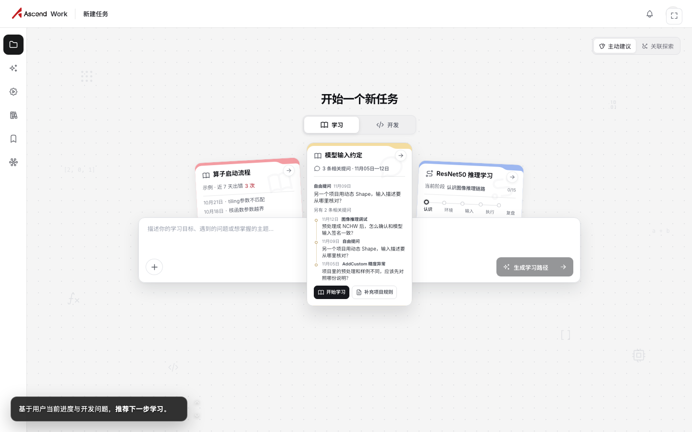

[打开此设计点 Demo](https://schihhsin.github.io/AscendCANN/ascstudio-pc/?rev=20261110-draft-all-content-canvas&chapter=1&pointIndex=0#chapter-1-recommend)

### 1.2 围绕关注主题，探索相关问题与路径

**起点页：**新建任务页 · 首页关联探索

从一个关注主题开始，沿着关联线索继续探索。

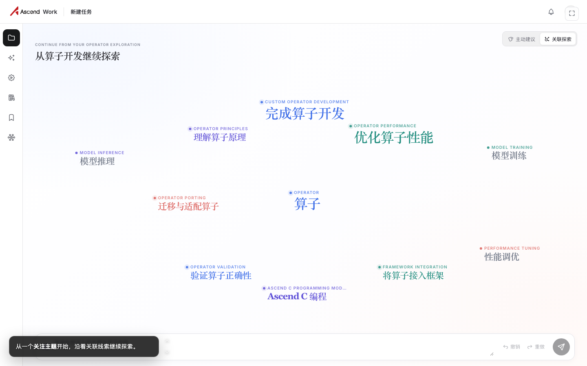

[打开此设计点 Demo](https://schihhsin.github.io/AscendCANN/ascstudio-pc/?rev=20261110-draft-all-content-canvas&chapter=1&pointIndex=1#chapter-1-related-exploration)

### 1.3 和 AI 一起调整学习路径

**起点页：**路径共创任务 · 输入框预填，等待发送

结合个人基础和目标，和 AI 一起调整路径。

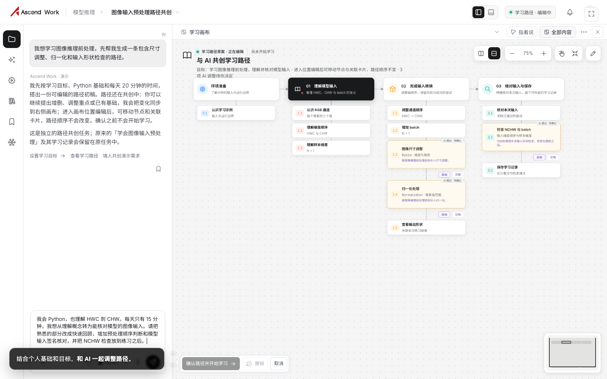

[打开此设计点 Demo](https://schihhsin.github.io/AscendCANN/ascstudio-pc/?rev=20261110-draft-all-content-canvas&chapter=1&pointIndex=2#chapter-1-co-create)

### 1.4 共创路径连接理解与实践

**起点页：**ResNet50 离线推理初体验 · 追踪样例预处理实践节点

让共创路径贯通理解、练习与结果核验。

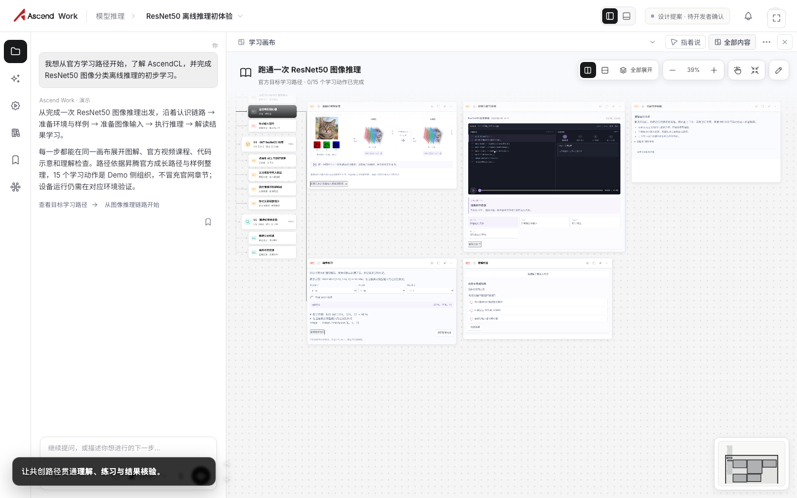

[打开此设计点 Demo](https://schihhsin.github.io/AscendCANN/ascstudio-pc/?rev=20261110-draft-all-content-canvas&chapter=1&pointIndex=3#chapter-1-resnet-path)

### 1.5 拖动输入框，调整对话位置

**起点页：**ResNet50 离线推理初体验 · 学习任务对话

拖动输入框外沿，在左侧对话栏与底部浮窗之间切换。

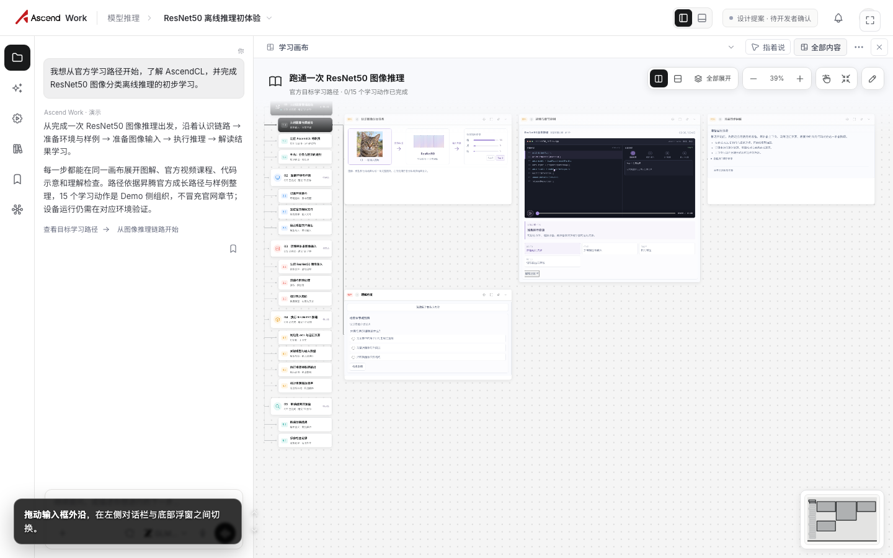

[打开此设计点 Demo](https://schihhsin.github.io/AscendCANN/ascstudio-pc/?rev=20261110-draft-all-content-canvas&chapter=1&pointIndex=4#chapter-1-composer-layout)

### 1.6 框选内容，直接指着说

**起点页：**ResNet50 学习画布 · 图解节点

框选学习画布里的疑问区域，再通过文字或语音直接提问。

[打开此设计点 Demo](https://schihhsin.github.io/AscendCANN/ascstudio-pc/?rev=20261110-draft-all-content-canvas&chapter=1&pointIndex=5#chapter-1-point-and-say)

## 第二章｜在开发过程中掌握知识

### 2.1 打开图解看懂判断依据

**起点页：**Add 算子精度差异排查 · 对话页，任务内容工作区收起

从关联图解看清排查线索与处理思路。

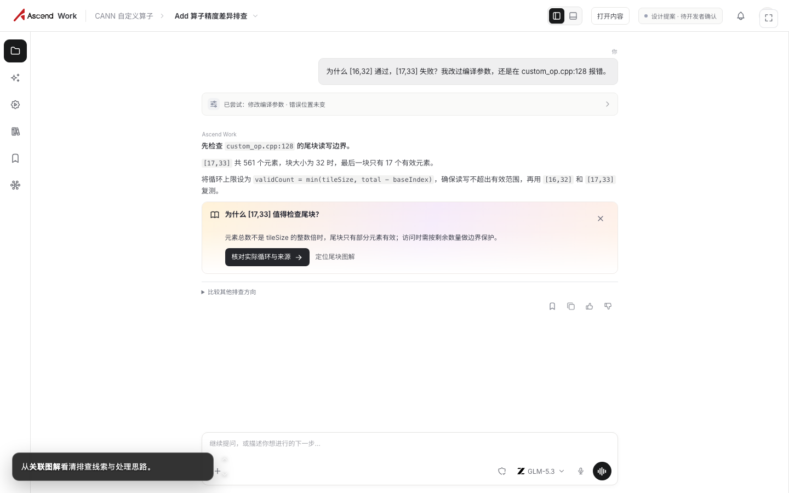

[打开此设计点 Demo](https://schihhsin.github.io/AscendCANN/ascstudio-pc/?rev=20261110-draft-all-content-canvas&chapter=2&pointIndex=0#chapter-2-diagram)

### 2.2 在示例副本里动手修改

**起点页：**Add 算子精度差异排查 · 全部内容画布

在可编辑的示例副本中尝试修改，原始材料继续保留，方便对照和回看。

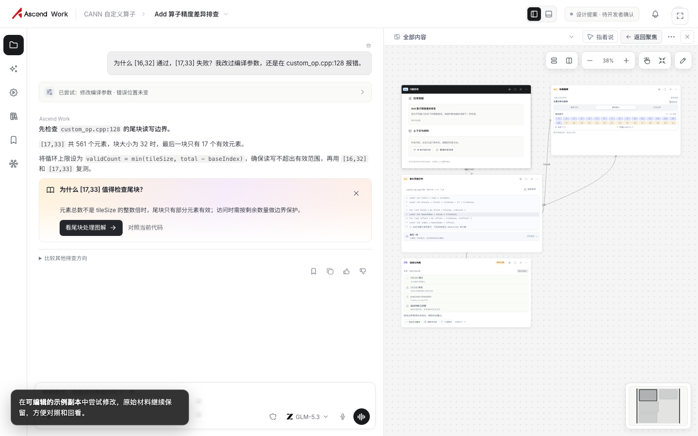

[打开此设计点 Demo](https://schihhsin.github.io/AscendCANN/ascstudio-pc/?rev=20261110-draft-all-content-canvas&chapter=2&pointIndex=1#chapter-2-edit)

### 2.3 处理完成后回流经验

**起点页：**Add 算子精度差异排查 · 示例完成后的社区经验邀请

完成处理后出现经验整理入口，让只留在个人对话中的经验有机会回到社区。

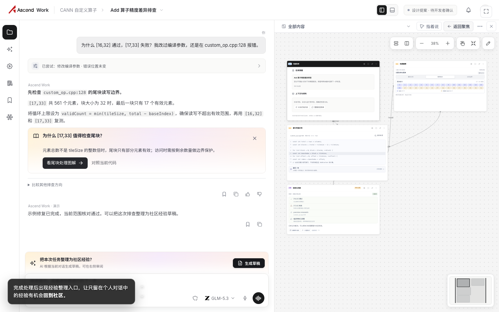

[打开此设计点 Demo](https://schihhsin.github.io/AscendCANN/ascstudio-pc/?rev=20261110-draft-all-content-canvas&chapter=2&pointIndex=2#chapter-2-return)

### 2.4 把处理过程整理成社区经验

**起点页：**社区经验 · 草稿审阅

将问题、尝试和验证情况整理为草稿，补充后再决定是否提交。

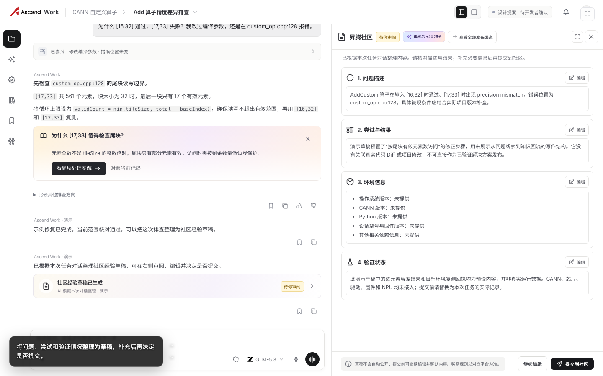

[打开此设计点 Demo](https://schihhsin.github.io/AscendCANN/ascstudio-pc/?rev=20261110-draft-all-content-canvas&chapter=2&pointIndex=3#chapter-2-community)

### 2.5 把经验带到更多平台

**起点页：**社区经验 · 多渠道预览

同一份经验可按不同平台的表达方式整理，并提供 GitCode、CSDN 和抖音等分享入口。

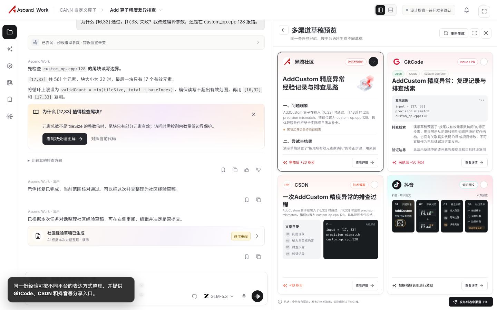

[打开此设计点 Demo](https://schihhsin.github.io/AscendCANN/ascstudio-pc/?rev=20261110-draft-all-content-canvas&chapter=2&pointIndex=4#chapter-2-channels)

## 第三章｜让学习随时继续

### 3.1 从电脑端的一条回答，接上手机里的下一步

**起点页：**小程序 · 电脑端入口

在 Agent 回答或学习内容里收下一条知识，标记感兴趣或还没弄懂，再选择即时送达或加入定期速览。

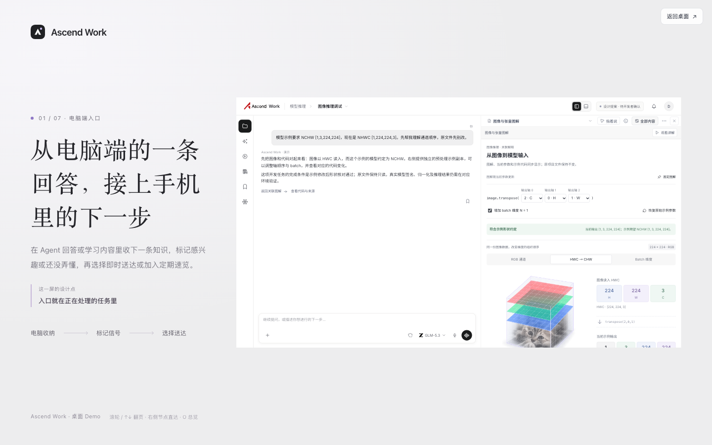

[打开此设计点 Demo](https://schihhsin.github.io/AscendCANN/ascstudio-pc/?rev=20261110-draft-all-content-canvas&chapter=3&pointIndex=0#chapter-3-desktop-handoff)

### 3.2 电脑端选「现在看」，微信列表收到同一条知识

**起点页：**小程序 · 即时学习

发送后，手机微信会话列表出现带有知识标题的服务通知；手机样机与电脑端共用这一条内容。

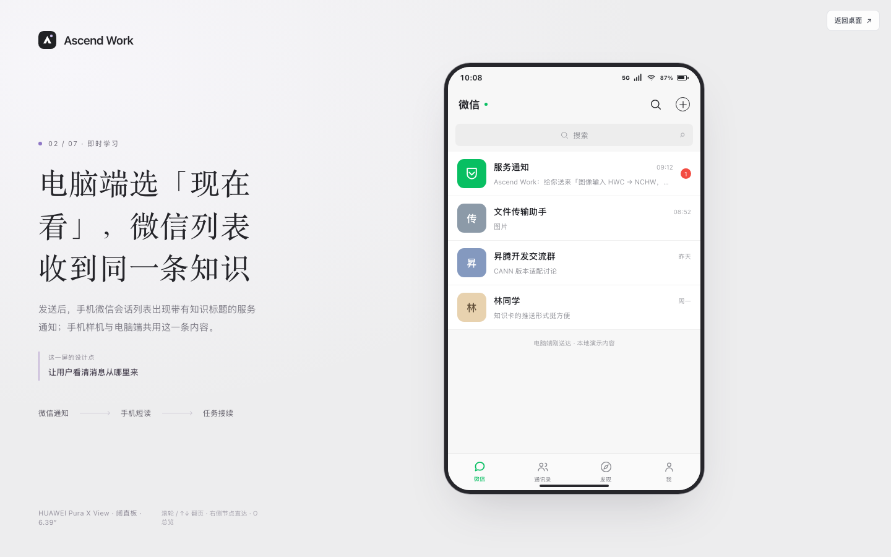

[打开此设计点 Demo](https://schihhsin.github.io/AscendCANN/ascstudio-pc/?rev=20261110-draft-all-content-canvas&chapter=3&pointIndex=1#chapter-3-instant-delivery)

### 3.3 手机短读卡，把一个知识点拆成几分钟

**起点页：**小程序 · 知识短读卡

从通知打开知识卡，用简明解释、重点和理解小题完成一次轻量学习；感兴趣或存疑也能继续保留。

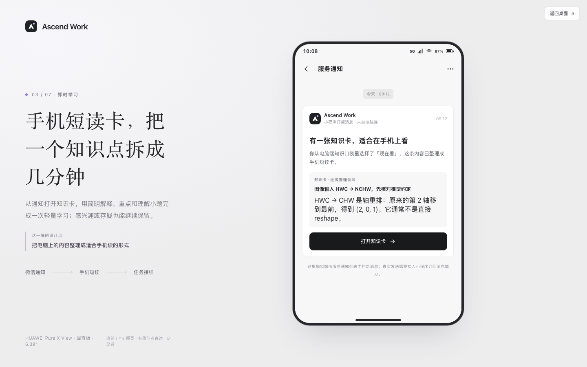

[打开此设计点 Demo](https://schihhsin.github.io/AscendCANN/ascstudio-pc/?rev=20261110-draft-all-content-canvas&chapter=3&pointIndex=2#chapter-3-mobile-short-read)

### 3.4 把关注或存疑的内容，放进每周回访

**起点页：**小程序 · 定期回访设置

电脑端可将知识加入定期速览；手机端再选择主题、接收时间并确认订阅。

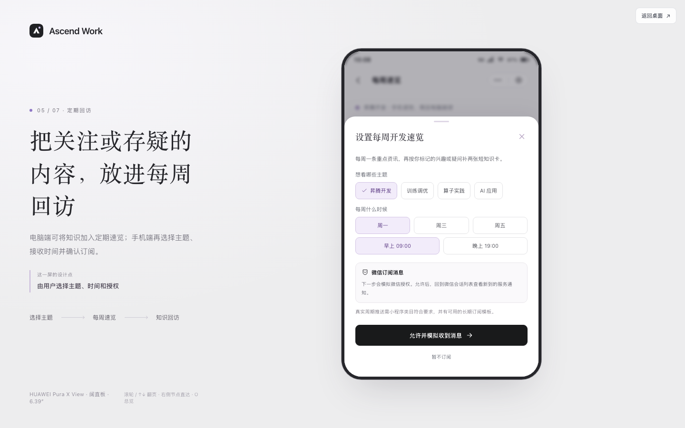

[打开此设计点 Demo](https://schihhsin.github.io/AscendCANN/ascstudio-pc/?rev=20261110-draft-all-content-canvas&chapter=3&pointIndex=3#chapter-3-weekly-review)

### 3.5 每周一条重点资讯，再补两张个性化卡片

**起点页：**小程序 · 每周速览

速览用一条重点资讯开场，再优先带上电脑端安排的内容，并参考感兴趣或还没弄懂的信号。

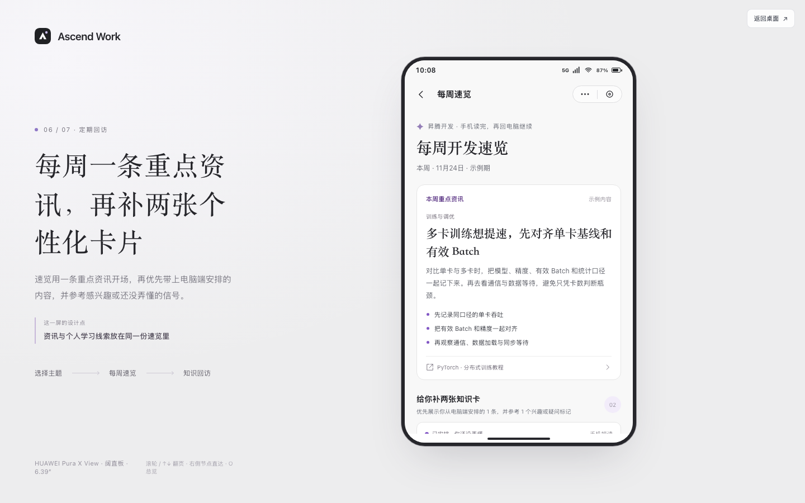

[打开此设计点 Demo](https://schihhsin.github.io/AscendCANN/ascstudio-pc/?rev=20261110-draft-all-content-canvas&chapter=3&pointIndex=4#chapter-3-weekly-briefing)

### 3.6 没有当前任务，也能主动发现下一点新知

**起点页：**小程序 · 自主探索

用户可以搜索、浏览分类或从推荐知识卡继续探索；发现的兴趣与问题还能成为之后回访的线索。

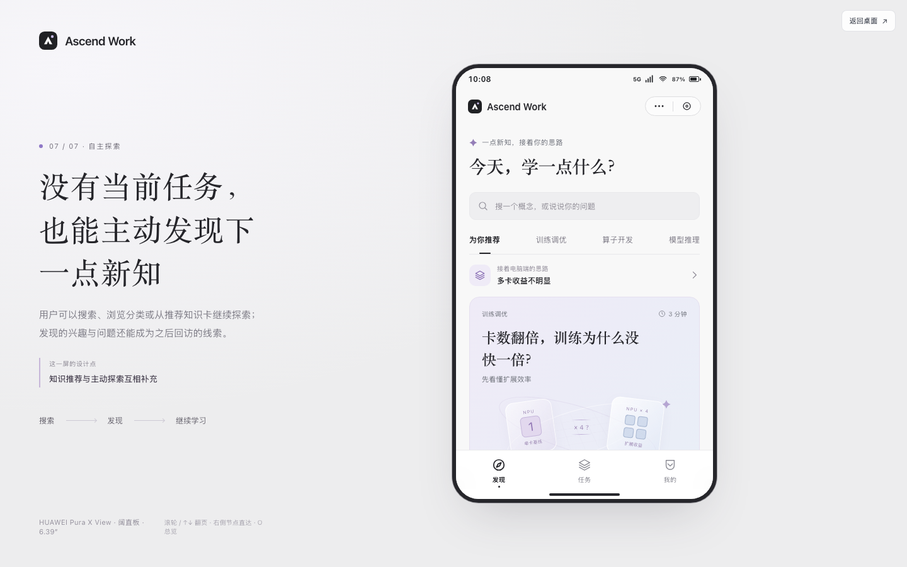

[打开此设计点 Demo](https://schihhsin.github.io/AscendCANN/ascstudio-pc/?rev=20261110-draft-all-content-canvas&chapter=3&pointIndex=5#chapter-3-discover)
