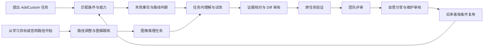

# 从任务问题到可复用经验：设计故事线与覆盖索引

日期：2026-10-11

状态：供用户讨论和评审的叙事提案。故事覆盖不等于 Demo 已实现；本次不修改原型。

## 1. 阅读范围与叙事目标

本次“所有设计点”的范围是当前讨论中的两份主材料及最新交互补充：

- [开发行为系统精简报告](../../ai-development-behavior-system-report-concise.html)：以最终 `reportOrder` 的正式六题、31页为准，包括问题01的供给、评价和协作分工。
- [Learning Canvas Story](index.html)：31页，包括Ploy启发、A1–A5、B1–B6及共用机制。
- [任务中学习交互记录](../../../ascend-studio/interaction-design.md)：补充当前实施状态；已确认规则的正式说明在上述两份设计材料中。

旧九题、已移出报告序列的方案、旧图里的学习中心/学习组/Codex品牌不重新作为既定需求。旧图和 `story-data.mjs` 中的措辞如与最新说明冲突，以最新用户决策与页面说明为准。

故事要让观众看见：一个开发者提出真实任务，在失败处获得有依据的下一步，在当前任务内理解并尝试，审阅修改后回到工程验证，把决策带给团队，最后由用户选择把经验交给社区；后来者能带着适用条件继续使用。

主要角色是开发者。团队评审者、社区维护者和后来者在对应段落接续，避免让一个人扮演所有职责。这里是提案脚本，不虚构用户情绪、实验效果或真实硬件结果。

## 2. 整体组织：任务主线、图像案例、学习起步入口

- **AddCustom 是完整闭环的主要演示案例**，贯穿正式问题01–06，任务中学习是其中的核心转折。
- **图像推理是第二个独立项目案例**，通过左侧项目/任务列表切换；承接RGB分层、HWC→CHW、batch、视频字幕与图解关联。它与AddCustom共享交互原则，不编造两者存在代码依赖。
- **从学习开始是补充入口**，完成A1–A5后，由用户决定是否进入图像推理开发任务。顺序仍先评审任务中学习，再细化学习起步。
- 故事可以包含所有分支；实际用户按需要经过。完整覆盖不转化为每个人必须做完的操作清单。

## 3. AddCustom主线：从一个问题走到后来者复用

### S01 · 带着目标进入任务，先把条件讲清楚

**用户行动**：选择“CANN自定义算子”项目，提出“在保证精度的前提下优化AddCustom”。也可从上次任务继续。

**系统呈现**：当前任务目标、已有代码、Shape/DType、芯片、CANN版本、验收条件。用户可检查并修改AI使用的条件；缺项保持可见，只有影响下一步的缺项需要补问。

**自然接续**：既然要执行具体任务，系统据此推荐环境检查、文档查询、性能采集与优化方法的互补组合。

**主动提示分支**：回来时若有新日志、版本变化或待处理事项，提示“发生了什么—根据什么—可做什么”，保留处理与关闭。已安排的自动化任务和已执行结果分别显示，计划不作为执行证据。

**覆盖**：问题01任务匹配；Ploy主动建议、来源与安排/结果分离。来源：行为报告问题01；学习材料#3–6。

### S02 · 选对能力，并看见它是否真正用上

**用户行动**：查看推荐依据，采用本次需要的组合；无profiling数据时先补采集条件，不直接套用优化结论。

**系统呈现**：候选的用途、输入、前提、适用范围和缺项。文档查询明确只读；方法载入、修改、构建和NPU评测的影响范围分别说明。

**执行后的内容**：载入记录、实际调用记录、产物/引用、验证记录分开。查询结果带原文锚点、版本及匹配状态；无匹配环境时评测为“未运行”。

**自然接续**：运行或检查产生具体结果，故事从“选了什么”进入“发生了什么”。

**覆盖**：问题01全部选配与使用状态；权限深度由用户决定；官方知识供给与跨平台适配。

### S03 · 遇到失败，保留事实再判断下一步

**用户行动**：报告“整块输入能通过，带余数输入失败”，请求诊断。

**系统呈现**：示例现场包含 `[16,32]`、`[17,33]`、`custom_op.cpp:128`、日志和已尝试动作。分别列事实、假设和缺失证据；比较尾块范围核对、逐元素精度证据、更换模型等路线，显示各自依据与不能解释的部分。

**主动性**：只报告失败时给短依据和深入入口；不强制进入完整讲解。用户也可补证或直接查看有充分依据的修改方案。

**自然接续**：用户说“为什么带余数会不同？”明确提出理解需求，短回答与相关图解一起出现，沿用原任务、日志和对话。

**覆盖**：问题02、B1、四层主动性。尾块仍是待核查线索，不能预设根因已确认。

### S04 · 看懂当前对象：结构、过程和差异一起说明

**用户行动**：点选失败输入、最后一块或关联代码行；需要更深解释时展开讲解。

**系统呈现**：二维输入→示例展开顺序→按32元素分块的结构图；尾块局部放大；相关代码行与当前访问位置、有效边界互相定位。用户不需先寻找材料或切入画布。

**示例数值**：`[17,33]`含561个元素，分成18块，最后一块17个有效元素，容量中另有15个位置。整块访问与仅访问有效元素的数学范围可比较；不能据此推断真实设备执行布局或根因。

**讲解分支**：关注代码/对象时同一图解聚焦；短讲解片段、字幕、图解使用同一关注点。字幕提问携带时间、原句和概念。固定参考保持位置，不因继续下一步被收起。

**覆盖**：问题04 L1；A3、B2；视频/字幕/图解关联、参考固定。AddCustom讲解是示例讲解，真实视频关联重点在图像案例。

### S05 · 直接在图解里改一点，立即看见变化

**用户行动**：调整Shape、分块参数或访问策略；不先点“试一下”才出现参数。

**系统呈现**：少量参数在图解内直接可调，结构、示例代码与当前演算一起更新。反馈留在本次操作附近，完整对话解释不随每个数值变化反复追加。

**状态与分支**：

- 就地试算只影响示例；需要修改多行或独立动手时进入隔离副本，原件继续只读。
- 保存一次尝试后，当前参数和保存快照分别保留；旧失败折叠可展开，不能被新结果覆盖。
- 失败时就地解释、重试；恢复基线不删除尝试。
- 需要比较时临时并排；退出恢复原来现场。只有主动整理多份材料时进入自由画布。

**自然接续**：用户看见策略带来的范围变化后，要求“核对真实实现”或“看看这个改动”。示例结果只能形成检查线索。

**覆盖**：问题04 L2；A4、B3、B6；即时图解、代码/结果联动、尝试对照与安全试错。

### S06 · 回到真实代码核对，再决定是否修改

**用户行动**：查看实际循环范围、日志及精度证据；依据充分后要求生成修改建议。

**系统呈现**：真实原文件与示例/隔离副本身份明确。将已经理解的内容、待核查假设、未修改项目和待验证项分别记录。证据不足则继续补证，不把示例策略硬写成项目修复。

**审阅分支**：证据支持改动后，Diff展示具体增删行、影响范围、当前尝试依据和验证缺项。确认只作用于这次修改；取消返回解释/尝试并保留参数与记录。收起材料不代表应用修改。

**自然接续**：用户确认应用后，仍显示修改已应用和工程检查待运行。明确要求检查时，接原任务验证。

**覆盖**：问题04 L3；B4；实际对象、示例与正式变更分离，Diff确认/取消。当前Demo只应用浏览器副本，真实文件核对和写入是后续接入。

### S07 · 用原任务验收，让“通过”指向具体证据

**用户行动**：要求检查修改后的项目，而不是再次运行教学算例。

**系统呈现**：功能、精度、Shape覆盖和性能逐项列验收；每项关联代码版本、匹配环境、命令、覆盖范围、预期与实际结果以及证据。状态可为通过、失败、未运行、不适用。

**分支**：

- 常规输入通过但边界未覆盖，补边界用例；失败返回同一现场，不重新开一段无上下文对话。
- 无匹配NPU/CANN环境保留“未运行”，给出需要补齐的条件。
- 在GitCode变更中，证据未齐保留合入门禁；Reviewer据具体证据判断。

**完成边界**：概念理解、练习通过、修改应用、项目局部检查、完整任务验收分别表达。局部通过不替代精度和性能验收。

**覆盖**：问题03；B5；A4按结果继续；分层完成与恢复。

### S08 · 留下理解和可恢复的过程，观察能否迁移

**用户行动**：查看本次理解摘要，收纳过程材料；可选择在另一组Shape上先独立判断，再检查自己的解释。

**系统呈现**：看过讲解、完成尝试与检查通过分开。迁移练习先让用户作答，不直接展示答案；记录本次判断与后续核对，不能仅凭看过图解宣称已掌握。

**恢复分支**：讲解、图解、尝试和证据一起关联到任务。折叠保留摘要；收纳移出当前阅读区但保留索引；恢复/撤销找回原对象、关系与位置。固定参考继续可见。下次返回可继续原任务，跨刷新持久化需另实现。

**覆盖**：问题04能力迁移；A5；B5；共用收纳与恢复。新增Shape的独立解释是能力检查设计，不是已有能力前后测。

### S09 · 把选择理由带进GitCode评审

**角色接续**：开发者提出变更，团队评审者接手。

**系统呈现**：Diff旁附目标、方案理由、关键取舍、备选路线、失败尝试及排除依据；列出未验证项、适用范围、风险与后续负责人，引用S03–S07产生的记录，不要求用户重写整段背景。

**分支**：评审追问指向具体缺项；补证后更新同一个变更，避免把“讨论已回复”当成测试通过。

**覆盖**：问题05，以及问题03的证据门禁。Ascend Studio整理交接草案，GitCode承载正式评审和变更状态。

### S10 · 用户选择分享，维护者核验后沉淀

**用户行动**：选择分享环境/版本、问题、已尝试动作、修正和验证范围中的哪些内容。

**系统呈现**：先脱敏预览；明确同意后生成未公开、可编辑或撤回的草稿，不直接上传整段对话。

**角色接续**：GitCode/社区维护者核对依据、版本、硬件、复现、验证范围和不适用边界；审核后才发布索引，并关联原讨论、变更和证据。

**覆盖**：问题06前半；分享权限、草稿/审核/公开状态分开。

### S11 · 后来者遇到相似问题，带着条件复用

**角色接续**：另一位开发者按问题、环境与版本检索。

**系统呈现**：取回经过审核的经验、适用条件、来源和验证范围；条件不一致时说明差异和待核对项。可将它带进新的Studio任务，再匹配能力、核对与执行。

**故事闭合**：公共经验成为下一次判断的依据；后来者发现不适用条件或新失败时，可补充证据回到原讨论和维护过程。

**覆盖**：问题06后半；问题01查询适用性与后续供给更新。发布不等于已复用，找到经验不等于新任务通过。

## 4. 图像推理案例：把原材料的丰富图解完整讲出来

从左侧“模型推理”项目切换，保留AddCustom现场；返回时恢复各自对话、参数和材料，不把两个案例串成同一个根因。

| 场景 | 用户行动与系统呈现 | 设计点来源 |
|---|---|---|
| I01 失败现场 | 开发者报告模型输入维度不符；日志实际/期望形状关联 `preprocess.py` 的代码行。只报错时给短依据，可深入、直接看依据充分的修改或关闭建议。 | B1、问题02 |
| I02 理解对象 | 用户问“图片怎么变成模型输入？”照片→RGB分层→HWC张量→CHW→batch图解，代码行对应轴/维度。原件与概念图/示例身份分别标注。 | A3、B2 |
| I03 视频关联 | 展开当前概念的讲解片段；播放进度只改变图解关注点，字幕追问携带原句/时间；保持其他材料和阅读位置。需要时固定图解作参考。 | A3、共用机制 |
| I04 就地试改 | 图解内直接调整transpose轴和batch，图形、代码、当前形状和结果同步。调参暂停讲解，可继续播放；参数保留。重复轴是无效尝试，不能生成可用修改。 | B6、B3、A4 |
| I05 尝试对照 | 可保存失败/成功尝试，结果附本次代码；必要时临时并排或进入隔离副本。固定参考不覆盖当前参数；退出对照恢复现场。 | A4、B3 |
| I06 修改与项目检查 | 明确采用后审阅Diff，确认/取消；再检查项目输入。显示练习通过、修改应用、项目输入检查和完整推理待运行。 | B4、B5、问题03/04 |
| I07 保存与继续 | 收纳并保留关系/原位，恢复或撤销；用户决定是否继续完整推理，不能由形状通过推出模型运行通过。 | A5、B5 |

数值示例：HWC `[224,224,3]`，transpose `(2,0,1)` 得CHW `[3,224,224]`，补batch得NCHW `[1,3,224,224]`。这套图解解释数据维度；设备内存、模型和NPU执行仍需实际证据。

## 5. 从学习开始：另一入口汇入实际任务

这一段在任务中学习方案评审后展开，不增加常设学习中心或“学习组”。

| 场景 | 用户行动与响应 | 状态边界 |
|---|---|---|
| A01 表达目标 | 用户在Studio提出“有Python基础、每天半小时，想学图像输入预处理”；也可从官网现成路径进入。基础、目标和时间可见可改，两入口汇入同一草案。 | 浏览推荐不等于个人路径已生成。 |
| A02 调整路径 | 对话“环境已准备，跳过配置”或直接操作路径节点；节点定位、拟跳过和顺序变化显示在同一预览。 | 确认后生效；取消保留原路径；已有记录随节点保留。 |
| A03 理解内容 | 路径当前节点展开讲解；字幕提问直接带出RGB/维度图解，固定参考或调整查看大小。 | 跟练沿用已有目标和完成标准，不重新选模式。 |
| A04 跟练验证 | 直接调轴/batch，结果附尝试；失败原处解释重试，通过后做输入检查。 | 练习与结果属于学习示例，未运行模型。 |
| A05 完成保存 | 摘要区分看过与检查通过；收纳并能恢复原对象/关系/原位。 | 后续“进入图像推理项目”可选择或关闭，不自动新建/切任务。 |

A03–A05复用图像案例的图解、练习和保存机制，但目标是学会方法；I01–I07的目标是解决当前工程问题。进入开发后，学习记录可作为参考，仍需检查项目输入和完整推理。

## 6. 横贯故事的交互规则与空间规则

| 规则 | 故事中的可观察表现 |
|---|---|
| 主动性随意图变化 | 问为什么→回答/图解同步；只报错→短依据/深入入口；阅读编辑→不抢位/轻提示；明确试改、采用、检查→对应操作。 |
| 建议说明依据，可接手可关闭 | S01主动提醒、S03诊断、I01错误入口都绑定变化/来源/下一动作；不占常驻功能区域。 |
| 推进深度与权限范围清楚 | 准备解释、示例试算、隔离练习、正式修改、构建评测、公开分享分别表达；选能力不等于执行，应用需Diff确认。 |
| 保持当前现场 | 后台建议不换材料、不滚底；播放仅关联关注点；任务切换保存各自现场；等待回复不会把用户拉回旧任务。 |
| 右侧按需要打开 | 看文件用代码，查看输出用预览/结果，查权威来源用文档/浏览器，审阅用Diff，比较才临时并排。 |
| 画布用于主动整理 | 用户需要同时组织来源、日志、图解、尝试、Diff时打开自由画布；移动/调整大小/缩放/固定可用，默认不要求拖卡推进。 |
| 临时对照可以退出 | 只影响选中对象；退出恢复原位、尺寸和视口；固定参考不自动移动或收起。 |
| 收纳保留关系 | 折叠留摘要；收纳留索引；恢复/撤销回原对象/关系/位置，区别于删除或重新生成。 |
| 自适应支持同一故事 | 左项目分组/自动化/能力库，中对话，右按需内容；三栏可调宽，左侧可收起。窄栏图解、参数、代码、反馈重排，正文尽量铺满，极宽时居中留白。 |
| 信息与视觉有层次 | 白/浅中性底、黑主按钮、中性选中；蓝紫用于图解关联/当前关注，状态色对应已知状态。AI直接铺背景、无头像；用户气泡靠右。左/中氛围底图不占位，右侧无装饰。 |

自由画布、内容联动和状态反馈为产品提案/原型能力，不推断模型API或Host具有同名业务机制。

## 7. 设计点覆盖矩阵

| 材料与设计点 | 故事落点 | 必须显示的动作或状态 |
|---|---|---|
| 行为报告01：任务条件/推荐依据/缺项 | S01–S02 | 可核对的版本、芯片、Shape/DType、验收与互补候选 |
| 01：用途/输入/前提/权限 | S02 | 能力名称翻译为任务用途，加载与执行分开 |
| 01：载入/调用/验收/引用 | S02、S07、S11 | 原文/版本/匹配、使用记录、未运行 |
| 01：平台沙盘/领域资产/作用机制/供给建设 | S02、S11；第9节支撑线 | 同一资产按平台适配；方法产物承接需核对 |
| 01：评价总纲/任务对照/协作分工 | 第9节支撑线 | 收益、底线、探索与Owner；实验未执行 |
| 02：同一错误与已尝试动作 | S03、I01 | 事实、假设、缺证分开 |
| 02：路线比较/补证/进入理解 | S03–S04 | 用户理解依据后选择下一步 |
| 03：功能/精度/Shape/性能验证 | S07、I06 | 环境/命令/覆盖/结果与通过、失败、未运行、不适用 |
| 03：边界补测/证据门禁 | S07、S09 | 未覆盖可见，证据不足不合入 |
| 04 L1：沿现场理解待查假设 | S04 | 不预先确认根因 |
| 04 L2：原件只读/隔离练习 | S05、I04–I05 | 示例如有需要再升级为副本练习 |
| 04 L3：学习记录回任务/分层状态 | S06–S08 | 理解、修改和工程验证分开 |
| 04：独立解释/新条件迁移 | S08 | 用户先判断，再核对；不声称已证明能力增长 |
| 05：理由/备选/失败/风险/负责人 | S09 | 随Diff交接，Reviewer能接住未决项 |
| 06：选择分享/脱敏/同意/草稿 | S10 | 未公开、可编辑/撤回，不自动上传 |
| 06：维护核验/发布索引/后来者复用 | S10–S11 | 适用条件、来源、讨论与验证范围 |
| 学习#3–6：Ploy主动性/Why this/计划与结果 | S01–S03 | 变化—依据—下一动作，可处理可关闭 |
| 学习#3–6：Preview/推进范围/对象同屏 | S02、S04–S06 | 讨论与真实对象连续，预览不等于正式执行 |
| A1 #8–9：双入口/目标可见/按需展开 | A01 | 目标、基础、时间与草案 |
| A2 #10–11：节点定位/两种编辑/确认取消 | A02 | 拟变更、正式路径、已有记录分开 |
| A3 #12–13：片段字幕/关联图解/固定/接实践 | A03、I02–I03、S04 | 时间/原句/概念、关注点与参考 |
| A4 #14–15：临时对照/反馈归尝试/按结果继续 | A04、I04–I05、S05 | 失败保留、重试、退出恢复 |
| A5 #16–17：完成证据/收纳恢复/下一任务可选 | A05、I07、S08 | 看过与检查通过分开，恢复原对象关系 |
| B1 #19–20：建议依据/入口控制/绑定现场 | S03、I01 | 不强制学习，任务不变 |
| B2 #21–22：任务连续/身份/轻分组 | S04–S05、I02 | 相关内容关联与可收起，无常设学习组 |
| B3 #23–24：安全试错/结果边界/返回 | S05–S06、I04–I05 | 副本、失败重试、原件未改 |
| B4 #25–26：具体Diff/练习依据/确认 | S06、I06 | 本次修改的确认/取消 |
| B5 #27–28：项目验证/分层完成/可恢复 | S07–S08、I06–I07 | 完整任务待运行，学习材料可找回 |
| B6 #29–30：代码旁参数/形状图解结果联动 | S05、I04 | 图解内直接可调，当前结果就地更新 |
| 共用#31：主动性/空间/撤销/恢复 | 第6节，全程 | 现场稳定、临时对照、固定、折叠、收纳 |
| 最新视觉/布局与任务切换约束 | 第6节，两个任务往返 | 三栏自适应、黑主按钮、图解语义色、各任务现场 |

覆盖关系基于材料内容提取；它不代表每个动作都已经实现或被用户接受为最终流程。

## 8. 当前Demo与完整故事的差距

| 状态 | 范围 |
|---|---|
| 已有原型，可评审 | AddCustom/图像推理任务切换、图解/示例代码/参数联动、示例讲解与字幕追问、尝试快照、示例Diff取消/确认、浏览器副本检查、轻提示与现场保持、按需内容/对照/自由画布、三栏自适应。 |
| 已有会话内空间操作 | 自由画布中固定、收纳、恢复原位已实现；图像讲解中固定参考已实现。依据为此前design-qa.md记录，本轮不重复验收。 |
| 完整记录仍为提案 | A5跨次访问的讲解/路径/练习整套保存恢复尚缺，任务刷新持久化未实现；第6节是完整故事的规则，不意味着这些扩展已实现。 |
| 需要后续设计与实现 | A1–A2学习目标和路径草案/调整，A5完整保存恢复；问题01任务能力推荐/使用回执；问题03真实项目证据与GitCode门禁；问题05团队评审；问题06草稿审核与后来者复用。 |
| 需要真实服务/环境 | 真实AI、权威检索匹配、代码仓/项目写入、CI、Python/C++、模型/NPU执行、跨刷新/跨次访问持久化。 |

本地意图分流和范围/形状运算是演示规则；动态讲解不是已接入的真实课程视频。不能把任何教学算例通过写成真实AddCustom修复或完整推理通过。

## 9. 让后台建设与评价也有落点

这些内容属于服务如何支撑故事及如何验证收益，不让开发者在每个场景先走一遍后台管理。

1. **领域供给→平台适配→任务使用**：S02推荐的项目规则、知识、Skill与MCP分别交付；统一核对安装、触发、权限、结果呈现和产物承接。真实文档MCP的只读查询不能冒充构建或评测服务；Plugin不是必经中间层。既有资产数量/版本按原报告快照解释，不当成熟度或成功数。
2. **跨平台分工**：Ascend Studio保留任务现场/对话、意图、试改和交接草案；昇腾官网承载权威知识/版本/硬件适用性与现成学习路径；GitCode承载代码、Issue/变更、CI证据、评审与维护；匹配环境负责实际执行。不能全移到Studio，也不再增加第二个工作台品牌。
3. **反馈如何回到Owner**：方法未触发查入口和条件，引用不适用查知识元数据，产物无法承接查接口/格式，评测未执行查环境；体验部按行为回放与任务模型提出改进，领域/资料/平台/开发/测试Owner负责对应资产和服务。
4. **评价收益**：固定任务、平台、模型、代码、硬件、预算与验收；A原始资料、B整理资料文件、C与B相同内容经规则/Skill/MCP接入。A/B看内容整理收益，B/C看接入装配收益，并对齐信息和工具权限。三组实验尚未执行。
5. **三层评价**：优化目标看可信完成率、首次验证时间、失败恢复与单位验证成本；体验底线看权限理解、可撤回/接管、安全隐私、证据一致与可访问性；探索信号看放弃、犹豫、人工接管、绕行、跨平台断裂与新用法。结合日志与回放询问原因，不把接管直接算失败。
6. **其他问题的观察**：S03看下一步是否有依据，S08看新条件独立解释，S09看评审追问与重建背景成本，S10–S11看实际发布与实际复用。全部作为待验证指标，不写成现有成绩。

来源/机制事实、设计提案和实现观察分别记录。没有改变API/Protocol、Host/Harness、Application/Task三层定义：模型final仍是候选输出，任务完成由业务验收证据判断。

## 10. 建议的评审与后续实施顺序

1. 先讨论S03–S08：任务中学习、就地试改、证据与正式修改的接续。这是当前主体验。
2. 用I01–I07对照检查视频/图解/参数/失败恢复是否同样自然；保留项目列表切换。
3. 再讨论A01–A05：补上从学习目标开始的入口与路径调整。
4. 后续逐题评审问题01、03、05、06，不因完整故事线就一次实现全部。

本稿提供完整覆盖的叙事候选；用户评审后再把具体场景落实到Demo。现有报告页面序列、hash和Demo代码本轮均不改变。

## 本轮体验复核索引

- [主动交互体验复核：AddCustom 诊断、试改与应用后检查](proactive-interaction-review.md)：记录 2026-10-11 已实施的局部增强、主代理手动审阅及用户评审待定状态；包含修改前后截图、实际操作观察和浏览器示例/NPU验证边界，不代表全故事完成或用户验收。

- [任务内容管理讨论稿](content-management-design.md)：区分内容视图与历史结果，讨论自动分类、收起、就近恢复和统一任务内容索引；保留10月11日历史提案，并在§8补充10月12日反馈：画布总览保留全貌，按用途分区/按问题主题分组两个待评审方向及五类用途，收起仍留概要，未实施。
