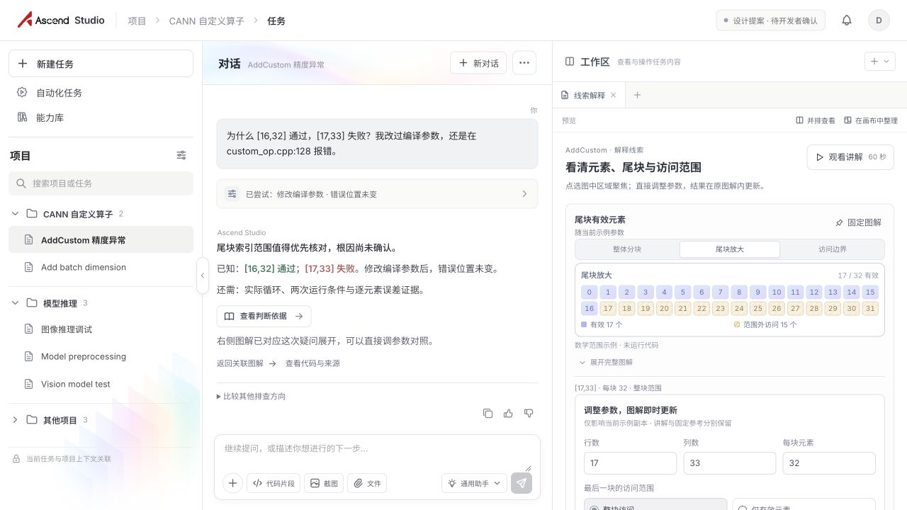
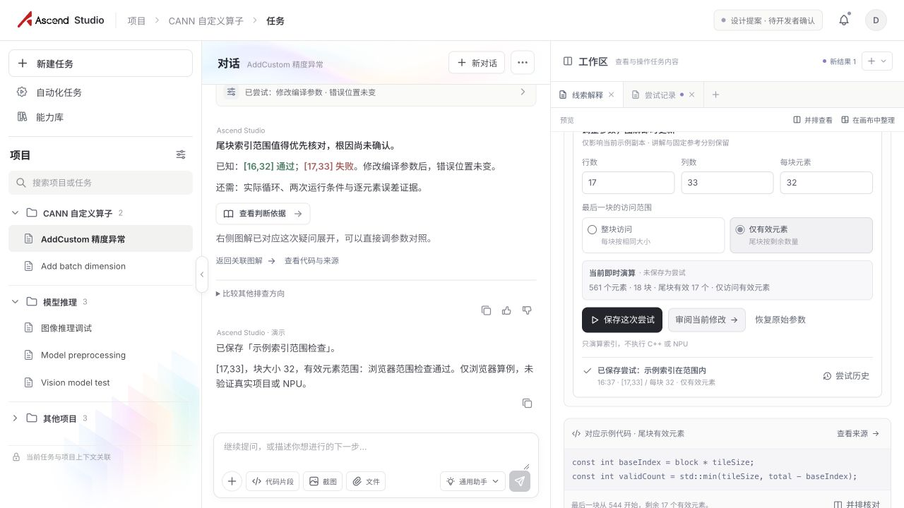
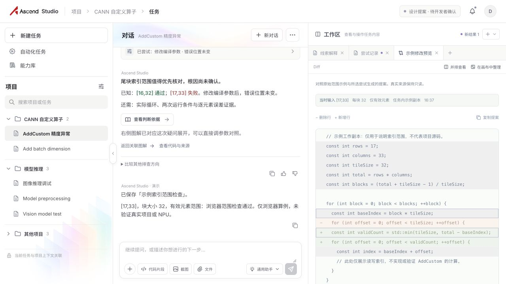
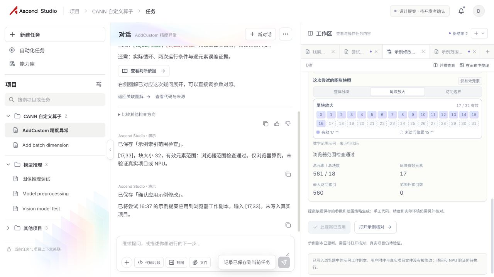
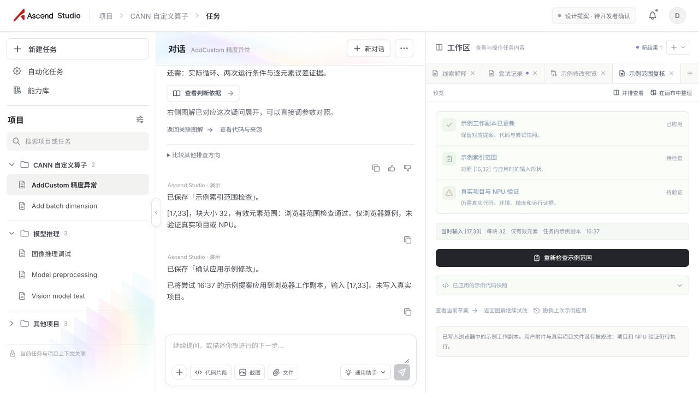
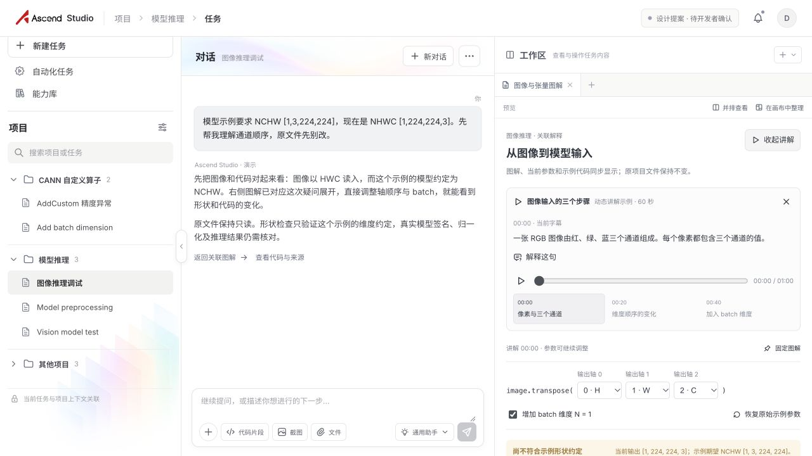
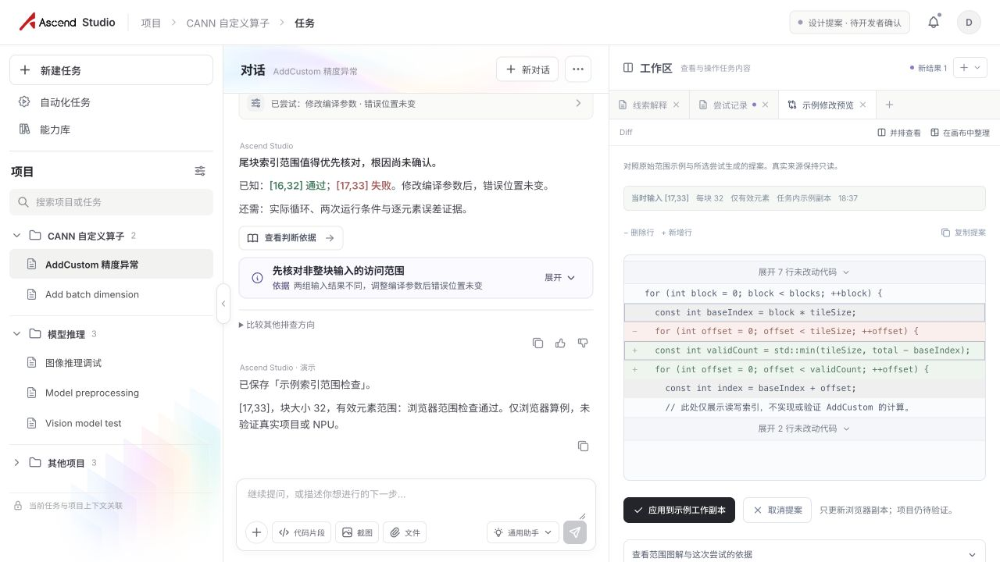
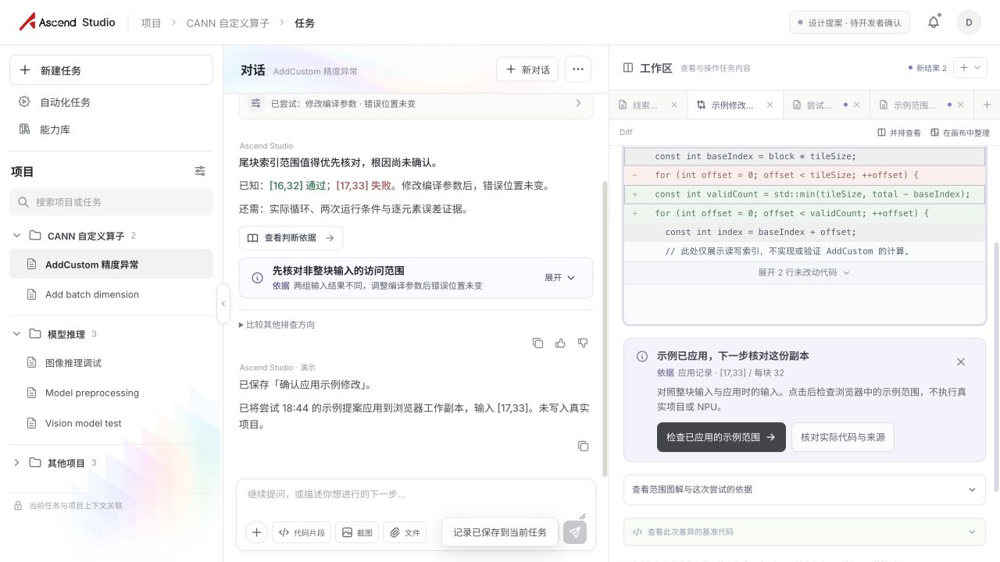
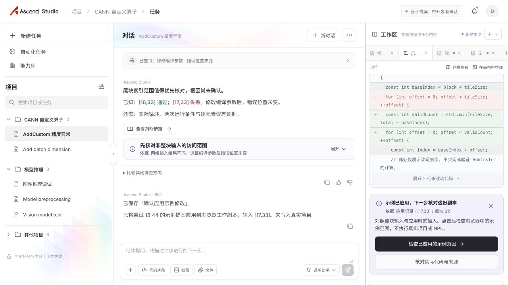

# 主动交互体验复核：AddCustom 诊断、试改与应用后检查

> **2026-10-11 实施记录**：本轮按用户已选方案 B 完成 AddCustom 诊断下一步、试改反馈、Diff 审阅和应用后浏览器范围检查的局部增强。主代理已手动审阅当前实现并记录下方操作观察；用户评审待定。方案 B 为就近行动提示、浅蓝紫提示面、关联对象一次强调、处理后收为摘要；黑色主按钮、无左侧色条；AI 文字铺背景、无头像。本稿不代表用户已验收，也不覆盖其他故事的完整实现。

## 1. 范围与证据口径

本稿只记录 AddCustom 诊断下一步、试改反馈、Diff 审阅及应用后的浏览器范围检查。图像推理不在本轮改动范围。

| 标记 | 含义 | 本稿用法 |
|---|---|---|
| **M · 截图/手动观察** | 截图直接呈现，或主代理按实际操作观察到的行为 | 说明本轮前后界面差异和手动操作结果 |
| **实施记录** | 当前实现按本次限定需求所做的行为规则 | 描述触发、状态和退出条件；不自动等于用户验收 |
| **边界事实** | 演示交互明确可做与不可做的范围 | 浏览器范围演算不代表真实 C++、NPU、根因或精度验证 |
| **未覆盖** | 本轮没有完整实操或没有扩展到的事项 | 明确保留后续验收边界 |

证据截图位于 `ascend-studio/evidence/20261011-proactive-audit/`。01–06 为修改前观察，07–11 为实施后截图。12 为已替换并检查的 360px 工作区截图，显示完整的应用后提示和换行动作。

## 2. 修改前观察（M）

### 2.1 诊断入口与下一步

01 显示诊断解释、判断依据、返回关联图解和试算区。用户问“为什么”时仍需直接打开关联图解，这是问题驱动的理解入口，不应因为增加行动提示而取消。需要调整的是：在解释时让“看实际代码与来源”成为主核对动作，把“定位尾块”作为次级行动；不改变问为什么后直接进入图解的路径。

### 2.2 保存试算后的身份混淆

02 的准确问题是：当前即时结果仍显示“未保存”，而下方已经有同一参数的已保存尝试，导致同一结果看起来同时处于未保存和已保存状态。“新结果”只作为未读提醒即可，不需要因本问题移除或重定义。

### 2.3 Diff 与应用按钮位置

03 的主要问题不是审阅入口难找，而是代码下方继续堆叠范围图和尝试结果，导致应用按钮距离代码差异很远、向下沉。修正重点是让 Diff 以修改行为核心，未修改代码按需展开，范围图与支持材料折叠，减少行动路径的纵向长度。

### 2.4 应用后的检查入口

04 已有“打开示例核对”入口；本轮将应用和检查的动作关系明确化：应用后仍停留在 Diff，不自动检查；用户再明确点击检查入口，才进入并运行浏览器范围检查。

### 2.5 验证状态与首次文案

05 中待检查与待 NPU 验证需要避免呈现为通过。首次检查按钮应根据是否已有 validation 记录区分“检查”和“重新检查”，而不是仅根据参数是否变化判断。

### 2.6 图像讲解对照（不在本轮范围）

06 仅作为图像流程边界对照：讲解展开较长，图解内容被推到下方。本轮没有调整图像解释、视频或图像处理流程。

## 3. 已实施规则：就近提示与状态保持

- **位置和样式**：提示贴近当前对象或动作，使用浅蓝紫提示面。关联对象仅在触发时短暂强调一次；黑色主按钮，无左侧色条。AI 不使用头像，回复直接铺在背景上。
- **执行与关闭**：用户执行提示动作或明确关闭时，提示收为摘要。离开材料本身不触发自动折叠，返回时仍保持该任务的状态。
- **状态身份**：同一 task、reset 状态和同一语义事件保持一致；打开/返回材料不生成重复提示。语义事件状态真正变化时，按新的结果更新对应对象。
- **参数反馈**：逐位编辑时不反复闪动；只有访问策略或范围外状态发生语义变化时，才触发一次对应反馈。审阅以当前参数快照为准。
- **动效和焦点**：提示在视口内以轻量淡入和短强调出现，不改变滚动位置、不抢键盘焦点。减少动态效果规则在源码中核对过；屏幕阅读器完整实操不在本轮已验证范围内。

## 4. AddCustom 实际流程：依据、动作与退出

| 场景 / 触发 | 当前依据与主次行动 | 实施反馈 | 退出与状态规则 |
|---|---|---|---|
| **诊断下一步**：用户报告失败或查看 AddCustom 诊断 | 已知 `[16,32]` 通过、`[17,33]` 失败，尾块仍是待核查线索。主核对为“查看实际代码与来源”；次行动为定位尾块。用户明确问“为什么”仍直接打开关联图解，以图解解释当前问题 | 诊断提示就近显示；问题驱动的图解入口继续直达图解，不要求先经过诊断行动卡 | 执行诊断提示动作或关闭后收成摘要。离开材料不折叠；同 task/reset 与同一语义事件维持状态，不重复闪现 |
| **试改反馈**：改变参数或访问策略 | 反馈依据当前行列、块大小、访问策略、范围外情况和本次演算。主提示语义随“访问策略 + 是否有范围外”划分；逐位编辑不触发重复动画 | 范围变化就地反馈。审阅修改不要求先保存尝试；Diff 始终依据当前参数快照。保存成功后，结果身份与同参数的已保存尝试匹配 | 取消操作保留参数与历史。用户执行提示或关闭后收摘要；切换材料再返回不主动折叠。相同语义状态不重复触发 |
| **Diff 审阅**：用户审阅当前试改 | 以当前快照、提案来源和修改行作为依据；范围结果、尝试历史等支持信息不与主要代码差异争抢位置 | Diff 默认展示修改行及上下各 2 行上下文；未改动代码可展开。图解/范围等支持证据可折叠。应用动作紧邻代码差异，不要求先保存尝试 | 取消后保留参数和历史；应用时明确写入的是浏览器示例工作副本。应用完成后留在 Diff，不自动启动验证 |
| **应用后检查**：用户明确点击检查入口 | 当前示例副本、输入 Shape、块参数和访问策略。检查为浏览器范围计算，不运行 C++、真实项目或 NPU | 点击后进入并运行范围检查；结果表述限定为浏览器示例范围检查。首次/重复按钮由是否存在既有 validation 决定 | 应用不等于检查。关闭提示后收摘要；同一状态不再次提醒。只有实际完成的检查才显示完成态；真实项目/NPU仍为待验证 |

## 5. 实施后截图与手动审阅记录（M）

| 截图 | 对应场景 | 可见实施效果 |
|---|---|---|
| [07 · 诊断后](../../../ascend-studio/evidence/20261011-proactive-audit/07-after-diagnosis.jpg) | 诊断行动 | 主核对指向实际代码与来源，尾块定位为次级动作；问“为什么”仍可直达关联图解 |
| [08 · 试改后](../../../ascend-studio/evidence/20261011-proactive-audit/08-after-trial.jpg) | 试改反馈 | 当前算例反馈与审阅动作就近呈现；动效时序来自手动触发及源码规则，静态截图不独立证明不重复 |
| [09 · Diff 后](../../../ascend-studio/evidence/20261011-proactive-audit/09-after-diff.jpg) | 修改审阅 | Diff 默认聚焦修改行及上下文；未修改代码和支持证据可展开/折叠，减少按钮下沉 |
| [10 · 应用后](../../../ascend-studio/evidence/20261011-proactive-audit/10-after-applied.jpg) | 示例副本应用 | 应用后留在 Diff，不自动检查；检查入口由用户明确触发 |
| [11 · 验证后](../../../ascend-studio/evidence/20261011-proactive-audit/11-after-verification.jpg) | 浏览器范围检查 | 已保存结果与本次检查身份对应；范围结果与补证提示保留根因/真实项目待核对边界 |

**主代理手动操作观察**：关闭诊断后切换到图像任务再返回，诊断摘要仍保留；数学范围外索引数从 15 调到 0 时反馈即时更新；保存成功后尝试身份与参数一致；取消 Diff 保留参数和历史；列数为空时不演算、不保存且不显示提示；列数改为 34 后 Diff 对应总范围 578、尾块 2；应用后保留 Diff 且不自动自检；点击检查后才进入并运行范围检查；待 NPU 状态为中性。

布局观察：右侧宽 360px 时图解、参数区（316px）、提示（290px）的 scrollWidth 一致，按钮 264px 单列；390px 页面 scrollWidth 为 390px；1600px 桌面检查通过。中栏 300×480 时宽约 299px、提示宽约 273px，输入框底部 y=390px，位于 480px 视口内。

最后一次完整刷新后，回看聊天时对话 scrollTop=0，点击范围检查完成后仍为 0（scrollHeight 592→724、clientHeight493）；新增记录未抢阅读位置。最终浏览器 error 日志为空。动效为提示220ms淡入/4px位移、关联对象700ms淡强调，无循环；减少动效与完整屏幕阅读器仍保留未实操边界。

## 6. 状态文案与边界

- 即时结果与已保存尝试按参数快照保持一致，避免同一参数一处写“未保存”、另一处又显示“已保存”。“新结果”仍可作为未读提醒。
- 首次/重复检查按钮依据是否已有 validation 记录决定：没有记录时为“检查示例范围”；已有记录时为“重新检查示例范围”。不要求输入必须变化才允许重复检查。
- 仅已执行且通过的浏览器范围检查可显示完成态。待检查、待 NPU 验证使用中性状态，不把计划或应用动作呈现为通过。
- 本轮范围演算、Diff 和应用作用于浏览器端示例工作副本，不是用户真实项目源码。它不能验证 AddCustom 的真实根因、精度、C++ 构建、性能或 NPU 运行。
- 未改变 API / Protocol、Host / Harness、Application / Task 的边界。提示和任务状态是产品界面与应用任务层的设计；模型输出仍是候选内容，任务完成取决于相应实际验证证据。

## 7. 未覆盖与后续评审边界

能力选配是否要求用户先理解 Skill/MCP、收纳恢复能否跨刷新持久化、团队评审/分享如何携带上下文，仍是完整故事中的设计风险推演，不是本轮实测，也不应写成已实现。图像讲解较长的问题未改。

减少动态效果规则已作源码核对，但未实操完整 `reduced-motion` 环境；屏幕阅读器也未做完整走查。已替换窄栏截图 12 并实际打开核对，完整提示及两个动作均可见。

## 8. 用户评审待定

主代理已按当前实现范围完成手动审阅，以上截图与操作记录用于用户评审。用户尚未确认最终体验；后续评审以补充/替换截图和真实操作为准，不应把本稿写成全故事完成或用户验收结论。
